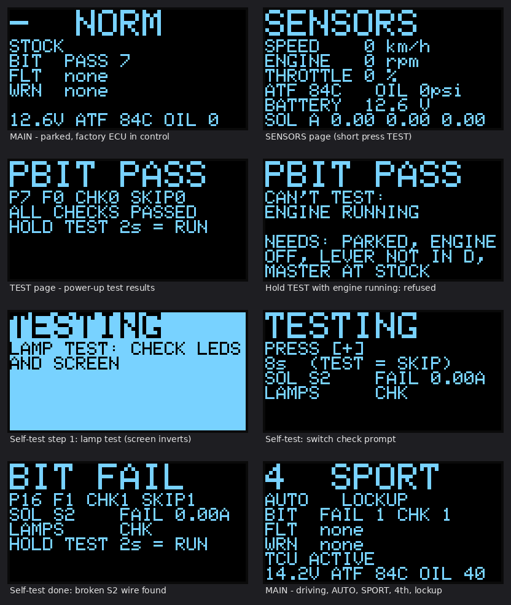
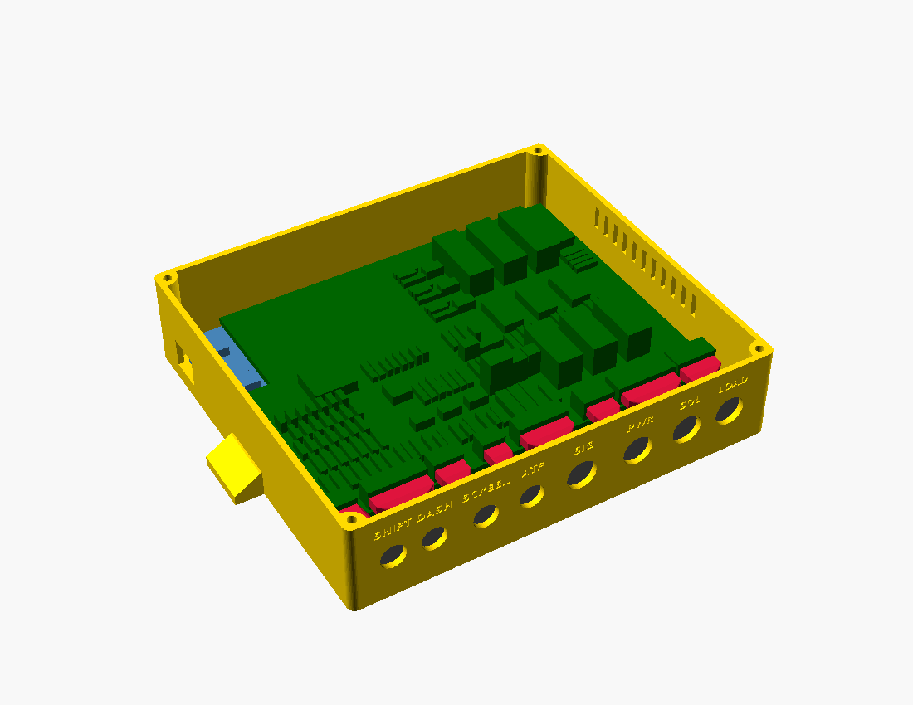

# 1999 RAV4 Transmission Controller

**Ever wished your POS gen 1 RAV4 automatic had a shifter, so you could pretend it's a rally car?
Now you can, with this transmission mod.**

Pull the lever back: it shifts up. Push it forward: it shifts down. One click, one gear, like a
rally car's sequential gearbox. Not in the mood to row your own gears? Flip a switch and it shifts
for you: gently in **ECO**, or holding every gear to the redline in **SPORT**.

## What this is

A do-it-yourself transmission controller (a "TCU") for the **1999 Toyota RAV4 4WD** automatic
(first generation, 4-speed, 3S-FE engine). A small box under the dash, built around an Arduino
Mega, takes over the three solenoids that choose the transmission's gears. The engine, the
throttle and the engine computer stay **100 % stock**: only three wires get cut, and a plug puts
them straight back.

You build three pieces:

| Piece | Where | What it is |
|---|---|---|
| **Sequential shifter** | Centre console | A real sequential lever (the Beavis Motorsport design, 3D-printed) on a printed base |
| **Dash pod** | Dash top, driver's side | A screen, then ECO, SPORT, MANUAL, TEST and ON/OFF switches |
| **TCU box** | Under the passenger side of the dash | The Arduino and one ready-made circuit board you solder the parts onto |

**What you get:**
- **Manual mode:** you pick every gear with the lever, right up to the redline: it never
  upshifts for you, it just flashes **SHIFT UP!** on the screen. It won't let you over-rev the
  engine with a downshift.
- **Two automatic modes,** ECO and SPORT, with shift points you can tune.
- **Smarter lockup** of the torque converter: lower rpm and a cooler transmission on the highway.
- **No surprise shifts mid-corner:** a gyro holds the gear while you're turning.
- **A screen in plain English:** the gear in big numbers, the mode, and the transmission
  temperature in °F. If something's wrong, it says what, in words.
- **An aircraft-style self-test** you run from the dash, and a key-on check every time you start.

**What it takes:** about $675 in parts, a 3D printer, a soldering iron and a multimeter. You
don't need to know electronics: the [build book](docs/05-build-book.md) goes one small step at a
time, Lego-style, with a meter check after every step, and a calibration helper does the maths.

**The factory computer is always the backup.** Flip the ON/OFF switch off, lose power, or let
anything go wrong, and relays hand the transmission straight back to the factory computer. The
car then drives exactly as it did from the factory. The ON/OFF switch cuts the relays' power
**directly, in hardware**, so OFF works even if the Arduino itself has failed. How every failure
is handled, and how each one is tested, is in the [system review](docs/06-system-review.md).

## What it does and doesn't do (in real life)

**It does:**
- Let you pick every gear yourself with the lever (MANUAL), or shift for you on its own schedule
  (ECO or SPORT).
- Change **when** the transmission shifts, and when the torque converter locks up.
- Keep the converter locked more of the time: lower rpm, cooler transmission fluid, and slightly
  better mpg.
- Hold the gear through corners, and in SPORT downshift as you brake, so you're in the right gear
  for the exit.
- Show the gear, the mode and the transmission temperature, and explain any problem in words.
- Hand back to the stock car instantly (ON/OFF off), or come out completely (the BYPASS plug).

**It doesn't:**
- **Add power.** The engine, throttle and engine computer are untouched. 0–60 mph changes by a
  few tenths of a second at most. It feels more responsive, not faster.
- **Make shifts faster or firmer.** Each shift still takes about half a second, and its firmness
  is set by the transmission's own hydraulics, as stock. Shifts feel like stock shifts, just at
  different times.
- **Give engine braking from 2nd or 1st.** In D this transmission freewheels in those gears; only
  the 4→3 downshift slows the car. In MANUAL, downshifts are for holding power (corner exits,
  hills), not for slowing down.
- **Blip the throttle** on downshifts (see [rev matching](#what-about-rev-matching-on-downshifts)
  below).
- **Set off warning lights or trouble codes**, or change emissions or inspections: dummy
  resistors keep the engine computer happy.
- **Fit other cars as-is.** It's built for the 1999 RAV4 4WD automatic. Other first-generation
  RAV4 automatics are close, but check [spec §0](docs/02-revised-spec.md) first.
- **Come proven.** It hasn't been built or driven yet ([Status](#status)). Test it off public
  roads first (the build book shows how), and check your local rules and insurance.

### Day to day

You'll probably leave it in **ECO**. It drives like the stock car, only calmer: it upshifts
earlier and runs at lower rpm, so it's quieter, and the converter locks from about 23 mph, so it
feels more connected and less "slushy". Small pedal movements are smoothed out, so it doesn't
shift back and forth. Floor it and it still kicks down instantly. At very low rpm in 3rd you may
feel a slight hum; that can be tuned. **SPORT** feels sharper, not faster. **MANUAL** is the fun
one.

### MPG (estimates until it's measured on a real car)

| Driving | Compared with stock | Why |
|---|---|---|
| Steady, flat highway | about 0–2 % better | Stock already locks up in 4th at a steady cruise |
| Hills, headwinds, 70 mph and up | about 2–5 % better | Stock unlocks and slips on grades; this stays locked up to 95 % throttle |
| Town and mixed driving in ECO | about 2–6 % better | Earlier upshifts, earlier lockup, fewer extra shifts |
| SPORT or MANUAL, driven hard | worse | High rpm, on purpose |

So expect a few percent better in ECO, mostly from hills and highway speed, not a big jump. Your
right foot matters more than any mode. To measure yours, run one tank with ON/OFF off and the
next in ECO, on the same commute. Do it twice, because weather and traffic alone can swing one
tank by 5 %.

**Transmission life:** more time locked up in ECO and on the highway means less heat, and heat is
what wears out automatic transmission fluid and clutches. Driving hard in SPORT or MANUAL means
more wear, as on any car. The screen keeps an eye on the fluid temperature.



## The modes in detail

All speeds are in **mph**; the screen shows temperatures in **°F**.

Three mode switches sit on the dash: **ECO, SPORT and MANUAL. Exactly one is on at a time.** If
none is on, or two or more are, the screen says so in plain words (MODE ERROR / PICK MODE) and
the factory computer shifts until you fix it; then the box takes back over by itself. There is
no NORMAL mode: with the ON/OFF switch off, you have stock.

| Mode | Feel | What changes |
|---|---|---|
| **ECO** | Calm, economical | Early upshifts; torque-converter lockup as early as the engine can take it (from ~23 mph in 3rd), kept on when you lift for longer fuel cut, released if the engine would labour; pedal stabs ignored (0.8 s throttle smoothing). Flooring it still kicks down instantly. |
| **Highway (all modes)** | Locked and steady | In 4th above ~51 mph the torque converter stays locked up to 95 % throttle, so a long 90 mph run (~3,550 rpm) or a highway grade doesn't let it slip: lower rpm, less fuel, much less transmission heat. Only flooring it releases lockup (in SPORT, a quick stab does too). |
| **SPORT** | Sharp | Holds each gear to just under the redline at full throttle (the fastest way through these gears), kicks down from 60 % throttle, holds the gear when you snap off the throttle between corners, downshifts while braking so you're in the right gear for the exit, and releases lockup on a closed throttle or a fast pedal stab. |
| **MANUAL** | SPORT, you shift | Turn on **MANUAL** (with ECO and SPORT off), then pull or push the sequential shifter lever: one click, one gear. Same lockup and pedal response as SPORT, but the box never shifts up for you: at 6,000 rpm the screen says **SHIFT UP!** and the rest is your call (the engine computer's own fuel cut is the limit). It only downshifts by itself when you slow to a stop, so you never pull away in 4th. In ECO or SPORT the lever does nothing. |
| **STOCK** | Factory | ON/OFF off, the lever not in D, a fault, or a mode-switch mistake: the factory computer shifts, exactly as before. |
| **All automatic modes** | | No automatic shifts mid-corner (gyro), lockup off when braking. |

**Protection, always on:**
- **No over-rev:** every downshift is checked against engine rpm (refused above 5,800), and 1st
  is never allowed above 28 mph. In ECO and SPORT the box upshifts at 6,200 rpm; in MANUAL it
  tells you to (SHIFT UP!) and leaves it to you.
- **No stalling:** lockup releases when you brake and at low speed.
- **Fluid temperature:** lockup is blocked while the fluid is cold, and engages earlier when it's
  hot (110 °C+). Locking up is what cools the fluid.
- **Faults hand back to the factory computer:** a lost speed signal, a failed throttle sensor,
  bad voltage, the wrong gear engaged, a broken solenoid wire, a stuck relay, or the ON/OFF
  switch's two halves disagreeing (a broken wire in the dash cable).
- **Safe takeover:** the box only takes over after a deliberate OFF→ON flip (never by itself at
  key-on or after a reset), and only when the gear it senses from the factory computer agrees
  with the engine rpm; otherwise it waits until you stop.
- **Built-in self-test:** hold TEST for 2 s with the car parked, the engine off and ON/OFF on.
  It checks the screen, each solenoid's current, the relays, the shifter and every dash switch,
  that ON/OFF really cuts the relays by itself, and the watchdog. It refuses to run unless the
  car is parked with the engine off. A shorter relay check also runs at every key-on.
- **Locked until calibrated:** the box can't take control until you've calibrated it on your car
  (see [First steps](#first-steps)).

**Not touched:** the engine computer, the throttle, and the transmission's throttle cable.

### What about rev matching on downshifts?

True rev matching (a throttle "blip" before each downshift) needs something that can open the
throttle. The 1999 RAV4 has a cable throttle, so the box can't do it without adding a throttle
actuator. That would be a separate, safety-critical system that can accelerate the car on its
own, so this project deliberately doesn't do it.

An automatic gets the same result a different way, and the box already does it:
- **The torque converter is the rev matcher.** Before every downshift the box unlocks the
  converter clutch (200 ms ahead of the shift). The fluid coupling then absorbs the speed
  difference, which is the job a blip does in a manual gearbox.
- **Lockup stays off for 1.5 s after each shift**, so the engine settles to its new speed
  smoothly before the connection goes solid again.
- **Over-rev guard:** downshifts that would land above 5,800 rpm are refused.
- **On this transaxle, 1st and 2nd freewheel when you lift off** (one-way clutches in D). Only
  the 4→3 downshift can pull the car back with engine braking, so a downshift into 2nd or 1st
  can't jolt the car.

## Wiring


The full step-by-step guide is in **[`docs/03-wiring-guide.md`](docs/03-wiring-guide.md)**. It
covers every connector pin-out, a numbered wire list (W1–W21) matching the diagram, where each
signal is on the 1999 RAV4 with a multimeter test to confirm it, the circuit for every input,
and the build order. [`docs/wiring-detail-a.svg`](docs/wiring-detail-a.svg) is a close-up of
the solenoid changeover, which is built three times.

**The whole system is 8 cables**, each into its own labelled hole in the box:


Only three factory wires are cut (S1, S2, SL); everything else is a tap. A **bypass plug**
restores stock driving with the box removed.

**Where everything goes in the car** (TCU box, gyro, heatsink, dash pod, shifter base, ATF probe, plus the
4WD-specific notes) is [guide §9](docs/03-wiring-guide.md#9-where-everything-goes-1999-rav4-4wd).

## 3D-printed housings


Three separate pieces, each with its own cables to the TCU box. They're parametric OpenSCAD
models with ready-to-print STLs in [`hardware/`](hardware/README.md):

1. **Dash pod**, on top of the dash (driver's side): the 2.42" screen on the left, then one row of
   switches, **ECO, SPORT, MANUAL, TEST, ON/OFF** (with a flip-up safety cover). It sits on a
   small hinged mount and tilts to face you.
2. **Shifter base**, on the centre console next to the gear lever: the real
   [Beavis Motorsport sequential shifter](hardware/beavis_shifter/README.md) (by bbeavis,
   CC BY-NC) bolts on top, with its own cable to the box.
3. **TCU box**, under the passenger side of the dash where you can reach it: the Mega with the
   TCU circuit board plugged on top (it carries the gyro too). It has no switches:
   the round things on its front are eight labelled cable glands, one per cable.

A **fit check** in each model confirms that every part fits: switch bodies, terminals, wire
bends, board parts at their real heights, glands and bolts. It runs every time the STLs are
rebuilt.



Print them in **PETG or ASA, not PLA** (PLA softens in a hot car). The dummy-load resistors stay
outside on a finned heatsink. Print settings, hardware and assembly:
[`hardware/README.md`](hardware/README.md).

## Status

- **Done:** full design, firmware and documentation.
  - `make check` runs it all: 1,266 unit-test checks, 26 whole-system scenarios (the real
    firmware in a simulated car, with faults injected, plus the build book's jack-stand test step
    by step), the calibration helper on a simulated drive, and about 800 cross-checks that the
    circuit, the circuit board (pad by pad), pin map, firmware, screen text and 3D models agree. All pass
    ([system review](docs/06-system-review.md)).
  - The firmware compiles for the Arduino Mega 2560 without warnings (15 % flash, 51 % RAM).
  - The screens above come from the real firmware running in a simulator.
- **Not done yet:** nothing has been built or run on real hardware or in the car. The gear
  ratios, speed-sensor scaling and throttle-sensor voltages are best estimates until you
  calibrate them (spec §8).

---

## Parts and cost

**Full shopping list, with a price estimate for every item:
[`docs/04-shopping-list.md`](docs/04-shopping-list.md)** (also as a spreadsheet:
[`shopping-list.csv`](docs/shopping-list.csv)). It lists what to buy, which store, and what to
measure on the car first so you order the right sizes once.

| | Estimate (US$, late 2026) |
|---|---|
| Brain and power (Mega, the circuit board, 5 V regulator, fuses) | $97 |
| Solenoid control (relays, MOSFETs, current sensors, dummy loads + heatsink) | $82 |
| Signal inputs (optos, comparator, chip sockets, resistors, diodes) | $48 |
| Board connectors and wire (screw terminals, pin headers) | $51 |
| Car harness and connectors (Deutsch kit with crimper, wire, shielded cable, glands) | $147 |
| Dash pod controls, OLED, gyro | $68 |
| ATF temperature probe and fittings | $59 |
| 3D printing (filament, inserts, screws) | $65 |
| Sequential shifter (Beavis Motorsport DIY) | $59 |
| **Total parts** | **≈ $675** (±25 %) |
| Tools, if you own none (your 3D printer and jack stands aren't counted) | ≈ $200 |

Many items are packs and kits, so you'll have spares. The big-ticket items are the connector kit
with its crimper, the wire and cable, and the filament.

The key parts:

- **Arduino Mega 2560** + the **TCU circuit board** (ordered from a board maker from the files in
  [`hardware/pcb/`](hardware/pcb/README.md), about $20–40 for five). It plugs on top of the Mega
  and does all the wiring: you only solder the parts in.
- **3 × Omron G2RL-2-DC12 DPDT relays**: the factory/box changeover. Coil off = factory computer.
- **3 × IRF4905 P-MOSFETs + 3 × ACS712-05B current sensors**: switch +12 V to each solenoid
  and measure its current. (The RAV4's computer switches +12 V, so low-side MOSFET boards
  won't work.)
- **3 × 15 Ω 50 W resistors on a finned heatsink**: dummy loads, so the factory computer sees a
  "solenoid" while the box is in control. Outside the box: they make ~14 W each.
- **RECOM R-78HB5.0-0.5** 5 V regulator (72 V input), PC817 optos, LM393, ULN2803A.
- **Dash pod:** ON/OFF toggle with a flip-up cover, ECO, SPORT and MANUAL mini toggles, TEST
  button, and a **2.42" OLED** (the gear shows 18 mm tall, everything else in plain words).
- **Shifter base:** the **Beavis sequential shifter** (two V-155-1C25 switches).
- **MPU-6050 gyro (GY-521)** on the board, and a **DS18B20 ATF probe** in a brass tee.

## Tools and equipment

| Needed | Why |
|---|---|
| **Factory repair manual + electrical wiring diagram for your VIN** | To find the computer's S1/S2/SL, speed, tach, brake and lever-in-D wires, and to confirm the items in spec §10 |
| **Multimeter** with continuity beep | Every test in the build book uses it |
| **Temperature-controlled soldering iron**, solder, flux, flush cutters | About 130 parts into the circuit board |
| Wire stripper, heat gun, hot-glue gun | Harness and cables (the Deutsch kit includes its crimper) |
| **12 V 5 A DC adapter** | Bench power for testing |
| **Laptop + USB A-B cable** | Flashing the Mega and logging calibration data |
| **OBD-II scan tool** | Confirm no trouble codes are set with the box installed |
| **Four jack stands** (you have them) | Your RAV4 is full-time 4WD: **all four wheels** must be off the ground for in-gear testing |
| **3D printer** (you have one) | The housings and the shifter. 250 mm bed, or 220 mm with the no-ears TCU box |
| Drain pan, funnel, IR thermometer, phone level and GPS apps | Probe install, mounting the box flat, calibration |

## First steps

**Follow the [build book](docs/05-build-book.md)**: every step in order, from measuring the car
to the first drive, with a picture for each board step. In outline:

1. **Check the facts against your car.** Read spec [§0](docs/02-revised-spec.md) (what is
   confirmed for the 1999 RAV4) and confirm every **VERIFY** item in §10 against your repair
   manual. In particular, read the transaxle code on its ID plate.
2. **Bench test.** Build the box, connect 15 Ω resistors in place of the solenoids, and flash the
   firmware. Hold TEST to run the self-test; every line should pass. Build book part 10 walks
   through it, with a table of what to check for each failed line.
3. **Install it with the switch OFF.** In OFF, the car runs entirely on the factory computer while
   the box watches and logs over USB.
4. **Calibrate with the helper.** `tools/calibrate.py` does the maths: a 5-minute parked step
   (gas pedal, battery) and one drive with a passenger at the laptop (speed signal, gear ratios).
   It writes the numbers into `config.h`, and `calibrate.py unlock` unlocks the box once every
   step is done. Until then the ON/OFF switch is ignored and the screen shows `NOT CALIBRATED`.
5. **Test in stages** (build book part 13): jack stands with all four wheels up, then an empty
   car park, then the road.

## Documents

| Document | Contents |
|---|---|
| [`docs/03-wiring-guide.md`](docs/03-wiring-guide.md) | **Wiring guide:** connectors, wire list, where each signal is on the RAV4 and how to confirm it, circuits, build order, shifter lever |
| [`docs/wiring-diagram.svg`](docs/wiring-diagram.svg) / [`wiring-detail-a.svg`](docs/wiring-detail-a.svg) | System wiring diagram; solenoid channel close-up (regenerate with `python3 tools/wiring_diagram.py`) |
| [`docs/06-system-review.md`](docs/06-system-review.md) | **System review:** how it all fits together, every failure and what happens, the safety chain, test results, what's left |
| [`docs/02-revised-spec.md`](docs/02-revised-spec.md) | The full design: wiring, pin map, solenoid logic, every control rule, self-test, calibration, test plan |
| [`docs/oled-screens.png`](docs/oled-screens.png) | What each screen looks like |
| [`docs/05-build-book.md`](docs/05-build-book.md) | **Build book:** every step in order, Lego-instruction style, with a picture for each board step |
| [`docs/04-shopping-list.md`](docs/04-shopping-list.md) | **Shopping list** with cost estimates, by store |
| [`hardware/README.md`](hardware/README.md) | 3D-printed dash pod, shifter base and TCU enclosure: print settings, hardware, assembly, mounting |
| [`docs/01-audit.md`](docs/01-audit.md) | Review of the original spec this project started from (rev 0, which still had an oil sender and a Nextion dashboard) and what was fixed |

## Repository layout

```
firmware/tcu/tcu.ino        hardware layer: pins, inputs, relays, watchdog, screen pages, USB log
firmware/tcu/tcu_logic.*    every driving decision (no Arduino code; unit-tested on a PC)
firmware/tcu/self_test.*    built-in test: power-up, continuous and press-to-test (unit-tested)
firmware/tcu/config.h       every tunable number: shift maps, mode features, calibration
firmware/tcu/oled.*         screen driver (SSD1309 / SSD1306 / SH1106), never stalls the control loop
firmware/tcu/ds18b20.*      ATF probe driver + tested decoding
firmware/tcu/imu.*          gyro (MPU-6050) yaw-rate reader
test/                       unit tests; test/system/: whole-firmware simulation with fault injection
tools/system_check.py       cross-checks circuit, board, pins, firmware, screens and 3D models agree
tools/calibrate.py          calibration helper: records the USB log, works out the numbers
tools/avr_build.sh          compile for the Mega without the Arduino IDE
tools/wiring_diagram.py     regenerates the wiring diagrams in docs/
tools/build_stl.sh          fit-checks the housings, exports the STLs and previews in hardware/
tools/boards.py             the circuit, part by part (the one source of truth), and its checks
tools/pcb.py                the circuit board: placement, routing (pcb_router.py), DRC, Gerbers, build-book steps
tools/build_steps.py        the build book's Lego-style soldering steps and their pictures
hardware/pcb/               the KiCad board, the Gerber zip to order it, the parts list
tools/shopping_list.py      writes the shopping list and its cost totals
docs/build/                 build-book pictures (generated)
hardware/*.scad             3D-printable dash pod, shifter base and TCU enclosure (OpenSCAD)
hardware/stl/               ready-to-print STL files
LICENSE                     CC BY-NC-SA 4.0: free to build, not to sell (see the end of this page)
```

## Build and flash

```sh
make check  # everything: unit tests, system simulation, cross-checks
make test   # just the unit tests on a PC (g++)
make avr    # compile for the Mega 2560 (needs: apt install gcc-avr avr-libc arduino-core-avr)
```

To flash, open `firmware/tcu/tcu.ino` in the Arduino IDE (board: **Arduino Mega 2560**) or run
`pio run -t upload` with PlatformIO. No extra libraries to install (only `Wire`, which ships with the Arduino core).

---

**Safety:** this controls the transmission of a road car. Do all early testing off public roads,
keep the ON/OFF switch within reach, and check your local regulations and insurance.

---

## License: free to build, not to sell

Copyright © 2026 gamer927. This project (firmware, tools, board layouts, 3D models, documents and
pictures) is licensed under **[CC BY-NC-SA 4.0](LICENSE)**
(Creative Commons Attribution-NonCommercial-ShareAlike). In plain words:

- ✅ **Build it, share it, change it** for your own car, and post your own version.
- ✅ **Give credit:** say it's "RAV4 TCU by gamer927", link back here and to the license, and
  say what you changed.
- ✅ **Keep it open:** anything you share that's built on this must use the same license.
- ❌ **No selling** without written permission from gamer927: not the design, kits, boards, built
  boxes, printed parts, paid downloads or paid installs. To ask, open an
  [issue](https://github.com/gamer927/rav4/issues).

The shifter's own files in [`hardware/beavis_shifter/`](hardware/beavis_shifter/README.md) are by
**bbeavis (Beavis Motorsport)** under their own Creative Commons Attribution-NonCommercial license:
credit them, and don't sell them either.

**If someone breaks the license** (sells it, or passes it off as their own): under section 6 of
the license, their permission to use it ends automatically, and from then on they're simply
infringing copyright. The copyright holder can then:
1. **Report it** to the site it's on. GitHub, Etsy, eBay, Amazon, Thingiverse and Printables all
   have a copyright (DMCA) takedown form, and they remove infringing listings.
2. **Tell them to stop** in writing.
3. **Take legal action.** In the US a copyright has to be registered before you can sue
   (copyright.gov, about $45–65). Registering within 3 months of publishing, or before the copying
   starts, also makes statutory damages and legal fees available.

**Patents.** A license can't stop someone from filing a patent, but publishing can: this design
has been public on GitHub since 26 October 2026, and every change is dated in its history. That
makes it prior art, so nobody can validly patent what's shown here. Copyright protects these
files (the code, drawings, models and documents), not the general idea: someone could still
design their own controller from scratch.

*This is a plain-English summary, not legal advice. The [LICENSE](LICENSE) file is what counts.*
