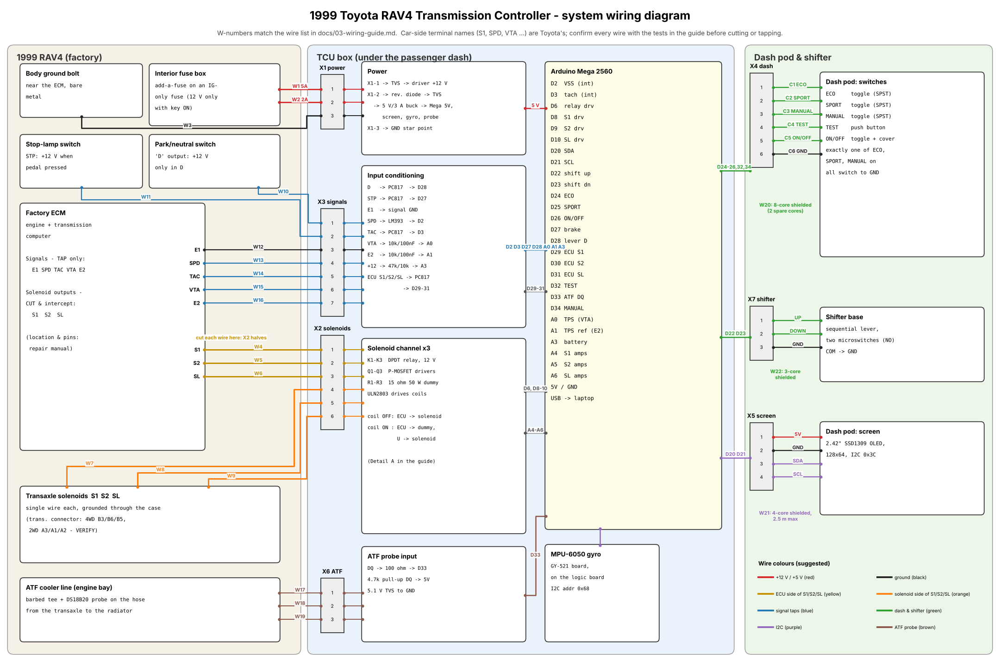
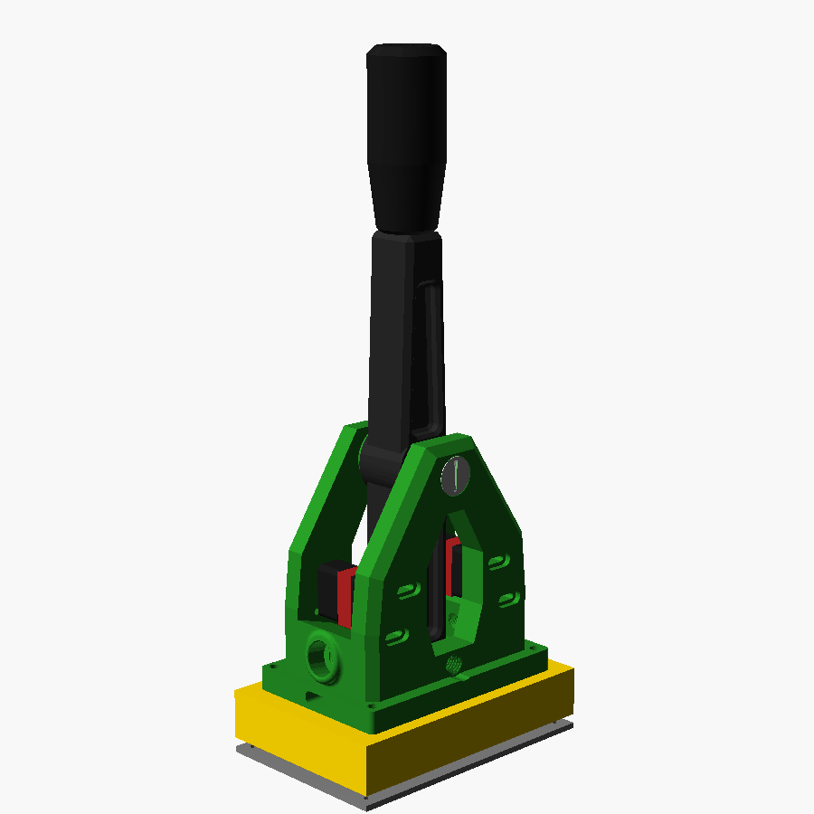

# Wiring guide: 1999 Toyota RAV4 transmission controller

Follow this guide alongside the two diagrams:

- [`wiring-diagram.svg`](wiring-diagram.svg) is the whole system. Every wire has a **W-number**
  that matches the wire list in §4.
- [`wiring-detail-a.svg`](wiring-detail-a.svg) is **Detail A**: one solenoid channel (relay,
  driver, dummy load, sense), built three times.



> **Read this first**
> - **Confirm every car wire with a meter before you cut or tap it.** §5 gives a test for each.
>   The Toyota terminal *names* (S1, SPD, VTA, …) are confirmed for this car, but ECM pin
>   numbers and wire colours vary by year, 2WD/4WD and market, and published pinouts disagree.
>   Use the factory repair manual (RM) and electrical wiring diagram (EWD) for your VIN.
> - **Disconnect the battery** before working on the ECM or solenoid wiring.
> - **Only S1, S2 and SL are cut.** Every other car connection is a *tap*: the factory wire
>   stays intact and the TCU listens to it.
> - **The ECM is static-sensitive.** Ground yourself, back-probe connectors, and never push
>   meter probes into the front of ECM pins.

---

## 1. What connects to what

The system is three separate pieces, each in its own 3D-printed housing
([hardware/README.md](../hardware/README.md)):

1. **Dash pod**: the screen and all five switches, on top of the dash (driver's side).
2. **Shifter base**: the sequential shifter lever, on the centre console next to the gear lever.
3. **TCU box**: the electronics, under the passenger side of the dash (§9). It has no switches.
   The round things on its front wall are cable glands, one per cable, each with its name above
   it.

| Connector (at the TCU) | Goes to | Wires |
|---|---|---|
| **X1 power** (3-pin) | Fuse box (ignition-switched 12 V), body ground | W1–W3 |
| **X2 solenoids** (6-pin) | The S1, S2, SL wires, cut between the ECM and the transaxle | W4–W9 |
| **X3 signals** (8-pin, 7 used) | Taps: lever "D", brake, ECM ground, speed, tach, throttle, throttle ground | W10–W16 |
| **X4 dash** (6-pin) | Dash pod: ECO, SPORT, MANUAL, TEST and ON/OFF switches | W20 (C1–C6) |
| **X5 screen** (4-pin) | 2.42" OLED screen in the dash pod | W21 |
| **X6 ATF** (3-pin) | Temperature probe in the cooler line | W17–W19 |
| **X7 shifter** (3-pin) | The sequential shifter lever's two microswitches, in the shifter base | W22 |
| USB | Laptop, for flashing and the calibration log | – |

Use sealed automotive connectors (Deutsch DT or Superseal) so the box unplugs cleanly.

**Make a bypass plug for X2:** a mating 6-pin plug with three jumpers, 1–4, 2–5 and 3–6. Unplug
the TCU, plug this into the car side of X2, and the ECM drives the solenoids directly. The car is
100 % stock, even with the TCU removed.

## 2. Harness colour code and wire sizes

These colours are for **your** harness, the new wires from the TCU. Toyota's own wire colours
are in the EWD. Label both ends of every wire with its W-number (heat-shrink markers).

| Colour | Use | Size |
|---|---|---|
| Red | +12 V (W1, W2) and +5 V (W17, screen 5V) | W1 16 AWG, others 18–22 AWG |
| Black | Ground (W3, W18, screen GND, C6, shifter GND) | W3 16 AWG, others 18–22 AWG |
| Black/white | ECM ground reference E1 (W12) | 18 AWG |
| Yellow | S1/S2/SL, **ECM side** (W4–W6) | 18 AWG |
| Orange | S1/S2/SL, **solenoid side** (W7–W9) | 18 AWG |
| Blue | Signal taps (W10, W11, W13–W16) | 22 AWG; SPD+TAC and VTA+E2 as shielded pairs |
| Brown | ATF probe (W17–W19) | 3-core shielded cable |
| Green | Dash pod switches (W20) | 8-core shielded cable, 24 AWG (one core spare) |
| Purple | Screen I²C (W21) | 4-core shielded cable, ≤ 2.5 m |
| Grey | Shifter (W22) | 3-core shielded cable (the same cable as the ATF probe's) |

Ground every cable shield **at the TCU end only**.

## 3. Connector pin-outs

**X1 power**

| Pin | Wire | Signal | Inside the TCU |
|---|---|---|---|
| 1 | W1 | +12 V drivers, **5 A fuse** | TVS → current sensors and MOSFET drivers Q1–Q3, relay coils |
| 2 | W2 | +12 V logic, **2 A fuse** | Reverse-polarity diode → TVS → 5 V buck; battery sense (47k/10k → A3) |
| 3 | W3 | Body ground | Star ground point |

**X2 solenoids** (Detail A)

| Pin | Wire | Signal | Inside the TCU |
|---|---|---|---|
| 1 | W4 | S1, ECM side | K1 COM-A; ECU-sense opto → D29 |
| 2 | W5 | S2, ECM side | K2 COM-A; ECU-sense opto → D30 |
| 3 | W6 | SL, ECM side | K3 COM-A; ECU-sense opto → D31 |
| 4 | W7 | S1, solenoid side | K1 NC-A + K1 NO-B |
| 5 | W8 | S2, solenoid side | K2 NC-A + K2 NO-B |
| 6 | W9 | SL, solenoid side | K3 NC-A + K3 NO-B |

**X3 signals**

| Pin | Wire | Signal | Inside the TCU |
|---|---|---|---|
| 1 | W10 | Lever in **D** (+12 V in D) | PC817 opto → D28 |
| 2 | W11 | Brake **STP** (+12 V when pressed) | PC817 opto → D27 |
| 3 | W12 | ECM ground **E1** | TCU signal ground reference |
| 4 | W13 | Speed **SPD** | LM393 comparator → D2 |
| 5 | W14 | Tach **TAC** | PC817 opto → D3 |
| 6 | W15 | Throttle **VTA** | 10k series, 100 nF, clamp → A0 |
| 7 | W16 | Throttle ground **E2** | 10k series, 100 nF, clamp → A1 (measured, *not* tied to TCU ground) |
| 8 | – | spare | |

**X4 dash** (W20, 8-core; cut the two spare cores back and tape them)

| Pin | Core | Signal | Mega pin |
|---|---|---|---|
| 1 | C1 | ECO switch | D24 |
| 2 | C2 | SPORT switch | D25 |
| 3 | C3 | MANUAL switch | D34 |
| 4 | C4 | TEST button | D32 |
| 5 | C5 | ON/OFF switch | D26 |
| 6 | C6 | Common ground: the other side of every switch | GND |

Each control switches its core to C6 (ground). Closed means active. A broken wire reads as off:
ON/OFF falls back to STOCK, and a broken ECO, SPORT or MANUAL wire leaves no mode on, which also
means STOCK (the screen says PICK MODE). Exactly one of ECO, SPORT and MANUAL must be on.

**X7 shifter** (W22, 3-core): 1 = UP (upshift microswitch NO, D22), 2 = DOWN (downshift
microswitch NO, D23), 3 = GND (both microswitches' COM).

**X5 screen** (W21): 1 = 5 V, 2 = GND, 3 = SDA (D20), 4 = SCL (D21). At the 2.42" screen: VCC = 5 V,
GND, DIN = SDA, CLK = SCL, DC and CS to GND, RES to a 10k pull-up + 1 µF to GND (build book part 7).
**X6 ATF**: 1 = +5 V (W17), 2 = GND (W18), 3 = DQ (W19 → 100 Ω → D33, 4.7k pull-up to 5 V).
The **MPU-6050 gyro** sits inside the box on the same I²C bus (5 V, GND, D20, D21). Mount it flat (§9).

## 4. Wire list

| W | From (car) | To | Colour / size | Notes |
|---|---|---|---|---|
| W1 | Add-a-fuse output → 5 A inline fuse | X1-1 | Red 16 AWG | Fuse within 20 cm of the tap |
| W2 | Add-a-fuse output → 2 A inline fuse | X1-2 | Red 18 AWG | Same tap as W1, separate fuse |
| W3 | Body ground bolt | X1-3 | Black 16 AWG | Short; bare metal; star washer |
| W4 | ECM terminal **S1** (cut, ECM end) | X2-1 | Yellow 18 AWG | Solder + heat-shrink |
| W5 | ECM terminal **S2** (cut, ECM end) | X2-2 | Yellow 18 AWG | |
| W6 | ECM terminal **SL** (cut, ECM end) | X2-3 | Yellow 18 AWG | |
| W7 | S1 wire (cut, solenoid end) | X2-4 | Orange 18 AWG | |
| W8 | S2 wire (cut, solenoid end) | X2-5 | Orange 18 AWG | |
| W9 | SL wire (cut, solenoid end) | X2-6 | Orange 18 AWG | |
| W10 | Park/neutral switch **D** output | X3-1 | Blue 22 AWG | Tap |
| W11 | Stop-lamp switch **STP** output | X3-2 | Blue 22 AWG | Tap |
| W12 | ECM ground **E1** / engine ground | X3-3 | Black/white 18 AWG | |
| W13 | ECM **SPD** | X3-4 | Shielded pair with W14 | Tap (high impedance) |
| W14 | ECM **TAC** | X3-5 | Shielded pair with W13 | Tap. **Never the ignition coil (−) terminal** |
| W15 | ECM **VTA** | X3-6 | Shielded pair with W16 | Tap |
| W16 | ECM **E2** | X3-7 | Shielded pair with W15 | Tap |
| W17–W19 | DS18B20 probe red / black / yellow | X6-1/2/3 | Brown 3-core shielded | Through a firewall grommet |
| W20 | Dash pod switches | X4 | Green 8-core shielded | Behind the dash trim, away from the passenger airbag |
| W21 | Dash pod screen | X5 | Purple 4-core shielded | Same route as W20; 2.5 m maximum |
| W22 | Shifter base | X7 | Grey 3-core shielded | Under the console trim, away from the handbrake and seat rails |

## 5. Finding each signal on the 1999 RAV4

Do these tests with a multimeter **before** you cut or tap. Write down the wire colour you find on
your car next to each W-number.

| Signal | Where (VERIFY in your EWD) | How to confirm it's the right wire |
|---|---|---|
| **IG 12 V** (W1, W2) | Interior fuse box: an ignition-only fuse, with an add-a-fuse | 12 V with the key ON and engine running, **0 V with the key OFF** |
| **Body ground** (W3) | A factory ground bolt near the ECM | < 0.5 Ω to the battery negative |
| **ECM location** | See the RM's "location of components" page. Many Toyotas of this era have it behind the glovebox or passenger kick panel, but check | – |
| **S1, S2, SL** (W4–W9) | ECM terminals named S1, S2, SL; the same three wires run to the solenoid connector on the transaxle | Battery disconnected. Unplug the transaxle solenoid connector and check continuity from each ECM wire to it. Expected: S1 → A3 (2WD) / B3 (4WD), S2 → A1 / B6, SL → A2 / B5 (Toyota service text; VERIFY). With the connector plugged back in, each reads **11–15 Ω to body ground** (through the solenoid). |
| **SPD** (W13) | ECM terminal SPD (speed signal from the meter) | Key ON, lever in N, roll the car slowly: the voltage pulses between ~0 V and ~5 V (or 12 V). About **1.1 pulses per second per mph** |
| **TAC** (W14) | ECM terminal TAC (or TAC at the engine-bay diagnostic connector, if fitted) | Engine idling (~750 rpm): about **25 Hz** in frequency mode (2 pulses per crank turn) |
| **VTA / E2** (W15, W16) | ECM terminals VTA and E2 (throttle sensor signal and its ground) | Key ON, engine off, measured VTA-to-E2: **~0.3–0.8 V closed**, rising smoothly to **~3.2–4.9 V** at full throttle. E2 is within a few mV of ground |
| **E1** (W12) | ECM ground terminal E1, or the engine ground strap | < 0.5 Ω to the engine block |
| **STP** (W11) | Stop-lamp switch on the brake pedal (output side), or ECM terminal STP | 0 V pedal up, **12 V pedal down** |
| **Lever D** (W10) | Park/neutral position switch "D" output (it also feeds the "D" light in the cluster) | Key ON: **12 V only with the lever in D**, 0 V in P, R, N, 2, L |

**How to tap a wire:** strip a 10 mm window without cutting the strands, wrap the new wire around
it, solder, and seal with adhesive heat-shrink. Don't use Scotch-lock taps.
**How to cut S1/S2/SL:** cut close to the ECM (inside the car, dry), leaving room to work. Solder
each end into its X2 harness wire and seal it.

## 6. Inside the TCU (Detail B: input and output circuits)

The TCU is three boards joined by two ribbon cables. Exact part positions, every wire, and the
order to build them in are in the [build book](05-build-book.md).

| Board | What's on it |
|---|---|
| **Power board** (90 × 150 mm perfboard) | Everything that touches the car's 12 V wiring: X1/X2/X3 and LOAD terminals, protection, the 5 V buck converter, relays, drivers, current sensors, optocouplers, speed comparator, throttle taps. Ribbon A (26-way) to the hub |
| **Logic board** (90 × 70 mm perfboard) | X7 shifter, X4 dash, X5 screen and X6 ATF terminals (left to right, under their glands), seven switch input filters, ATF probe parts, the **gyro**. Ribbon B (16-way) to the hub |
| **Hub** (Mega prototype shield) | Two ribbon sockets, each pin wired to its Mega pin |

Detail A (the solenoid channel) is in [`wiring-detail-a.svg`](wiring-detail-a.svg). The other
circuits are below. A 10 kΩ pull-down sits on **every** output that drives something (D6, D8,
D9, D10), so everything is off while the Mega resets.

**Solenoid driver** (×3: D8/D9/D10 → S1/S2/SL)
```
D8 ── ULN2803 IN4 (10k pull-down) ; ULN2803 OUT4 ── 4.7k ── Q1 gate
+12 V DRV ── CS1 ACS712 (IP+ → IP−) ── Q1 source (IRF4905 P-MOSFET)
Q1 gate ── 10k ── source (pull-up = off) ; 15 V zener gate–source (cathode on source)
Q1 drain ── K1 COM-B ; clamp: drain ── UF4007 (cathode on drain) ── 24 V zener ── GND
CS1 OUT ── A4 (185 mV/A around ~2.5 V)
```
D8 high → the ULN2803 pulls the gate down → the MOSFET switches +12 V to the solenoid. The
zener clamp lets the solenoid release quickly, like the ECM's own driver.

**Switch input** (×7: shifter D22, D23; dash D24, D25, D26, D32, D34), on the logic board
```
+5V ── 2.2k ──┬── 1k ──┬── Mega pin
              │        ├── 100 nF ── GND
              │        └── BAT85 to 5V, BAT85 from GND (clamps)
       X4 / X7 core ── switch ── GND (X4-6 / X7-3)
```

**12 V opto input** (brake D27, lever D28, ECU sense D29–D31, tach D3)
```
car signal ── 2.2k (3.3k for ECU sense) ──┬── PC817 LED (+) ── LED (−) ── GND
                                          └── 1N4148 reverse across the LED
PC817 transistor: collector ── Mega pin (10k pull-up to 5V), emitter ── GND
Mega reads LOW when the car signal is at +12 V.
```

**Speed (SPD) comparator**, high impedance so it never loads the car's line (D2)
```
SPD ── 22k ──┬── LM393 (+)        LM393 (−) ── 0.76 V (10k / 1.8k from 5V)
             ├── 10k ── GND       1M feedback (+) ← output (hysteresis)
             └── 5.1V zener       output ── 10k pull-up to 5V ── D2
```
The 22k/10k divider scales the signal by about 0.31, so a 5 V speed signal reaches 1.56 V and
a 12 V one 3.75 V, both well over the 0.76 V threshold. (Revision 3 fix: the earlier 47k/10k
divider with a 2.5 V threshold never switched.)

**Throttle tap** (A0, A1)
```
VTA ── 10k ──┬── A0      E2 ── 10k ──┬── A1
           100 nF                  100 nF
        BAT85 clamps            BAT85 clamps
(Firmware reads A0 − A1. E2 is never tied to the TCU ground.)
```

**Battery sense** (A3): `X1-2 (+12 V) ── 47k ──┬── A3; 10k to GND, 100 nF, 5.1 V zener`

**ATF probe** (D33): `X6-3 DQ ── 100 Ω ── D33; 4.7k from DQ to 5 V; 5.1 V zener to GND`
(use 2.2k if readings drop out on the long run)

**Relay coils** (D6): `D6 ── ULN2803 IN1-3 (10k pull-down); OUT1-3 ── K1/K2/K3 coil (−); coil (+) ── +12 V DRV; ULN COM ── +12 V DRV`


## 7. Build order

This is the short version. The [build book](05-build-book.md) is the full step-by-step version,
in order, with pictures.

1. **Bench:** build the TCU on the bench with 15 Ω power resistors (plus LEDs) in place of the
   three solenoids. Flash the firmware, calibrate `IS_AMPS_PER_VOLT`, hold TEST, and check every
   self-test line passes.
2. **Power (car):** W1–W3 only, with the ON/OFF switch OFF. Key ON: the screen shows the MAIN page
   and the power-up test runs.
3. **Signal taps:** W10–W16. Check the SENSORS page: speed 0, throttle 0 % → 100 % as you press
   the pedal, rpm at idle.
4. **Dash pod, screen and shifter:** W20–W22. Hold TEST: the prompts check the shifter's two
   switches and every dash switch.
5. **ATF probe:** W17–W19, and the probe in the cooler line (spec §3.8). Top up the ATF.
6. **Solenoid intercept:** cut S1/S2/SL and fit X2 (W4–W9). With the switch OFF, the relays rest
   in factory position, so the car must drive **exactly** as before. Then try the bypass plug: it
   must drive the same. Check the OBD-II scanner for trouble codes.
7. **Calibrate** with the switch OFF (spec §8), set `CALIBRATED = true`, and follow spec §9: lift,
   then a closed lot, then the road.

## 8. Sequential shifter lever

Any sim-racing style sequential lever with **two microswitches** works. This project uses the
**DIY Racing Sim Sequential Shifter by bbeavis (Beavis Motorsport)**: build guide at
[beavismotorsport.com](https://beavismotorsport.com/sim-racing/diy-sequential-shifter/), printed
parts on Thingiverse [4557771](https://www.thingiverse.com/thing:4557771) and
[Printables](https://www.printables.com/model/371496-diy-racing-sim-sequential-shifter). It's
shared under CC BY-NC; its STLs, credit and license are in
[`hardware/beavis_shifter/`](../hardware/beavis_shifter/README.md). It bolts onto the
[shifter base](../hardware/README.md#shifter-base) (4 × M6, 116 × 74 mm), which sits on the
centre console next to the factory gear lever and has its own cable (W22) to the TCU box.



- Build the lever as the guide describes, but **print it in PETG or ASA, not PLA**: PLA goes
  soft in a hot car.
- **Drill its four mounting holes to 6.5 mm.** They print at 6.0 mm, too tight for M6 bolts.
- **Point the long side front-to-back.** The lever swings along the body's long side.
- **It's tall:** about 33 cm from the base to the top of the printed knob (35 cm above the
  console). Before you drill anything, hold it in place and check it clears the dash, the radio
  and your arm. A shorter M10 stud or a lower knob brings it down a few centimetres.
- Leave out the bottom cover: the shifter base's deck closes the pocket underneath instead.
- Use its two **V-155-1C25 roller limit switches**, and leave out the Arduino Pro Micro. That
  board turns the switches into a USB game controller for a PC; the TCU reads the switches
  directly.
- Inside the shifter base, three lever-nut connectors join the switch wires to W22:
  - Upshift switch NO → X7-1 (UP).
  - Downshift switch NO → X7-2 (DOWN).
  - Both switches' COM → X7-3 (GND).
  - Leave each switch's NC terminal unconnected.
- **The lever only shifts with the MANUAL switch on** (and ECO and SPORT off). In ECO or SPORT
  the TCU shifts by itself, and a click on the lever just shows MANUAL OFF on the screen.
  Switching between MANUAL and ECO or SPORT never shifts by itself: the TCU keeps the gear
  you're in, and you (or the map) shift from there.
- To change between "pull = upshift" (rally style) and "push = upshift", set
  `SWAP_SHIFT_INPUTS` in `config.h`. You don't need to rewire.
- **In the car:** bolt the base where the lever can't foul the factory gear lever, your knee,
  the handbrake or the cup holder, and give the lever hard end-stops. The V-155 switches are
  open-frame. That's fine inside the cabin, but keep drinks away, or use sealed (IP67) V-type
  switches with the same footprint.
- The firmware's 25 ms debounce and edge detection mean one click is always exactly one shift,
  even with a bouncy switch.

## 9. Where everything goes (1999 RAV4 4WD)

| Part | Where | Why / how |
|---|---|---|
| **TCU box** ([3D-printed](../hardware/README.md#tcu-enclosure)) | Under the passenger side of the dash, below the glovebox, bolted **flat** to metal | See below |
| **Gyro (MPU-6050)** | **Inside the TCU box**, soldered flat on the logic board | See below |
| **Dummy-load heatsink** | Under the dash on metal, in moving air, ≥ 50 mm from plastic, wiring and the TCU box | ~14 W per resistor. Never inside the box |
| **Dash pod** (screen and switches) | On top of the dash, driver's side | See below. Within 2.5 m of cable from the box, for the screen's I²C cable |
| **Shifter base** (sequential lever) | Centre console, next to the factory gear lever, long side front-to-back | §8. Bolted down through its bottom plate |
| **ATF probe** | Engine bay, in the hot ATF cooler hose | See below |
| **Fuse tap** | Cabin fuse box, an IG (ignition-switched) fuse | §5 |

### Where the TCU box goes

It doesn't have to hide behind the glovebox. What it needs:

1. **Inside the cabin, dry.** Not the engine bay (heat, water), and not the floor (wet shoes,
   carpet shampoo, and feet).
2. **Close to the ECM.** The three solenoid wires are cut at the ECM, and five signal wires are
   tapped there; short runs keep them tidy and away from interference. Find the ECM with the RM's
   "location of components" page (§5).
3. **Bolted rigidly to metal**, because the gyro is inside: four bolts, not Velcro or tape.
4. **Within 2.5 m of cable of the dash pod**, for the screen.
5. **Room around it:** 244 × 178 × 51 mm with its mounting ears, plus about 10 cm in front for the
   cables to bend out of the glands.

**Best spot: under the passenger side of the dash, below the glovebox**, bolted to the metal dash
support or a steel bracket hung from it. You can see and reach it by kneeling at the passenger
footwell, without taking anything apart, and it's as close to the ECM as behind the glovebox.
Check it clears the passenger's knees and the heater ducts. If there's no room there, behind the
glovebox works too; it's just slower to reach.

**On its side is fine.** If the best flat spot is the vertical kick panel, bolt the box on its
side and set `GYRO_AXIS` in `config.h` to whichever axis printed on the gyro board now points up
(X = 0, Y = 1). The relays and boards don't care which way up they are.

**Laptop access without reaching the box:** a 50 cm USB-B panel-mount extension (optional on the
shopping list) from the box's USB socket to the inside of the glovebox. Plug the laptop in there
to log and calibrate.

Avoid: under a seat (wet floor, seat rails, far from the ECM), the trunk (too far), and anywhere
near the heater core outlets.

### The dash pod

The pod hangs on a hinge from a small mount and tilts to face you. Tighten the hinge bolt's nyloc
nut until the pod holds its angle over bumps.

- **On the dash top, driver's side**, where it doesn't block your view of the road or the
  gauges. **Never on or near the passenger airbag door** in the right-hand half of the dash top:
  an airbag would throw it at someone. Fix the mount with two screws into the dash pad's frame,
  or with 3M VHB tape on a clean, flat spot.
- **Cables:** both cables (W20 switches, W21 screen) leave from the pod's back. Tuck them down
  behind the dash trim to the box. Keep the screen cable under 2.5 m: the firmware runs the
  screen at the standard 100 kHz I²C speed, which a shielded cable that long handles.

### The gyro

- It sits **inside the TCU box**, soldered flat on the logic board. It shares the I²C bus with
  the screen, so it needs no extra cable.
- **Level matters; where doesn't.** The firmware only uses the yaw rate (how fast the car is
  turning), and every point of a rigid car turns at the same rate. Under the dash reads the
  same as the middle of the car. The axis it reads (`GYRO_AXIS`: Z for a flat box) must point
  up; a tilt only scales the reading by cos(tilt): 5° costs 0.4 %, 15° costs 3.4 %. Check the
  box with a phone level app as you bolt it in.
- **Rigid matters.** If the box can rock on its mount, the gyro reads the rocking.
- **Which way it faces around that axis doesn't matter.**
- Keep it away from the heatsink and heater ducts. The zero offset drifts with temperature.
  The firmware re-learns it at every stop, so this only reduces noise.
- **Test:** the SENSORS page shows SIDE FORCE. A brisk roundabout or on-ramp reads about
  0.2–0.5 g; driving straight it stays near 0.00. If it jumps around on a straight, bumpy road, the box
  isn't mounted rigidly.

### The ATF temperature probe

The probe goes in a barbed tee spliced into the **hot** ATF cooler hose: the one carrying fluid
*from* the transaxle *to* the cooler in the radiator's tank. Parts: README §6. Background:
spec §3.8.

1. **Find the two cooler lines.** On the RAV4 they are steel pipes from the transaxle to
   the radiator, joined by short rubber hoses near the radiator. Your RM's ATF-cooler section
   shows them.
2. **Find the hot one.** Start the cold engine, idle in P, and IR-check or carefully feel
   both hoses. The one that warms first is the outlet: that's the hot line. Stop the engine.
3. **Pick the spot:** a **straight rubber section at least 50 mm long**, on the hot line near
   the radiator end. That's easy to reach and away from the exhaust.
   - At least 150 mm from the exhaust manifold and its heat shield.
   - Clear of the fan, belts and anything that moves.
   - Before any auxiliary cooler, if one is fitted, so it reads transaxle-out temperature.
4. **Fit it:**
   - Clamp the hose or have a drain pan ready, then cut the hose square.
   - Fit the tee with fuel-injection clamps on both barbs.
   - Point the probe's port **sideways**: pointing down collects debris, and pointing up
     traps air.
   - Seal the probe's thread with ATF-resistant sealant.
5. **Route the cable** (3-core shielded):
   - Run it along the existing engine harness with zip ties every 150–200 mm, well clear of
     the exhaust, the steering shaft and the 4WD transfer/driveshaft area below.
   - Go through a **firewall grommet**: an existing one on the glovebox side if you can (pierce
     it and seal it with RTV), or a new grommet in a drilled hole with the edge painted.
   - Inside, run it to the TCU box's **ATF** gland (X6).
   - Ground the shield at the TCU end only.
6. **Top up and check:** run the engine, shift through every gear, check for leaks, then check
   the ATF level **hot** on the dipstick as the owner's manual describes. Top up with the fluid
   it specifies.
7. **Test:** the SENSORS page should show the ATF temperature climbing with the engine warm,
   within a few degrees of an IR thermometer on the tee.

### 4WD notes (SXA11)

- **Solenoid connector pins:** on the 4WD transaxle, S1 / S2 / SL are terminals
  **B3 / B6 / B5** (2WD: A3 / A1 / A2). This is Toyota service text; **confirm it** with the
  continuity test in §5 before cutting anything.
- **Lift all four wheels** for any in-gear testing. The full-time 4WD drives both axles through
  the centre differential. With only the front wheels up, the rear wheels can drive the car
  off the stands, and the centre diff is stressed.
- **Transfer and centre-diff circuits stay on the factory ECU.** The TCU only intercepts S1,
  S2 and SL.
- **Speed signal:** use the same SPD wire at the ECM as on the 2WD (§5). Tyre size changes it
  equally on both, which calibration (spec §8) corrects.
- **Final drive:** the firmware's starting rpm-per-mph table uses ~4.40, the figure listed for
  the 4WD automatic. Calibrate it anyway (spec §8): sources disagree.
