# Build book: 1999 RAV4 transmission controller

<!-- Generated by tools/boards.py from tools/build_book_template.md. Edit the template, then run
     python3 tools/boards.py -->

Every step, in the order you do it, like a Lego instruction book. Each step lists what you
need, shows where things go, and ends with a **✅ Check**. **Don't start the next step until the
check passes.** That way a mistake is found minutes after you make it, not when the car won't
shift.

The order is arranged so you never have to go back. The prints run while you solder, every board
is tested on its own, the whole system is tested on the bench before it goes near the car, and
the car stays drivable every evening until the very last connection.

| Part | What | Time (rough) |
|---|---|---|
| [0](#part-0--measure-the-car-one-evening-nothing-cut) | Measure the car (nothing is cut) | 2–3 h |
| [1](#part-1--order-the-parts) | Order the parts | 1 h + delivery |
| [2](#part-2--start-the-3d-prints) | Start the 3D prints (they run while you solder) | 30 min + ~45 h of printing |
| [3](#part-3--set-up-the-bench) | Set up the bench | 30 min |
| [4](#part-4--power-board) | Power board, steps P1–P8 | 6–8 h |
| [5](#part-5--logic-board) | Logic board, steps L1–L4 | 2–3 h |
| [6](#part-6--hub-shield-on-the-mega) | Hub shield on the Mega | 1–2 h |
| [7](#part-7--console-pod-and-shifter) | Console pod and shifter | 3–4 h |
| [8](#part-8--dummy-loads-on-the-heatsink) | Dummy loads on the heatsink | 30 min |
| [9](#part-9--bench-test-the-whole-system) | Bench test the whole system | 2 h |
| [10](#part-10--close-up-the-tcu-box) | Close up the TCU box, make the cable tails | 2–3 h |
| [11](#part-11--install-in-the-car) | Install in the car, one evening per stage | 4 evenings |
| [12](#part-12--calibrate-unlock-and-test-drive) | Calibrate, unlock, test drive | a week of normal driving |

**Before you start,** read the **Safety** note at the end of the [README](../README.md), and keep
the [wiring guide](03-wiring-guide.md) open. It has the meter test for every car wire.

---

## How to read the pictures

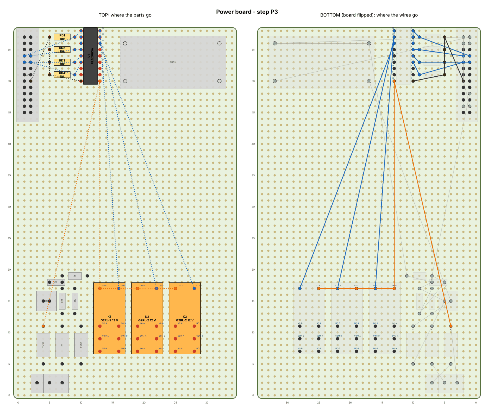

- **Left = TOP view** (component side). New parts in this step are **coloured**, parts from
  earlier steps are grey. Red dots are the holes the new parts' legs go through.
- **Right = BOTTOM view**, as you see it after flipping the board over: **left and right are
  swapped**. Coloured lines are this step's wires; grey lines are earlier wires.
- **Grid numbers** (columns along the bottom, rows up the side) count holes from the board's
  front-left corner. Front = the edge with the big screw terminals, which faces the cable glands.
- Dashed outlines are **modules on foam tape**. Their "pins" are pads or screw terminals on the
  module, not board holes: solder a wire to them.
- **Polarity marks:**
  - **Diodes:** the band is the cathode, marked **K** in the pictures.
  - **Chips** (ULN2803, LM393, PC817): pin 1 is at the notch or dot.
  - **Electrolytic capacitor:** the stripe is the − leg.
  - **MOSFET:** label facing you, pins are G-D-S from left to right; the metal tab faces the back.
  - **Box header:** pin 1 has a triangle on the plastic and a square pad.
- **Wire tables:** *"Connect, in this order"* means **one** insulated wire hopping from pin to
  pin in that order, soldered at each stop (cut, strip, solder, next). The last column is the
  wire size: 18–20 AWG for the power paths, 22 AWG for everything else.
- **Print the 1:1 templates** ([power](build/power-template.svg), [logic](build/logic-template.svg))
  at 100 % scale. Check the board outline with a ruler, then tape the template on the board and
  push the legs through it. You can't misplace a part this way.

---

## Part 0 — Measure the car (one evening, nothing cut)

**You need:** the repair manual (RM) and wiring diagram (EWD) for your VIN, a multimeter,
a tape measure, a notepad, and a phone for photos.

1. **Transaxle ID plate:** read the transaxle code (A241H or A540H on a 4WD). Note it.
2. **Fuse box:** pull one fuse and note the blade size (standard ATO/ATC or mini). Use the EWD to
   find a fuse that's live **only with the key ON** (an "IG" fuse) and has spare capacity.
3. **ATF cooler hoses:** find the two cooler lines at the radiator (wiring guide §9). Measure the
   rubber hose's **inside diameter** (5/16" or 3/8"). Idle the cold engine for 2 minutes and feel
   which hose warms first: that's the **hot line**. Mark it with tape.
4. **Space behind the glovebox:** remove the glovebox. The TCU box needs **216 × 178 × 51 mm**
   (244 mm wide with its ears) on a flat metal surface, away from the heater ducts. Find a spot.
   Also find room for the **heatsink** (100 × 100 × 25 mm) in moving air, at least 50 mm from
   plastic and wiring.
5. **Space on the centre console:** the pod is **150 × 130 × 70 mm**, plus the shifter on top.
   Check it can't foul the gear lever, the handbrake or your knee.
6. **Find the ECM** (RM, "location of components") and identify each wire **without cutting
   anything**, using the meter tests in [wiring guide §5](03-wiring-guide.md): S1, S2, SL, SPD,
   TAC, VTA, E2, E1, STP, and the park/neutral switch's "D" output. Write each wire's **colour and
   terminal** in this table, and photograph the connectors:

| Signal | ECM terminal | Wire colour | Meter test result |
|---|---|---|---|
| S1 | | | |
| S2 | | | |
| SL | | | |
| SPD | | | |
| TAC | | | |
| VTA | | | |
| E2 | | | |
| E1 | | | |
| STP | | | |
| D | | | |

✅ **Check:** you have every row filled in, the hose size, the fuse size, and two mounting spots.
If a meter test doesn't match the guide, stop and work it out before buying anything.

---

## Part 1 — Order the parts

Use the [shopping list](04-shopping-list.md): about **$640** in parts. Your 3D printer and jack
stands aren't counted.

1. Pick the barbed tee for **your hose size** and the fuse tap for **your blade size** (part 0).
2. Place one **DigiKey or Mouser** order and one **Amazon** (or AliExpress) order, then visit a
   hardware store and an auto-parts store. The list is grouped by store at the end.

✅ **Check:** tick every row of the shopping list as it arrives.

---

## Part 2 — Start the 3D prints

Start printing as soon as the filament arrives. The prints run in the background while you
solder parts 4–6. Settings, orientation and screws: [hardware/README.md](../hardware/README.md).

**PETG or ASA, never PLA.** 0.2 mm layers, 4 walls, 30–40 % infill, no supports.

| Print | File | Time (rough) |
|---|---|---|
| TCU box | `hardware/stl/tcu_enclosure_box.stl` (220 mm bed: `…_no_ears.stl`) | ~12 h |
| TCU lid | `hardware/stl/tcu_enclosure_lid.stl` | ~4 h |
| Pod shell | `hardware/stl/console_pod_shell.stl` (prints upside down) | ~10 h |
| Pod bottom plate | `hardware/stl/console_pod_bottom.stl` | ~2 h |
| Shifter parts | Thingiverse [4557771](https://www.thingiverse.com/thing:4557771), the Beavis guide's settings, but PETG/ASA | ~15–20 h |

✅ **Check:** each print comes off flat and un-warped. Test-fit a toggle switch in its hole and
an M3 heat-set insert in a corner boss before printing the rest.

---

## Part 3 — Set up the bench

1. Soldering iron at ~330 °C, solder, flux, wire strippers, multimeter, hot-glue gun.
2. **Bench 12 V supply:** the 12 V adapter → screw-terminal barrel jack → **a 5 A blade fuse in
   an inline holder** on the + wire. Every bench test goes through this fuse.
3. Print the two **1:1 templates** at 100 % ([power](build/power-template.svg),
   [logic](build/logic-template.svg)). Measure the board outline: 90 × 150 mm and 90 × 70 mm. If
   it's wrong, your printer scaled it: turn "fit to page" off.
4. Lay the perfboards on the templates. If your boards have no corner mounting holes, drill
   3 mm holes 3 mm in from each corner.

✅ **Check:** the meter reads 12–13 V after the fuse, and the templates measure correctly.

---

## Part 4 — Power board

Everything that touches the car's 12 V wiring. Build it in eight small steps; each ends with a
test using the bench supply and the meter.

### Step P1 — Power in, protection and the 5 V supply (1 h)

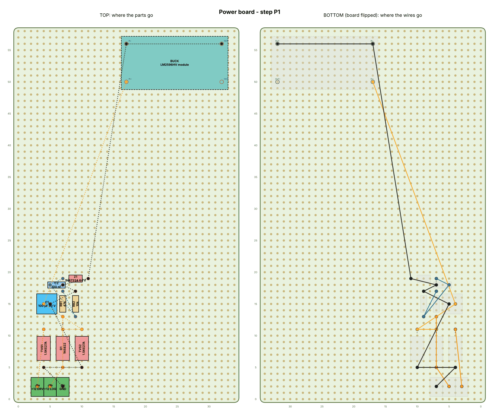

| Part | Value | Goes in | Notes |
|---|---|---|---|
| **J1a** | +12 DRV | 1 col 3, row 2 | X1-1 (5 A fuse) |
| **J1b** | +12 LOG | 1 col 5, row 2 | X1-2 (2 A fuse) |
| **J1c** | GND | 1 col 7, row 2 | X1-3 (body ground) |
| **TVS1** | 1.5KE27A | A col 4, row 5 → K col 4, row 11 | band (K) towards the back |
| **D1** | 1N5822 | A col 7, row 5 → K col 7, row 11 | band (K) towards the back |
| **TVS2** | 1.5KE27A | A col 10, row 5 → K col 10, row 11 | band (K) towards the back |
| **C1** | 100 µF 50 V | + col 4, row 15 → - col 5, row 15 | long leg (+) left, stripe (−) right |
| **RB1** | 47k | 1 col 7, row 13 → 2 col 7, row 17 | battery sense, top |
| **RB2** | 10k | 1 col 9, row 13 → 2 col 9, row 17 | battery sense, bottom |
| **C2** | 100 nF | 1 col 5, row 18 → 2 col 7, row 18 |  |
| **Z1** | 1N4733A 5.1 V | A col 11, row 19 → K col 7, row 19 | band (K) left |
| **BUCK** | LM2596HV module | on foam tape, IN+ at col 17, row 50 | foam tape; set to 5.0 V before wiring 5 V anywhere |

| Wire | Net | Connect, in this order | Wire |
|---|---|---|---|
| P1.1 | +12 DRV | J1a.1 → TVS1.K | 18 AWG |
| P1.2 | +12 LOG | J1b.1 → D1.A → RB1.1 | 20 AWG |
| P1.3 | LOG | D1.K → TVS2.K → C1.+ → BUCK.IN+ | 20 AWG |
| P1.4 | GND | J1c.1 → TVS1.A → TVS2.A → C1.- → RB2.2 → C2.2 → Z1.A → BUCK.IN- | 18 AWG |
| P1.5 | VBAT | RB1.2 → RB2.1 → C2.1 → Z1.K | 22 AWG |
| P1.6 | GND | BUCK.IN- → BUCK.OUT- | 20 AWG |

**Do this first:** the buck module's 5 V adjustment comes set to anything up to 30 V.

1. Solder the parts in the table. The three big diodes (TVS1, D1, TVS2) stand **band (K) towards
   the back**.
2. Stick the buck module down with foam tape. Solder its four wires.
3. **Set the buck to 5.0 V:** connect the bench 12 V to J1b (+) and J1c (−). Measure between the
   buck's OUT+ and OUT−, and turn its brass screw until it reads **5.00 V** (many turns,
   anticlockwise to go down). Put a dab of hot glue on the screw.

✅ **Check** (12 V on J1b/J1c):
- buck OUT+ reads 4.95–5.05 V
- the RB1/RB2 junction (VBAT) reads about 2.1 V
- 12 V on J1a reads 12 V on TVS1's band end
- **Reverse the bench leads for one second:** nothing gets warm, and the buck output reads 0 V
  (D1 blocks reversed polarity).

### Step P2 — Ribbon header A (20 min)

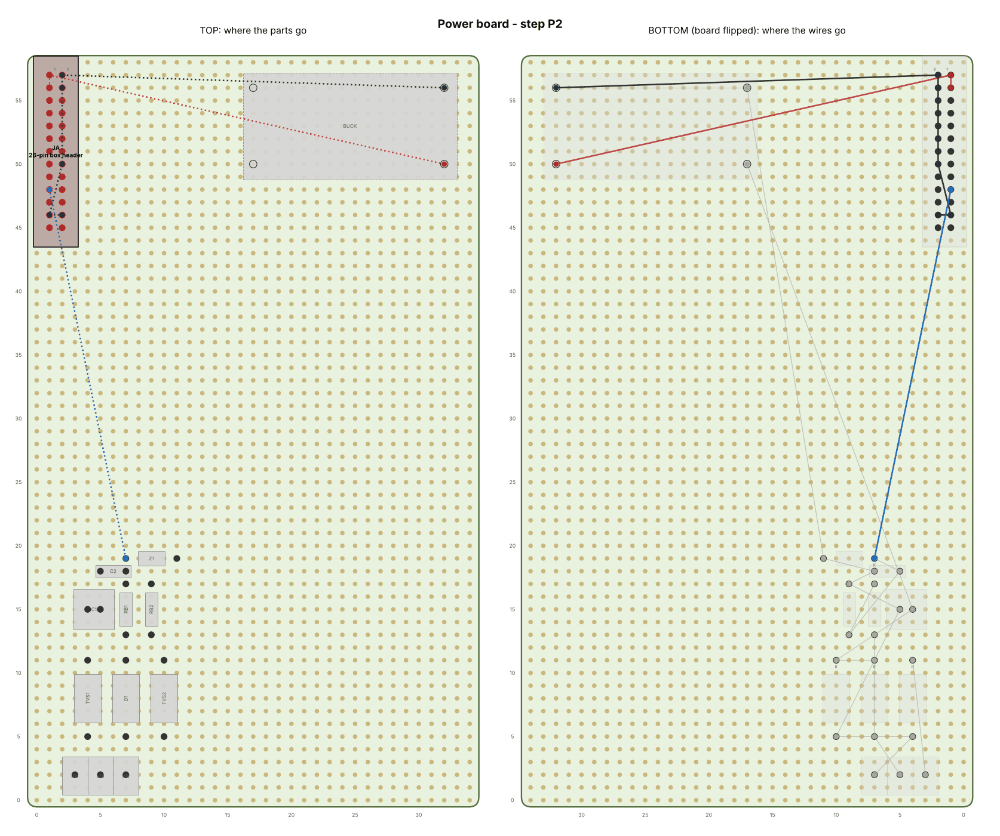

| Part | Value | Goes in | Notes |
|---|---|---|---|
| **JA** | 26-pin box header | 1 at col 1, row 57 | notch facing the left edge; pin 1 (square pad) at the back |

| Wire | Net | Connect, in this order | Wire |
|---|---|---|---|
| P2.1 | 5V | BUCK.OUT+ → JA.1 → JA.3 | 22 AWG |
| P2.2 | GND | BUCK.OUT- → JA.2 → JA.4 → JA.16 → JA.23 → JA.24 | 22 AWG |
| P2.3 | VBAT | Z1.K → JA.19 | 22 AWG |

The box header's **notch faces the left edge** of the board, and **pin 1 (square pad) is at the
back**.

✅ **Check** (12 V on J1b/J1c): JA pins 1 and 3 read 5.0 V against pin 2. Pin 19 reads ~2.1 V.

### Step P3 — Relays and their driver (1 h)

**First, the relay beep test (2 minutes, before soldering):**
1. Set the meter to beep. Each relay has two pins alone at one end: that's the **coil**. On each
   long side, the three contact pins sit 15, 20 and 25 mm from the coil end.
2. With nothing connected, the **15 mm and 20 mm pins beep** on each side. That's NC and COM.
3. Put 12 V across the coil pins (it clicks). Now the **20 mm and 25 mm pins beep**: COM and NO.
4. That's the layout in the pictures (NC at 15, COM at 20, NO at 25). **If yours differs, write
   the real names on the template and wire by name**, not by position.

| Part | Value | Goes in | Notes |
|---|---|---|---|
| **U1** | ULN2803A | 1 at col 10, row 58 | notch / dot (pin 1) at the back-left |
| **RD1** | 10k | 1 col 5, row 57 → 2 col 9, row 57 | pull-down, D6 |
| **RD2** | 10k | 1 col 5, row 55 → 2 col 9, row 55 | pull-down, D8 |
| **RD3** | 10k | 1 col 5, row 53 → 2 col 9, row 53 | pull-down, D9 |
| **RD4** | 10k | 1 col 5, row 51 → 2 col 9, row 51 | pull-down, D10 |
| **K1** | G2RL-2 12 V | COIL1 at col 13, row 17 | coil end at the back |
| **K2** | G2RL-2 12 V | COIL1 at col 19, row 17 | coil end at the back |
| **K3** | G2RL-2 12 V | COIL1 at col 25, row 17 | coil end at the back |

| Wire | Net | Connect, in this order | Wire |
|---|---|---|---|
| P3.1 | RLY (D6) | JA.7 → RD1.2 → U1.1 → U1.2 → U1.3 | 22 AWG |
| P3.2 | DRV1 (D8) | JA.8 → RD2.2 → U1.4 | 22 AWG |
| P3.3 | DRV2 (D9) | JA.9 → RD3.2 → U1.5 | 22 AWG |
| P3.4 | DRV3 (D10) | JA.10 → RD4.2 → U1.6 | 22 AWG |
| P3.5 | GND | JA.16 → RD1.1 → RD2.1 → RD3.1 → RD4.1 → U1.9 | 22 AWG |
| P3.6 | +12 DRV | TVS1.K → U1.10 → K1.COIL1 → K2.COIL1 → K3.COIL1 | 20 AWG |
| P3.7 | COIL K1 | U1.18 → K1.COIL2 | 22 AWG |
| P3.8 | COIL K2 | U1.17 → K2.COIL2 | 22 AWG |
| P3.9 | COIL K3 | U1.16 → K3.COIL2 | 22 AWG |

✅ **Check** (12 V on J1a and J1b, J1c to −): put a wire from JA pin 1 (5 V) to **JA pin 7**
(the relay signal). All three relays click. Remove it: they click off. The bench supply's
current rises by about 0.1 A with the relays on.

### Step P4 — Solenoid terminals and relay contacts (1 h)

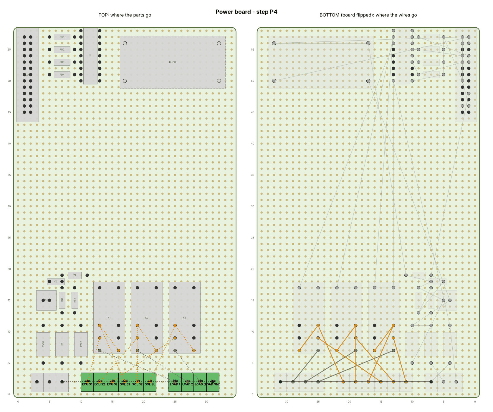

| Part | Value | Goes in | Notes |
|---|---|---|---|
| **J2a** | ECU S1 | 1 col 11, row 2 | X2-1 |
| **J2b** | ECU S2 | 1 col 13, row 2 | X2-2 |
| **J2c** | ECU SL | 1 col 15, row 2 | X2-3 |
| **J2d** | SOL S1 | 1 col 17, row 2 | X2-4 |
| **J2e** | SOL S2 | 1 col 19, row 2 | X2-5 |
| **J2f** | SOL SL | 1 col 21, row 2 | X2-6 |
| **J4a** | LOAD 1 | 1 col 25, row 2 | to dummy resistor 1 |
| **J4b** | LOAD 2 | 1 col 27, row 2 | to 2 |
| **J4c** | LOAD 3 | 1 col 29, row 2 | to 3 |
| **J4d** | LOAD GND | 1 col 31, row 2 | resistors' common |

| Wire | Net | Connect, in this order | Wire |
|---|---|---|---|
| P4.1 | ECU 1 | J2a.1 → K1.COM-A | 20 AWG |
| P4.2 | SOL 1 | J2d.1 → K1.NC-A → K1.NO-B | 20 AWG |
| P4.3 | LOAD 1 | J4a.1 → K1.NO-A | 20 AWG |
| P4.4 | ECU 2 | J2b.1 → K2.COM-A | 20 AWG |
| P4.5 | SOL 2 | J2e.1 → K2.NC-A → K2.NO-B | 20 AWG |
| P4.6 | LOAD 2 | J4b.1 → K2.NO-A | 20 AWG |
| P4.7 | ECU 3 | J2c.1 → K3.COM-A | 20 AWG |
| P4.8 | SOL 3 | J2f.1 → K3.NC-A → K3.NO-B | 20 AWG |
| P4.9 | LOAD 3 | J4c.1 → K3.NO-A | 20 AWG |
| P4.10 | GND | J1c.1 → J4d.1 | 18 AWG |

Use 20 AWG wire for these. They carry the solenoid current (about 1 A).

✅ **Check** (power off, meter on beep):
- **relays off:** J2a–J2d beep (ECU S1 → solenoid S1), likewise J2b–J2e and J2c–J2f; J2a–J4a don't
- **relays on** (bench 12 V on, JA pin 7 to 5 V): J2a–J4a beep (ECU → dummy load) and J2a–J2d
  **don't**.

That's the whole fail-safe: relays off = factory ECU straight through.

### Step P5 — The three solenoid drivers (1.5 h)

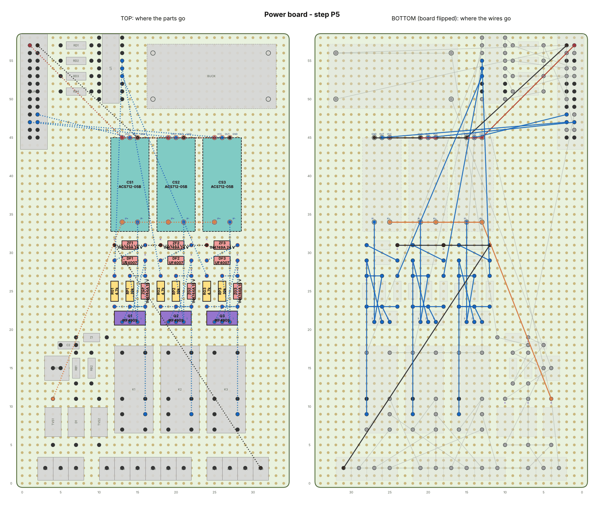

| Part | Value | Goes in | Notes |
|---|---|---|---|
| **Q1** | IRF4905 | G at col 13, row 21 | metal tab towards the back |
| **RG1** | 4.7k | 1 col 12, row 23 → 2 col 12, row 27 | gate drive |
| **RP1** | 10k | 1 col 14, row 23 → 2 col 14, row 27 | gate pull-up (= off) |
| **ZG1** | 1N4744A 15 V | A col 16, row 23 → K col 16, row 27 | band (K) towards the back |
| **DF1** | UF4007 | A col 12, row 29 → K col 16, row 29 | band (K) right |
| **ZF1** | 1N4749A 24 V | A col 16, row 31 → K col 12, row 31 | band (K) left |
| **CS1** | ACS712-05B | on foam tape, IP+ at col 13, row 34 | foam tape; screw terminals towards the front |
| **Q2** | IRF4905 | G at col 19, row 21 | metal tab towards the back |
| **RG2** | 4.7k | 1 col 18, row 23 → 2 col 18, row 27 | gate drive |
| **RP2** | 10k | 1 col 20, row 23 → 2 col 20, row 27 | gate pull-up (= off) |
| **ZG2** | 1N4744A 15 V | A col 22, row 23 → K col 22, row 27 | band (K) towards the back |
| **DF2** | UF4007 | A col 18, row 29 → K col 22, row 29 | band (K) right |
| **ZF2** | 1N4749A 24 V | A col 22, row 31 → K col 18, row 31 | band (K) left |
| **CS2** | ACS712-05B | on foam tape, IP+ at col 19, row 34 | foam tape; screw terminals towards the front |
| **Q3** | IRF4905 | G at col 25, row 21 | metal tab towards the back |
| **RG3** | 4.7k | 1 col 24, row 23 → 2 col 24, row 27 | gate drive |
| **RP3** | 10k | 1 col 26, row 23 → 2 col 26, row 27 | gate pull-up (= off) |
| **ZG3** | 1N4744A 15 V | A col 28, row 23 → K col 28, row 27 | band (K) towards the back |
| **DF3** | UF4007 | A col 24, row 29 → K col 28, row 29 | band (K) right |
| **ZF3** | 1N4749A 24 V | A col 28, row 31 → K col 24, row 31 | band (K) left |
| **CS3** | ACS712-05B | on foam tape, IP+ at col 25, row 34 | foam tape; screw terminals towards the front |

| Wire | Net | Connect, in this order | Wire |
|---|---|---|---|
| P5.1 | +12 DRV | TVS1.K → CS1.IP+ | 20 AWG |
| P5.2 | SRC1 | CS1.IP- → Q1.S → RP1.2 → ZG1.K | 20 AWG |
| P5.3 | GATE1 | Q1.G → RP1.1 → ZG1.A → RG1.1 | 22 AWG |
| P5.4 | GDRV1 | RG1.2 → U1.15 | 22 AWG |
| P5.5 | DOUT1 | Q1.D → DF1.K → K1.COM-B | 20 AWG |
| P5.6 | CLAMP1 | DF1.A → ZF1.A | 22 AWG |
| P5.7 | GND | J4d.1 → ZF1.K | 22 AWG |
| P5.8 | 5V | JA.1 → CS1.VCC | 22 AWG |
| P5.9 | GND | JA.2 → CS1.GND | 22 AWG |
| P5.10 | IS1 (A4) | CS1.OUT → JA.20 | 22 AWG |
| P5.11 | +12 DRV | CS1.IP+ → CS2.IP+ | 20 AWG |
| P5.12 | SRC2 | CS2.IP- → Q2.S → RP2.2 → ZG2.K | 20 AWG |
| P5.13 | GATE2 | Q2.G → RP2.1 → ZG2.A → RG2.1 | 22 AWG |
| P5.14 | GDRV2 | RG2.2 → U1.14 | 22 AWG |
| P5.15 | DOUT2 | Q2.D → DF2.K → K2.COM-B | 20 AWG |
| P5.16 | CLAMP2 | DF2.A → ZF2.A | 22 AWG |
| P5.17 | GND | ZF1.K → ZF2.K | 22 AWG |
| P5.18 | 5V | CS1.VCC → CS2.VCC | 22 AWG |
| P5.19 | GND | CS1.GND → CS2.GND | 22 AWG |
| P5.20 | IS2 (A5) | CS2.OUT → JA.21 | 22 AWG |
| P5.21 | +12 DRV | CS2.IP+ → CS3.IP+ | 20 AWG |
| P5.22 | SRC3 | CS3.IP- → Q3.S → RP3.2 → ZG3.K | 20 AWG |
| P5.23 | GATE3 | Q3.G → RP3.1 → ZG3.A → RG3.1 | 22 AWG |
| P5.24 | GDRV3 | RG3.2 → U1.13 | 22 AWG |
| P5.25 | DOUT3 | Q3.D → DF3.K → K3.COM-B | 20 AWG |
| P5.26 | CLAMP3 | DF3.A → ZF3.A | 22 AWG |
| P5.27 | GND | ZF2.K → ZF3.K | 22 AWG |
| P5.28 | 5V | CS2.VCC → CS3.VCC | 22 AWG |
| P5.29 | GND | CS2.GND → CS3.GND | 22 AWG |
| P5.30 | IS3 (A6) | CS3.OUT → JA.22 | 22 AWG |

- MOSFETs: **metal tab towards the back**. Zeners and diodes: watch the band.
- Current sensors: foam tape, **screw terminals towards the front**. Their IP+/IP− screw
  terminals take the 20 AWG wires; solder the VCC/OUT/GND wires to their header pins.

✅ **Check:** connect one 15 Ω 50 W resistor between **J2d** and **J1c** (a fake solenoid; it
gets warm, so lay it on the heatsink). Then, with the bench 12 V on J1a/J1b/J1c:
1. JA pin 7 → 5 V (relays on), JA pin 8 → 5 V (S1 on): J2d reads ~12 V, the resistor warms, and
   **CS1 OUT** moves from ~2.5 V to ~2.65 V (0.8 A × 0.185 V/A).
2. Remove the JA pin 8 wire: J2d drops to 0 V.
3. Relays **off** (JA pin 7 open), JA pin 8 → 5 V: J2d stays at 0 V (the relay isolates the
   driver).
4. Repeat for S2 (JA pin 9, resistor on J2e) and SL (JA pin 10, resistor on J2f).

### Step P6 — Signal terminals and optocouplers (1.5 h)

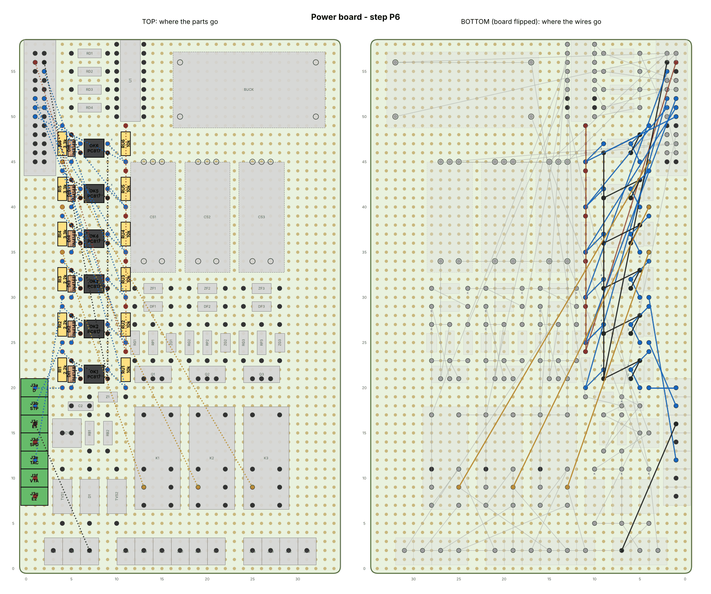

| Part | Value | Goes in | Notes |
|---|---|---|---|
| **J3a** | D | 1 col 1, row 20 | X3-1 lever in D |
| **J3b** | STP | 1 col 1, row 18 | X3-2 brake |
| **J3c** | E1 | 1 col 1, row 16 | X3-3 ECM ground |
| **J3d** | SPD | 1 col 1, row 14 | X3-4 speed |
| **J3e** | TAC | 1 col 1, row 12 | X3-5 tach |
| **J3f** | VTA | 1 col 1, row 10 | X3-6 throttle |
| **J3g** | E2 | 1 col 1, row 8 | X3-7 throttle ground |
| **OK1** | PC817 | 1 at col 6, row 22 | dot (pin 1) top-left |
| **RI1** | 2.2k | 1 col 4, row 20 → 2 col 4, row 24 | input |
| **DI1** | 1N4148 | A col 5, row 23 → K col 5, row 20 | band (K) towards the front |
| **RU1** | 10k | 1 col 11, row 20 → 2 col 11, row 24 | output pull-up |
| **OK2** | PC817 | 1 at col 6, row 27 | dot (pin 1) top-left |
| **RI2** | 2.2k | 1 col 4, row 25 → 2 col 4, row 29 | input |
| **DI2** | 1N4148 | A col 5, row 28 → K col 5, row 25 | band (K) towards the front |
| **RU2** | 10k | 1 col 11, row 25 → 2 col 11, row 29 | output pull-up |
| **OK3** | PC817 | 1 at col 6, row 32 | dot (pin 1) top-left |
| **RI3** | 2.2k | 1 col 4, row 30 → 2 col 4, row 34 | input |
| **DI3** | 1N4148 | A col 5, row 33 → K col 5, row 30 | band (K) towards the front |
| **RU3** | 10k | 1 col 11, row 30 → 2 col 11, row 34 | output pull-up |
| **OK4** | PC817 | 1 at col 6, row 37 | dot (pin 1) top-left |
| **RI4** | 3.3k | 1 col 4, row 35 → 2 col 4, row 39 | input |
| **DI4** | 1N4148 | A col 5, row 38 → K col 5, row 35 | band (K) towards the front |
| **RU4** | 10k | 1 col 11, row 35 → 2 col 11, row 39 | output pull-up |
| **OK5** | PC817 | 1 at col 6, row 42 | dot (pin 1) top-left |
| **RI5** | 3.3k | 1 col 4, row 40 → 2 col 4, row 44 | input |
| **DI5** | 1N4148 | A col 5, row 43 → K col 5, row 40 | band (K) towards the front |
| **RU5** | 10k | 1 col 11, row 40 → 2 col 11, row 44 | output pull-up |
| **OK6** | PC817 | 1 at col 6, row 47 | dot (pin 1) top-left |
| **RI6** | 3.3k | 1 col 4, row 45 → 2 col 4, row 49 | input |
| **DI6** | 1N4148 | A col 5, row 48 → K col 5, row 45 | band (K) towards the front |
| **RU6** | 10k | 1 col 11, row 45 → 2 col 11, row 49 | output pull-up |

| Wire | Net | Connect, in this order | Wire |
|---|---|---|---|
| P6.1 | D in | J3a.1 → RI1.1 | 22 AWG |
| P6.2 | LED OK1 | RI1.2 → OK1.1 → DI1.K | 22 AWG |
| P6.3 | GND | OK1.2 → DI1.A → OK1.3 | 22 AWG |
| P6.4 | LEVD (D28) | OK1.4 → RU1.1 → JA.12 | 22 AWG |
| P6.5 | 5V | JA.3 → RU1.2 | 22 AWG |
| P6.6 | GND | JA.4 → OK1.3 | 22 AWG |
| P6.7 | STP in | J3b.1 → RI2.1 | 22 AWG |
| P6.8 | LED OK2 | RI2.2 → OK2.1 → DI2.K | 22 AWG |
| P6.9 | GND | OK2.2 → DI2.A → OK2.3 | 22 AWG |
| P6.10 | STP (D27) | OK2.4 → RU2.1 → JA.11 | 22 AWG |
| P6.11 | 5V | RU1.2 → RU2.2 | 22 AWG |
| P6.12 | GND | OK1.3 → OK2.3 | 22 AWG |
| P6.13 | TAC in | J3e.1 → RI3.1 | 22 AWG |
| P6.14 | LED OK3 | RI3.2 → OK3.1 → DI3.K | 22 AWG |
| P6.15 | GND | OK3.2 → DI3.A → OK3.3 | 22 AWG |
| P6.16 | TAC (D3) | OK3.4 → RU3.1 → JA.6 | 22 AWG |
| P6.17 | 5V | RU2.2 → RU3.2 | 22 AWG |
| P6.18 | GND | OK2.3 → OK3.3 | 22 AWG |
| P6.19 | ECU 1 | K1.COM-A → RI4.1 | 22 AWG |
| P6.20 | LED OK4 | RI4.2 → OK4.1 → DI4.K | 22 AWG |
| P6.21 | GND | OK4.2 → DI4.A → OK4.3 | 22 AWG |
| P6.22 | ECU1 (D29) | OK4.4 → RU4.1 → JA.13 | 22 AWG |
| P6.23 | 5V | RU3.2 → RU4.2 | 22 AWG |
| P6.24 | GND | OK3.3 → OK4.3 | 22 AWG |
| P6.25 | ECU 2 | K2.COM-A → RI5.1 | 22 AWG |
| P6.26 | LED OK5 | RI5.2 → OK5.1 → DI5.K | 22 AWG |
| P6.27 | GND | OK5.2 → DI5.A → OK5.3 | 22 AWG |
| P6.28 | ECU2 (D30) | OK5.4 → RU5.1 → JA.14 | 22 AWG |
| P6.29 | 5V | RU4.2 → RU5.2 | 22 AWG |
| P6.30 | GND | OK4.3 → OK5.3 | 22 AWG |
| P6.31 | ECU 3 | K3.COM-A → RI6.1 | 22 AWG |
| P6.32 | LED OK6 | RI6.2 → OK6.1 → DI6.K | 22 AWG |
| P6.33 | GND | OK6.2 → DI6.A → OK6.3 | 22 AWG |
| P6.34 | ECU3 (D31) | OK6.4 → RU6.1 → JA.15 | 22 AWG |
| P6.35 | 5V | RU5.2 → RU6.2 | 22 AWG |
| P6.36 | GND | OK5.3 → OK6.3 | 22 AWG |
| P6.37 | GND | J3c.1 → J1c.1 | 20 AWG |

PC817s: dot (pin 1) top-left, as in the picture. The small 1N4148s: band towards the front.

✅ **Check** (bench 12 V on, so 5 V is on the ribbon header): each output idles at 5 V and
drops below 0.5 V when its input gets 12 V:
- 12 V on J3a (D) → JA pin 12 low
- 12 V on J3b (STP) → JA pin 11 low
- 12 V on J3e (TAC) → JA pin 6 low
- 12 V on J2a / J2b / J2c → JA pins 13 / 14 / 15 low

### Step P7 — Speed-signal comparator (45 min)

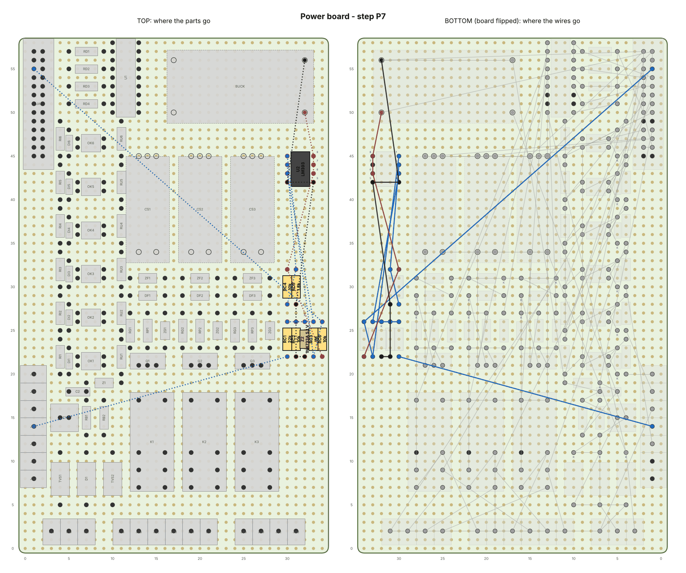

| Part | Value | Goes in | Notes |
|---|---|---|---|
| **U2** | LM393 | 1 at col 30, row 45 | notch / dot (pin 1) top-left |
| **RC1** | 22k | 1 col 30, row 22 → 2 col 30, row 26 | SPD in |
| **RC2** | 10k | 1 col 31, row 22 → 2 col 31, row 26 | SPD to ground |
| **Z2** | 1N4733A 5.1 V | A col 32, row 22 → K col 32, row 26 | band (K) towards the back |
| **RC3** | 1M | 1 col 33, row 22 → 2 col 33, row 26 | hysteresis |
| **RC6** | 10k | 1 col 34, row 22 → 2 col 34, row 26 | output pull-up |
| **RC4** | 10k | 1 col 30, row 28 → 2 col 30, row 32 | threshold, top |
| **RC5** | 1.8k | 1 col 31, row 28 → 2 col 31, row 32 | threshold, bottom (0.76 V) |

| Wire | Net | Connect, in this order | Wire |
|---|---|---|---|
| P7.1 | SPD in | J3d.1 → RC1.1 | 22 AWG |
| P7.2 | SPDIN | RC1.2 → RC2.2 → Z2.K → RC3.2 → U2.3 | 22 AWG |
| P7.3 | SPD (D2) | U2.1 → RC3.1 → RC6.2 → JA.5 | 22 AWG |
| P7.4 | REF | RC4.1 → RC5.2 → U2.2 | 22 AWG |
| P7.5 | 5V | BUCK.OUT+ → U2.8 → U2.6 → RC4.2 → RC6.1 | 22 AWG |
| P7.6 | GND | BUCK.OUT- → U2.4 → U2.5 → RC5.1 → RC2.1 → Z2.A | 22 AWG |

✅ **Check:** J3d (SPD) open → JA pin 5 reads ~0 V. 5 V on J3d → JA pin 5 reads ~5 V. 12 V on J3d
→ also ~5 V. (Threshold ≈ 2.4 V at the input.)

### Step P8 — Throttle taps (30 min)

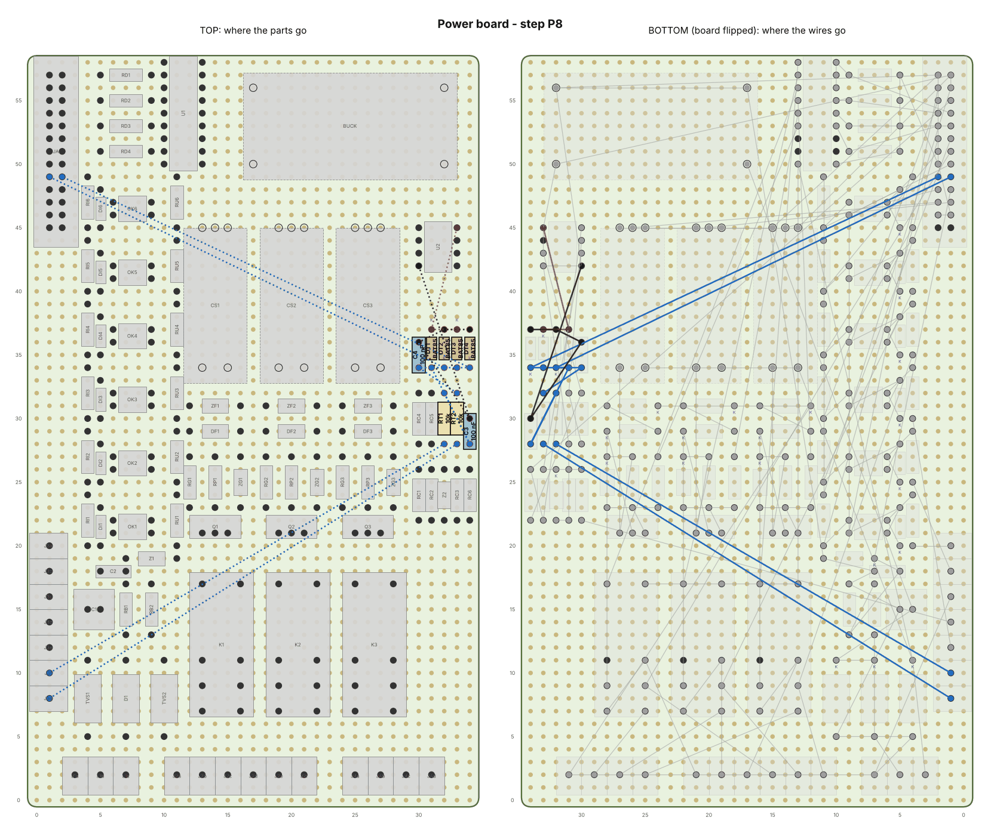

| Part | Value | Goes in | Notes |
|---|---|---|---|
| **RT1** | 10k | 1 col 32, row 28 → 2 col 32, row 32 | VTA series |
| **RT2** | 10k | 1 col 33, row 28 → 2 col 33, row 32 | E2 series |
| **C3** | 100 nF | 1 col 34, row 28 → 2 col 34, row 30 | VTA filter |
| **C4** | 100 nF | 1 col 30, row 34 → 2 col 30, row 36 | E2 filter |
| **DT1** | BAT85 | A col 31, row 34 → K col 31, row 37 | VTA to 5 V; band (K) towards the back |
| **DT2** | BAT85 | A col 32, row 37 → K col 32, row 34 | GND to VTA; band (K) towards the front |
| **DT3** | BAT85 | A col 33, row 34 → K col 33, row 37 | E2 to 5 V; band (K) towards the back |
| **DT4** | BAT85 | A col 34, row 37 → K col 34, row 34 | GND to E2; band (K) towards the front |

| Wire | Net | Connect, in this order | Wire |
|---|---|---|---|
| P8.1 | VTA in | J3f.1 → RT1.1 | 22 AWG |
| P8.2 | E2 in | J3g.1 → RT2.1 | 22 AWG |
| P8.3 | VTA (A0) | RT1.2 → C3.1 → DT1.A → DT2.K → JA.17 | 22 AWG |
| P8.4 | E2 (A1) | RT2.2 → C4.1 → DT3.A → DT4.K → JA.18 | 22 AWG |
| P8.5 | 5V | U2.8 → DT1.K → DT3.K | 22 AWG |
| P8.6 | GND | U2.4 → C3.2 → C4.2 → DT2.A → DT4.A | 22 AWG |

✅ **Check:** 5 V (from JA pin 1) on J3f (VTA) → JA pin 17 reads ~5 V. J3f to ground → 0 V.
Same for J3g → JA pin 18.

**Power board done.** Look over the underside with a bright light for solder splashes and
whiskers between pads. Write "POWER" on it.

---

## Part 5 — Logic board

Console inputs, OLED and ATF probe terminals, and the gyro.

For the checks, power it with 5 V from the power board: JA pin 1 → JB pin 1, JA pin 2 → JB pin 2,
using two jumper wires (or wait for the hub and the ribbons).

### Step L1 — Terminals, header B and the 5 V / ground rails (45 min)

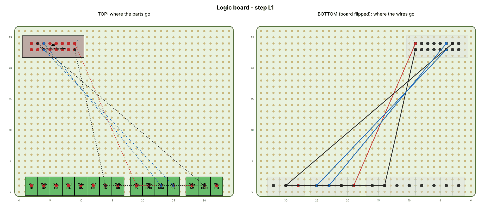

| Part | Value | Goes in | Notes |
|---|---|---|---|
| **X4a** | C1 | 1 col 2, row 1 | X4-1: C1 [+] |
| **X4b** | C2 | 1 col 4, row 1 | X4-2: C2 [−] |
| **X4c** | C3 | 1 col 6, row 1 | X4-3: C3 ECO |
| **X4d** | C4 | 1 col 8, row 1 | X4-4: C4 SPORT |
| **X4e** | C5 | 1 col 10, row 1 | X4-5: C5 ON/OFF |
| **X4f** | C6 | 1 col 12, row 1 | X4-6: C6 TEST |
| **X4g** | C7 | 1 col 14, row 1 | X4-7: C7 GND |
| **X4h** | C8 | 1 col 16, row 1 | X4-8: C8 LED |
| **X5a** | 5V | 1 col 19, row 1 | X5-1 OLED |
| **X5b** | GND | 1 col 21, row 1 | X5-2 OLED |
| **X5c** | SDA | 1 col 23, row 1 | X5-3 OLED |
| **X5d** | SCL | 1 col 25, row 1 | X5-4 OLED |
| **X6a** | 5V | 1 col 28, row 1 | X6-1 ATF probe |
| **X6b** | GND | 1 col 30, row 1 | X6-2 ATF probe |
| **X6c** | DQ | 1 col 32, row 1 | X6-3 ATF probe |
| **JB** | 16-pin box header | 1 at col 9, row 24 | notch facing the back edge; pin 1 (square pad) at the right-hand end, back row |

| Wire | Net | Connect, in this order | Wire |
|---|---|---|---|
| L1.1 | 5V | JB.1 → X5a.1 → X6a.1 | 22 AWG |
| L1.2 | GND | JB.2 → X4g.1 → X5b.1 → X6b.1 → JB.13 | 22 AWG |
| L1.3 | SDA (D20) | JB.11 → X5c.1 | 22 AWG |
| L1.4 | SCL (D21) | JB.12 → X5d.1 | 22 AWG |

Header B's notch faces the **back** edge; pin 1 (square pad) is at the **right-hand end**, back row.

✅ **Check** (5 V on): X5a and X6a read 5 V, X5b and X6b read 0 V.

### Step L2 — Six console input filters (1 h)

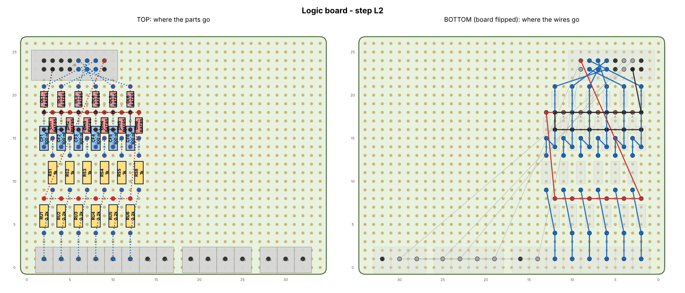

| Part | Value | Goes in | Notes |
|---|---|---|---|
| **RU1** | 2.2k | 1 col 2, row 4 → 2 col 2, row 8 | pull-up |
| **RS1** | 1k | 1 col 3, row 9 → 2 col 3, row 13 | series |
| **CF1** | 100 nF | 1 col 2, row 14 → 2 col 2, row 16 |  |
| **DH1** | BAT85 | A col 3, row 15 → K col 3, row 18 | band (K) towards the back |
| **DL1** | BAT85 | A col 2, row 18 → K col 2, row 21 | band (K) towards the back |
| **RU2** | 2.2k | 1 col 4, row 4 → 2 col 4, row 8 | pull-up |
| **RS2** | 1k | 1 col 5, row 9 → 2 col 5, row 13 | series |
| **CF2** | 100 nF | 1 col 4, row 14 → 2 col 4, row 16 |  |
| **DH2** | BAT85 | A col 5, row 15 → K col 5, row 18 | band (K) towards the back |
| **DL2** | BAT85 | A col 4, row 18 → K col 4, row 21 | band (K) towards the back |
| **RU3** | 2.2k | 1 col 6, row 4 → 2 col 6, row 8 | pull-up |
| **RS3** | 1k | 1 col 7, row 9 → 2 col 7, row 13 | series |
| **CF3** | 100 nF | 1 col 6, row 14 → 2 col 6, row 16 |  |
| **DH3** | BAT85 | A col 7, row 15 → K col 7, row 18 | band (K) towards the back |
| **DL3** | BAT85 | A col 6, row 18 → K col 6, row 21 | band (K) towards the back |
| **RU4** | 2.2k | 1 col 8, row 4 → 2 col 8, row 8 | pull-up |
| **RS4** | 1k | 1 col 9, row 9 → 2 col 9, row 13 | series |
| **CF4** | 100 nF | 1 col 8, row 14 → 2 col 8, row 16 |  |
| **DH4** | BAT85 | A col 9, row 15 → K col 9, row 18 | band (K) towards the back |
| **DL4** | BAT85 | A col 8, row 18 → K col 8, row 21 | band (K) towards the back |
| **RU5** | 2.2k | 1 col 10, row 4 → 2 col 10, row 8 | pull-up |
| **RS5** | 1k | 1 col 11, row 9 → 2 col 11, row 13 | series |
| **CF5** | 100 nF | 1 col 10, row 14 → 2 col 10, row 16 |  |
| **DH5** | BAT85 | A col 11, row 15 → K col 11, row 18 | band (K) towards the back |
| **DL5** | BAT85 | A col 10, row 18 → K col 10, row 21 | band (K) towards the back |
| **RU6** | 2.2k | 1 col 12, row 4 → 2 col 12, row 8 | pull-up |
| **RS6** | 1k | 1 col 13, row 9 → 2 col 13, row 13 | series |
| **CF6** | 100 nF | 1 col 12, row 14 → 2 col 12, row 16 |  |
| **DH6** | BAT85 | A col 13, row 15 → K col 13, row 18 | band (K) towards the back |
| **DL6** | BAT85 | A col 12, row 18 → K col 12, row 21 | band (K) towards the back |

| Wire | Net | Connect, in this order | Wire |
|---|---|---|---|
| L2.1 | C1 | X4a.1 → RU1.1 → RS1.1 | 22 AWG |
| L2.2 | IN1 (JB.3) | RS1.2 → DH1.A → CF1.1 → DL1.K → JB.3 | 22 AWG |
| L2.3 | C2 | X4b.1 → RU2.1 → RS2.1 | 22 AWG |
| L2.4 | IN2 (JB.4) | RS2.2 → DH2.A → CF2.1 → DL2.K → JB.4 | 22 AWG |
| L2.5 | C3 | X4c.1 → RU3.1 → RS3.1 | 22 AWG |
| L2.6 | IN3 (JB.5) | RS3.2 → DH3.A → CF3.1 → DL3.K → JB.5 | 22 AWG |
| L2.7 | C4 | X4d.1 → RU4.1 → RS4.1 | 22 AWG |
| L2.8 | IN4 (JB.6) | RS4.2 → DH4.A → CF4.1 → DL4.K → JB.6 | 22 AWG |
| L2.9 | C5 | X4e.1 → RU5.1 → RS5.1 | 22 AWG |
| L2.10 | IN5 (JB.7) | RS5.2 → DH5.A → CF5.1 → DL5.K → JB.7 | 22 AWG |
| L2.11 | C6 | X4f.1 → RU6.1 → RS6.1 | 22 AWG |
| L2.12 | IN6 (JB.8) | RS6.2 → DH6.A → CF6.1 → DL6.K → JB.8 | 22 AWG |
| L2.13 | 5V | JB.1 → RU1.2 → RU2.2 → RU3.2 → RU4.2 → RU5.2 → RU6.2 → DH6.K → DH5.K → DH4.K → DH3.K → DH2.K → DH1.K | 22 AWG |
| L2.14 | GND | JB.14 → DL1.A → DL2.A → DL3.A → DL4.A → DL5.A → DL6.A → CF6.2 → CF5.2 → CF4.2 → CF3.2 → CF2.2 → CF1.2 | 22 AWG |

✅ **Check** (5 V on): each X4 terminal C1–C6 reads ~5 V. Short it to X4g (C7, ground): the
matching JB pin 3–8 drops to 0 V.

### Step L3 — Status-LED resistor and the ATF probe parts (20 min)

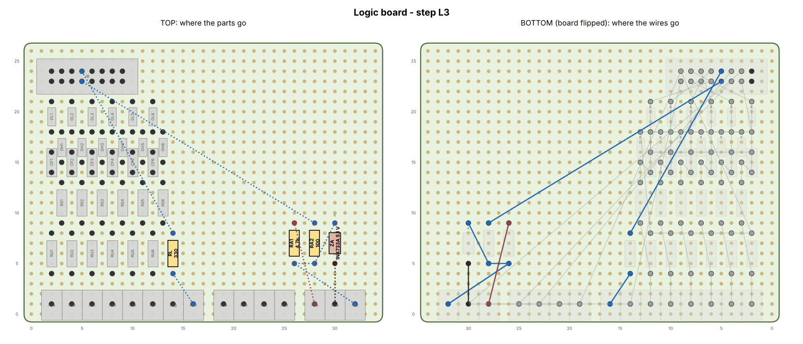

| Part | Value | Goes in | Notes |
|---|---|---|---|
| **RL** | 330 | 1 col 14, row 4 → 2 col 14, row 8 | status LED |
| **RA1** | 4.7k | 1 col 26, row 5 → 2 col 26, row 9 | ATF pull-up |
| **RA2** | 100 | 1 col 28, row 5 → 2 col 28, row 9 | ATF series |
| **ZA** | 1N4733A 5.1 V | A col 30, row 5 → K col 30, row 9 | band (K) towards the back |

| Wire | Net | Connect, in this order | Wire |
|---|---|---|---|
| L3.1 | LED (D7) | JB.9 → RL.2 | 22 AWG |
| L3.2 | C8 LED+ | RL.1 → X4h.1 | 22 AWG |
| L3.3 | DQ | X6c.1 → RA1.1 → RA2.1 → ZA.K | 22 AWG |
| L3.4 | ATF (D33) | RA2.2 → JB.10 | 22 AWG |
| L3.5 | 5V | X6a.1 → RA1.2 | 22 AWG |
| L3.6 | GND | X6b.1 → ZA.A | 22 AWG |

✅ **Check** (5 V on): X6c (DQ) reads ~5 V (the 4.7k pull-up).

### Step L4 — The gyro (20 min)

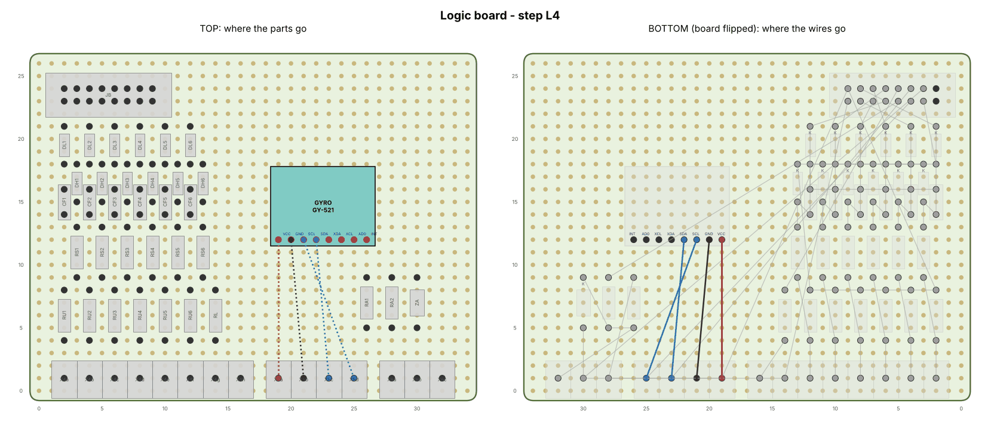

| Part | Value | Goes in | Notes |
|---|---|---|---|
| **GYRO** | GY-521 | VCC at col 19, row 12 | chip side up, flat on its header + a dab of hot glue |

| Wire | Net | Connect, in this order | Wire |
|---|---|---|---|
| L4.1 | 5V | X5a.1 → GYRO.VCC | 22 AWG |
| L4.2 | GND | X5b.1 → GYRO.GND | 22 AWG |
| L4.3 | SCL (D21) | X5d.1 → GYRO.SCL | 22 AWG |
| L4.4 | SDA (D20) | X5c.1 → GYRO.SDA | 22 AWG |

The gyro sits **chip side up, flat on its header**, like a little table. Push it down flat
before soldering, then put a dab of hot glue under its far edge. It's the reason the TCU box is
mounted level.

✅ **Check** (5 V on): the GY-521's small LED lights.

---

## Part 6 — Hub shield on the Mega

The Mega prototype shield carries two box headers, A (26-way, to the power board) and B (16-way,
to the logic board). Each header pin gets one short wire to its Mega pin on the shield.

1. Solder **header A** near the shield's right-hand end, notch facing the board edge, and
   **header B** along the front edge. Keep both clear of the USB socket end. Put a strip of
   electrical tape on top of the Mega's USB socket, so the shield can't touch it.
2. Solder one 22–24 AWG wire from each header pin to its Mega pin, as in the table. **Tick each
   row as you go.**

| Header A pin | Signal | Mega pin |
|---|---|---|
| A1 | 5V | **5V** |
| A2 | GND | **GND** |
| A3 | 5V | **5V** |
| A4 | GND | **GND** |
| A5 | SPD (speed) | **D2** |
| A6 | TAC (tach) | **D3** |
| A7 | RLY (relays) | **D6** |
| A8 | DRV1 (S1 driver) | **D8** |
| A9 | DRV2 (S2 driver) | **D9** |
| A10 | DRV3 (SL driver) | **D10** |
| A11 | STP (brake) | **D27** |
| A12 | LEVD (lever in D) | **D28** |
| A13 | ECU1 (ECU S1) | **D29** |
| A14 | ECU2 (ECU S2) | **D30** |
| A15 | ECU3 (ECU SL) | **D31** |
| A16 | GND | **GND** |
| A17 | VTA (throttle) | **A0** |
| A18 | E2 (throttle ground) | **A1** |
| A19 | VBAT (battery) | **A3** |
| A20 | IS1 (S1 current) | **A4** |
| A21 | IS2 (S2 current) | **A5** |
| A22 | IS3 (SL current) | **A6** |
| A23 | GND | **GND** |
| A24 | GND | **GND** |
| A25 | – | **not connected** |
| A26 | – | **not connected** |

| Header B pin | Signal | Mega pin |
|---|---|---|
| B1 | 5V | **5V** |
| B2 | GND | **GND** |
| B3 | C1 [+] | **D22** |
| B4 | C2 [−] | **D23** |
| B5 | C3 ECO | **D24** |
| B6 | C4 SPORT | **D25** |
| B7 | C5 ON/OFF | **D26** |
| B8 | C6 TEST | **D32** |
| B9 | LED | **D7** |
| B10 | ATF probe | **D33** |
| B11 | SDA | **D20 (SDA)** |
| B12 | SCL | **D21 (SCL)** |
| B13 | GND | **GND** |
| B14 | GND | **GND** |
| B15 | – | **not connected** |
| B16 | – | **not connected** |

✅ **Check** (power off, meter on beep): plug the shield onto the Mega. Beep each header pin to
its Mega pin, on the Mega's own header. Then beep neighbouring pins: none may beep each other
(5 V and GND pins excepted).

---

## Part 7 — Console pod and shifter

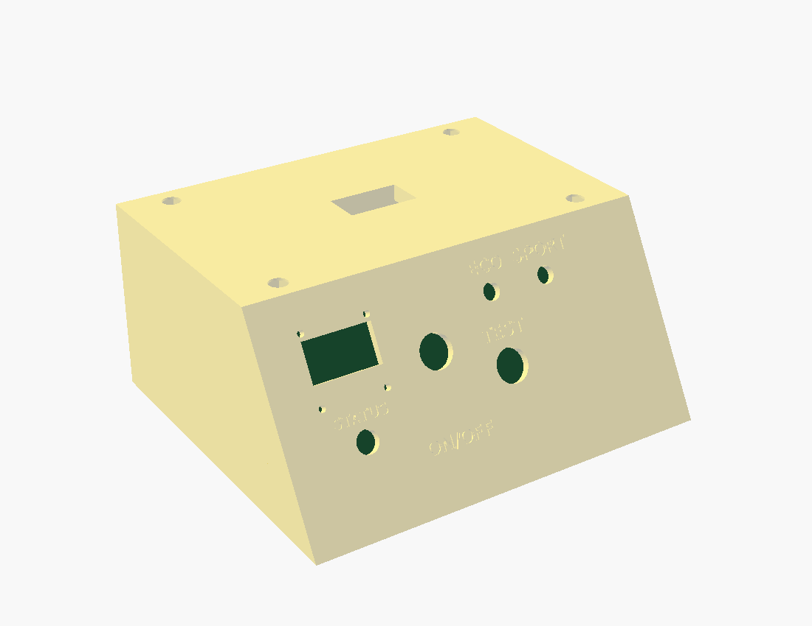

1. Heat-set the **four M3 inserts** into the pod's corner bosses (iron at 230–250 °C, push in
   square, flush).
2. Fit the **ON/OFF toggle with its flip-up cover** (cover hinge at the top), the **ECO** and
   **SPORT** mini toggles, the **TEST** button, and the **LED bezel**, all tightened from inside.
3. **OLED:** solder four 15 cm wires straight to its pads (no header). Mount it behind the window
   with 4 × M2 screws, with one M2 nut under each corner as a spacer so the glass isn't squeezed.
4. Fit the two **PG7 glands** in the back wall. Feed the **8-core console cable** through one,
   and the **4-core OLED cable** through the other.
5. Wire it up with lever nuts (Wago), one per console core:

| Core | Goes to |
|---|---|
| C1 | upshift switch NO (or the [+] button) |
| C2 | downshift switch NO (or the [−] button) |
| C3 | ECO switch |
| C4 | SPORT switch |
| C5 | ON/OFF switch |
| C6 | TEST button |
| C7 (ground) | the other side of **every** switch and button, both shifter switches' COM, and the LED's short leg (−) |
| C8 | LED long leg (+) |

   The OLED cable's 4 cores go straight to the OLED's 5V / GND / SDA / SCL wires.
6. **Shifter:** build the Beavis lever from its guide, in PETG/ASA. Use only its two
   **V-155-1C25** switches and skip the Arduino Pro Micro. Run the switch wires down through
   the deck slot into the lever nuts above.
7. Drop **four M6 nuts** into the traps under the deck. Cut the M6 bolts to **shifter base
   thickness + 6 mm** and bolt the shifter down.
8. Close the pod onto its bottom plate later, in the car (part 11.4).

✅ **Check** (meter on beep, at the cable's far end): C3–C7 beeps only with ECO on; C4 with
SPORT; C5 with ON/OFF; C6 with TEST pressed; C1 and C2 with the lever pulled and pushed. With the
meter on diode test, C8 (+) to C7 (−) lights the LED dimly.

---

## Part 8 — Dummy loads on the heatsink

1. Thermal paste under each **15 Ω 50 W resistor**. Bolt each to the heatsink with 2 × M3.
2. Solder one end of all three resistors together with 18 AWG silicone wire: that's the
   **common** (→ J4d, LOAD GND).
3. Solder an 18 AWG silicone wire to the other end of each resistor: **LOAD 1 / 2 / 3** (→ J4a /
   J4b / J4c). Twist the four wires together. This is the cable for the **LOAD** gland.

✅ **Check:** each LOAD wire reads 15 Ω to the common, and none of them beeps to the heatsink.

---

## Part 9 — Bench test the whole system

Everything is connected on the bench, outside the box, before anything is fixed down.

1. Plug the hub shield onto the Mega. Plug **ribbon A** (power board ↔ header A) and **ribbon
   B** (logic board ↔ header B). Pin 1 is the red stripe; the keys only fit one way.
2. Console cable cores **C1–C8 → X4a–X4h** on the logic board. OLED cable → X5 (5V, GND, SDA,
   SCL). ATF probe → X6 (red 5V, black GND, yellow DQ).
3. Dummy loads: **LOAD 1/2/3/common → J4a/J4b/J4c/J4d**. Use the three resistors as fake
   solenoids too, with three short jumpers: **J2d → J4a, J2e → J4b, J2f → J4c**. (Only for this
   test: in the car the solenoids do this job.)
4. **Flash the firmware:** install the Arduino IDE, open `firmware/tcu/tcu.ino`, choose
   **Tools → Board → Arduino Mega 2560** and your USB port, then press **Upload**. (Command-line
   option: `make avr` in the repository, then upload with `avrdude`.)
5. Bench 12 V → **J1a and J1b** (+) and **J1c** (−). The USB cable can stay plugged in: the buck
   is set to 5.00 V, the same as USB.

✅ **Checks:**
- The OLED shows the **MAIN** page and `NOT CALIBRATED` (correct: you calibrate in the car).
- The **SENSORS** page shows: battery ~12 V; ATF probe at room temperature; throttle 0 %; speed
  0; S1/S2/SL amps 0.00.
- **Calibrate the current sensors:** with ON/OFF **off**, hold TEST for 2 s to start the self-test. When it reaches
  the solenoid tests, each should read about **12 V ÷ 15 Ω ≈ 0.8 A** (use your measured supply
  voltage). If they're off by more than 10 %, adjust `IS_AMPS_PER_VOLT` in
  `firmware/tcu/config.h`, re-upload and repeat.
- **The whole self-test passes:**
  - power, throttle, ATF, gyro, switches and lamps
  - each solenoid draws its current
  - relay release
  - each switch prompt: flip ECO, flip SPORT, pull and push the lever, press the brake (put
    12 V on J3b), and so on
- Flip ON/OFF on and off: the status LED behaves as the README describes.

Fix anything that fails now, on the bench, where everything is easy to reach.

---

## Part 10 — Close up the TCU box

1. Heat-set the **four M3 inserts** into the box's corner bosses.
2. Fit the **seven glands**: PG7 for CON, OLED, ATF; PG9 for SIG, PWR, SOL, LOAD.
3. Screw down the **Mega**, the **power board** (right, terminals to the front) and the **logic
   board** (front left) on their standoffs, 14 × M3 × 6. The board names are engraved on the
   floor. Plug the hub shield back onto the Mega and plug both ribbons back in.
4. **Cable tails:** for each gland, push a cable through and wire it to its terminals inside. Put
   the **box half** of its Deutsch connector on the outside end, about 30 cm out. Pin-outs are in
   [wiring guide §3](03-wiring-guide.md).

| Gland | Cable | Inside, to | Outside connector |
|---|---|---|---|
| CON | 8-core from the pod | X4a–X4h | (direct to the pod, or an 8-way DT pair as X4) |
| OLED | 4-core from the pod | X5a–X5d | (direct, or a 4-way DT pair as X5) |
| ATF | 3-core | X6a–X6c | X6, 3-way |
| SIG | 7 × 22 AWG (D, STP, E1, SPD, TAC, VTA, E2) | J3a–J3g | X3, 8-way |
| PWR | 16 AWG red, red, black | J1a, J1b, J1c | X1, 3-way |
| SOL | 6 × 18 AWG | J2a–J2f | X2, 6-way |
| LOAD | the heatsink's 4 wires | J4a–J4d | (direct to the heatsink) |

5. Make the **bypass plug**: a 6-way DT plug that mates with the car half of X2, with jumpers
   1–4, 2–5, 3–6. Label it. Keep it in the glovebox.
6. Tighten every gland nut, then screw on the lid (4 × M3 countersunk).

✅ **Check:** repeat the part 9 self-test through the connectors. Everything passes.

---

## Part 11 — Install in the car

One stage per evening. **After each stage the car is drivable and behaves exactly as stock**,
because the box isn't in control until the solenoid wires are intercepted (11.6), and even then
only with the ON/OFF switch on.

**Disconnect the battery's negative terminal before every stage.** Solder and heat-shrink every
tap; no Scotch-lock taps.

### 11.1 Mount the box and the heatsink
- Bolt the box **flat** behind the glovebox (ears or floor holes, M5/M6 into metal). Check it
  with a phone level: within 5°.
- Bolt the heatsink where air moves, at least 50 mm from plastic, wiring and the box.

### 11.2 Power (W1–W3)
- Fuse tap in the **IG fuse** you found in part 0 → **5 A** inline fuse → X1-1, and a separate
  **2 A** inline fuse → X1-2, both within 20 cm of the tap. X1-3 → body ground bolt (bare metal,
  star washer).
- Battery on, **ON/OFF switch OFF**, key ON.

✅ **Check:** the screen shows MAIN within a second; after 1.5 s the power-up test shows no
faults apart from `NOT CALIBRATED`. Key OFF: the screen goes dark.

### 11.3 Signal taps (W10–W16)
- At the ECM, tap each wire from your part 0 table into the X3 car half: D, STP, E1, SPD, TAC,
  VTA, E2 ([wiring guide §4–5](03-wiring-guide.md)). Twist SPD with TAC, and VTA with E2.

✅ **Check** (SENSORS page): throttle 0 % → ~100 % as you press the pedal (engine off); rpm
~700–800 at idle; brake shows when pressed; lever D shows only in D; speed reads 0 parked and
something sensible on a gentle drive (it isn't calibrated yet).

### 11.4 Console pod
- Bolt the pod's bottom plate to the console (4 slots, large washers), then screw the shell onto
  it from underneath. Route its two cables to the box under the trim.

✅ **Check:** hold TEST for 2 s: every switch prompt passes, and the gyro reads ~0.00 g parked.

### 11.5 ATF probe (cold engine)
- Follow [wiring guide §9](03-wiring-guide.md#the-atf-temperature-probe): tee into the **hot**
  line on a straight rubber section, port sideways, probe sealed, clamps tight. Route the
  cable through a firewall grommet to X6.
- Start the engine, shift through every gear, check for leaks, and check the ATF level hot on
  the dipstick. Top up.

✅ **Check:** ATF temperature climbs as the engine warms, within a few degrees of an IR
thermometer pointed at the tee. No drips after a drive.

### 11.6 Solenoid intercept (W4–W9): the last connection
- Battery off. Confirm S1/S2/SL once more with the continuity test (4WD: transaxle pins
  B3/B6/B5). Cut each wire, then fit the X2 car half: ECM side → pins 1–3, solenoid side → 4–6.
- Plug in X2. **ON/OFF stays OFF.**

✅ **Check:** drive a normal loop. It must drive **exactly** as before: same shift points, same
feel. Then swap in the **bypass plug** and drive again: also identical. Read the OBD-II scanner:
no trouble codes.

---

## Part 12 — Calibrate, unlock, test drive

1. **Calibrate** with ON/OFF **OFF** ([spec §8](02-revised-spec.md)): drive normally for a few
   days with the laptop logging over USB, and use the GPS app for the speed check. This sets the
   speed scaling, throttle range and gear ratios, and logs the factory shift points.
2. **Unlock:** set `CALIBRATED = true` in `firmware/tcu/config.h` and re-upload.
3. **Test in stages** ([spec §9](02-revised-spec.md)), stopping at the first problem:
   1. In the driveway, self-test (hold TEST).
   2. **On four jack stands with all four wheels off the ground** (your RAV4 is full-time 4WD;
      never with only the front wheels up), ON/OFF on: go through the gears and watch the
      screen.
   3. An empty car park: ECO, NORMAL, SPORT, then MANUAL with the lever.
   4. The road.

✅ **Check:** flip ON/OFF off at any time, and the car is back on the factory computer
immediately. Keep it within reach for the first drives.

---

*Generated board steps come from [`tools/boards.py`](../tools/boards.py); the parts list and
prices from [`tools/shopping_list.py`](../tools/shopping_list.py).*
