# Build book: 1999 RAV4 transmission controller

<!-- Generated by tools/boards.py from tools/build_book_template.md. Edit the template, then run
     python3 tools/boards.py -->

**Follow it like a Lego book.** One small step at a time, in order. Every step has a picture,
a list of what you need, and boxes to tick. Many steps end with a **✅ CHECK**: don't go on
until it passes. A mistake found right away takes a minute to fix; found at the end, it takes
a weekend.

You don't need to understand the electronics to build it. If you can match a picture, read a
ruler and solder a wire, you can do this.

| Part | What you do | Time |
|---|---|---|
| [0](#part-0--look-at-the-car) | Look at the car and measure (nothing is cut) | 1 evening |
| [1](#part-1--buy-the-parts) | Buy the parts | 1 evening + delivery |
| [2](#part-2--start-printing) | Start printing (it runs while you solder) | ~45 h of printing |
| [3](#part-3--get-ready) | Get the bench ready, sort parts into bags | 1 h |
| [4](#part-4--power-board) | Power board | 3 evenings |
| [5](#part-5--logic-board) | Logic board | 1 evening |
| [6](#part-6--hub-on-the-mega) | Hub on the Mega | 1 evening |
| [7](#part-7--screen) | Screen | 1 h |
| [8](#part-8--dash-pod-and-shifter-base) | Dash pod and shifter base | 1 evening |
| [9](#part-9--dummy-loads) | Dummy loads on the heatsink | 30 min |
| [10](#part-10--test-everything-on-the-bench) | Test everything on the bench | 1 evening |
| [11](#part-11--close-the-box) | Close the box, make the cable ends | 1 evening |
| [12](#part-12--put-it-in-the-car) | Put it in the car | 4 evenings, one job each |
| [13](#part-13--calibrate-and-drive) | Calibrate and drive | a week of normal driving |

---

## Before you start: three skills

**1. The multimeter.** You only need two settings:
- **Beep** (the speaker symbol). Touch the two probes to two points: a beep means they are
  connected.
- **Volts DC** (V with a straight line). Black probe on ground, red probe on the point you're
  measuring.

**2. Soldering a part.** Push the legs through the holes. Turn the board over and bend the
legs out a little so the part can't fall out. Touch the iron to the leg *and* the pad together
for 2 seconds, feed in solder until it flows around the leg like a little volcano, take the
solder away, then the iron. Snip the leg off just above the joint.

**3. Soldering a wire.** Strip 4 mm off the end, twist the strands, and melt a little solder
into them ("tinning"). Hold it against the leg on the underside, touch the iron to both, and
it joins. For a wire that visits several pins, strip a short window of insulation at each stop
(or use separate short wires from pin to pin; both work).

**Safety:** disconnect the car's battery before every car job. Let hot parts cool down. Wear
eye protection when snipping legs: they fly.

---

## Part 0 — Look at the car

Nothing is cut or changed today. You're finding things and writing them down.

**You need:** the repair manual (RM) and wiring diagram (EWD) for your VIN, a multimeter, a tape
measure, a pen, your phone.

- [ ] **Transaxle code.** Find the ID plate on the transaxle and write down the code (on a 4WD,
  A241H or A540H).
- [ ] **Fuse size.** Pull out one fuse in the cabin fuse box. Is it a **standard** or a **mini**
  blade? Write it down.
- [ ] **A key-ON fuse.** In the EWD, find a fuse that only has power with the key ON (an "IG"
  fuse). Check with the meter: 12 V with the key ON, 0 V with it OFF.
- [ ] **Cooler hose size.** At the radiator, find the two ATF cooler hoses ([wiring guide §9](03-wiring-guide.md#the-atf-temperature-probe)).
  Measure the rubber hose's inside size: **5/16"** or **3/8"**.
- [ ] **Which hose is hot.** Start the cold engine, wait 2 minutes, and feel both hoses. The
  one that warms first is the **hot hose**. Put a piece of tape on it.
- [ ] **A spot for the box.** Kneel at the passenger footwell and look up under the dash, below
  the glovebox. You need a metal spot (the dash support, or somewhere to hang a steel bracket)
  for a box **216 × 178 × 51 mm** (244 mm wide with its ears), with ~10 cm in front for the
  cables, clear of the passenger's knees and the heater ducts. That's the best place: you can
  reach it later without taking anything apart. No room? Take out the glovebox and look behind
  it instead. Also find somewhere nearby for the heatsink (100 × 100 × 25 mm) where air moves.
  ([Why these spots](03-wiring-guide.md#where-the-tcu-box-goes).)
- [ ] **A spot for the dash pod** (200 × 64 × 64 mm, on a small tilting mount) on the **dash top,
  driver's side**. Sit in the driver's seat: you must see it without it blocking the road or the
  gauges. **Never over the passenger airbag** (the right-hand half of the dash top).
- [ ] **Room for the shifter base** (150 × 100 mm) on the centre console next to the gear lever,
  long side pointing front-to-back. With the shifter on it, it's about **35 cm tall**: check it
  clears the dash and the radio. Move a hand through the full lever travel: it mustn't hit the
  gear lever, handbrake, cup holder or your knee.
- [ ] **The ECM wires.** Find the engine computer (RM: "location of components"). For each wire
  below, do the meter test in [wiring guide §5](03-wiring-guide.md) and fill in the table.
  **Don't cut anything.** Take photos.

| Signal | ECM terminal | Wire colour | Test OK? |
|---|---|---|---|
| S1 | | | ☐ |
| S2 | | | ☐ |
| SL | | | ☐ |
| SPD | | | ☐ |
| TAC | | | ☐ |
| VTA | | | ☐ |
| E2 | | | ☐ |
| E1 | | | ☐ |
| STP | | | ☐ |
| D | | | ☐ |

✅ **CHECK:** every box ticked. If a test doesn't match the guide, stop and work out why before
you buy anything.

---

## Part 1 — Buy the parts

- [ ] Open the [shopping list](04-shopping-list.md) (about $650 in parts).
- [ ] Choose the brass tee for **your hose size** and the fuse tap for **your fuse size**.
- [ ] Order the electronic parts from **DigiKey or Mouser**, and the modules and kits from
  **Amazon** (or AliExpress: cheaper, slower).
- [ ] Get the rest at a **hardware store** and an **auto-parts store**.

✅ **CHECK:** as boxes arrive, tick each line of the shopping list.

---

## Part 2 — Start printing

Prints take a long time, so start them first. They print while you solder parts 4 to 7.

**PETG or ASA, never PLA** (PLA goes soft in a hot car). Settings: 0.2 mm layers, 4 walls,
30–40 % infill, no supports. More detail: [hardware/README.md](../hardware/README.md).

- [ ] **First, the panel test** (`hardware/stl/dash_pod_panel_test.stl`, about 1 hour): a flat
  copy of the dash pod's front. When your switches and screen arrive, push each one into its
  hole to check it fits. If a hole is too tight, change its size in `hardware/dash_pod.scad`
  before printing the real pod.
- [ ] TCU box: `tcu_enclosure_box.stl` (about 12 h). On a 220 mm printer:
  `tcu_enclosure_box_no_ears.stl`.
- [ ] TCU lid: `tcu_enclosure_lid.stl` (about 4 h).
- [ ] Dash pod: `dash_pod_shell.stl` (about 7 h, prints front face down).
- [ ] Dash pod back cover: `dash_pod_back.stl` (about 2 h) and mount: `dash_pod_mount.stl`
  (about 1 h).
- [ ] Shifter base: `shifter_base_box.stl` (about 5 h, prints upside down) and its bottom plate:
  `shifter_base_bottom.stl` (about 2 h).
- [ ] The shifter's own parts, from [`hardware/beavis_shifter/`](../hardware/beavis_shifter/README.md)
  (by bbeavis; about 1.5 days): `MainBody.stl` and `ShifterShaft.stl` with 3 walls and ~50 %
  infill, **4 ×** `SwitchSpacer.stl`, and if you want them `PivotPin.stl`, `PivotCap.stl`,
  `Knob.stl`. PETG, not the PLA its author used. Skip `BottomCover.stl`.

✅ **CHECK:** each print lies flat on the table without rocking.

---

## Part 3 — Get ready

- [ ] Clear a table. Iron at about 330 °C, solder, flux, wire cutters, strippers, meter, hot glue.
- [ ] **Bench power:** the 12 V adapter → the screw-terminal plug → a **5 A fuse** on the + wire.
  Every bench test goes through this fuse.
- [ ] **Print the two board templates** at **100 % size** ("fit to page" OFF):
  [power board](build/power-template.svg), [logic board](build/logic-template.svg). Measure
  them: 90 × 150 mm and 90 × 70 mm. Tape each to its perfboard.
- [ ] If a perfboard has no corner holes, drill four 3 mm holes, 3 mm in from each corner.
- [ ] **Sort the parts into bags**, one per step, and write the step name on each bag. Then
  each step is just "open the bag":

- [ ] **Bag P1**: 3× 5.08 mm screw-terminal positions; 2× 1.5KE27A diode; 1× 1N5822 diode; 1× 100 µF 50 V capacitor; 1× 47k resistor (yellow-violet-black-red-brown); 1× 10k resistor (brown-black-black-red-brown); 1× 100 nF capacitor; 1× 1N4733A 5.1 V diode; 1× LM2596HV module
- [ ] **Bag P2**: 1× 26-pin box header
- [ ] **Bag P3**: 1× ULN2803A chip; 4× 10k resistor (brown-black-black-red-brown); 3× G2RL-2 12 V relay
- [ ] **Bag P4**: 10× 5.08 mm screw-terminal positions
- [ ] **Bag P5**: 3× IRF4905 MOSFET; 3× 4.7k resistor (yellow-violet-black-brown-brown); 3× 10k resistor (brown-black-black-red-brown); 3× 1N4744A 15 V diode; 3× UF4007 diode; 3× 1N4749A 24 V diode; 3× ACS712-05B module
- [ ] **Bag P6**: 7× 5.08 mm screw-terminal positions; 6× PC817 chip; 3× 2.2k resistor (red-red-black-brown-brown); 6× 1N4148 diode; 6× 10k resistor (brown-black-black-red-brown); 3× 3.3k resistor (orange-orange-black-brown-brown)
- [ ] **Bag P7**: 1× LM393 chip; 1× 22k resistor (red-red-black-red-brown); 3× 10k resistor (brown-black-black-red-brown); 1× 1N4733A 5.1 V diode; 1× 1M resistor (brown-black-black-yellow-brown); 1× 1.8k resistor (brown-grey-black-brown-brown)
- [ ] **Bag P8**: 2× 10k resistor (brown-black-black-red-brown); 2× 100 nF capacitor; 4× BAT85 diode
- [ ] **Bag L1**: 16× 5.08 mm screw-terminal positions; 1× 16-pin box header
- [ ] **Bag L2**: 7× 2.2k resistor (red-red-black-brown-brown); 7× 1k resistor (brown-black-black-brown-brown); 7× 100 nF capacitor; 14× BAT85 diode
- [ ] **Bag L3**: 1× 4.7k resistor (yellow-violet-black-brown-brown); 1× 100 resistor (brown-black-black-black-brown); 1× 1N4733A 5.1 V diode
- [ ] **Bag L4**: 1× GY-521 module

✅ **CHECK:** the meter reads about 12 V after the fuse, and every bag is full.

---

## Part 4 — Power board

The big board. It handles everything that connects to the car's wiring.

**How to read the pictures:**
- **"Place the parts" pages** show the board from the **top**. New parts are coloured, parts
  you already fitted are grey. Red dots are the holes the new legs go through. The numbers
  along the edges count holes, so "col 5, row 57" means 5 holes across and 57 up.
- **"Solder the wires" pages** show the board **flipped over** (left and right swapped, like a
  mirror). Each numbered wire goes from its number's end along the coloured line, stopping at
  every dot.
- **Diodes:** the purple circle marks the end where the **stripe (band)** goes.
- **Chips:** the red circle with a "1" marks **pin 1**: put the chip's notch or dot there.
- **Resistors:** match the colour bands in the "YOU NEED" box (or check with the meter on Ω).

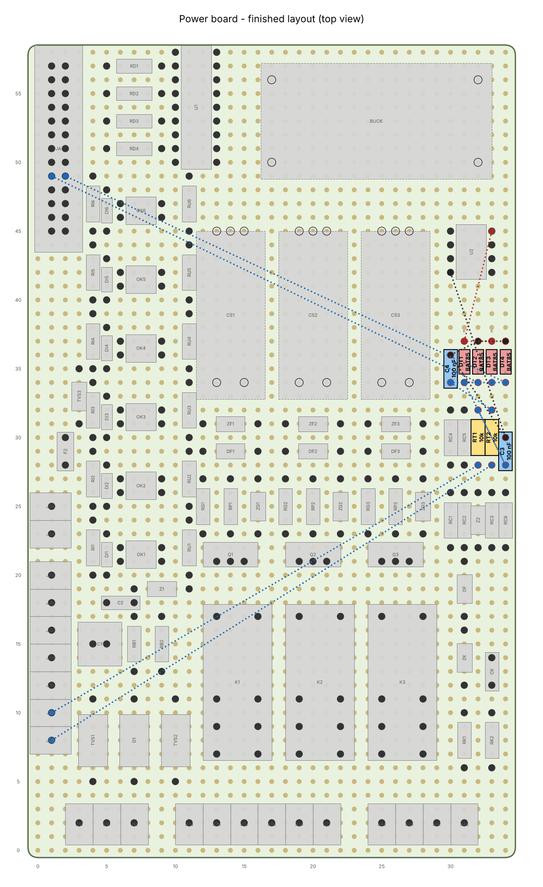

### Step P1 — Power in

#### P1.1 — Place 6 parts

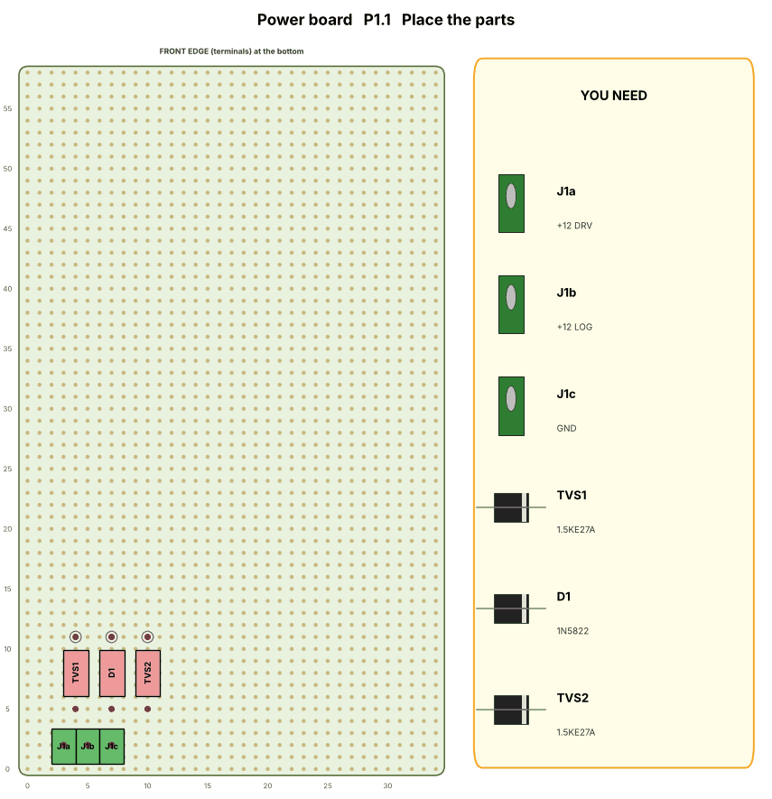

- [ ] **J1a**: +12 DRV screw terminal → col 3, row 2. X1-1 (5 A fuse)
- [ ] **J1b**: +12 LOG screw terminal → col 5, row 2. X1-2 (2 A fuse)
- [ ] **J1c**: GND screw terminal → col 7, row 2. X1-3 (body ground)
- [ ] **TVS1**: 1.5KE27A diode → col 4, row 5 and col 4, row 11. Band (K) towards the back
- [ ] **D1**: 1N5822 diode → col 7, row 5 and col 7, row 11. Band (K) towards the back
- [ ] **TVS2**: 1.5KE27A diode → col 10, row 5 and col 10, row 11. Band (K) towards the back

Push the legs through, bend them out a little underneath, solder, snip.

#### P1.2 — Place 6 parts

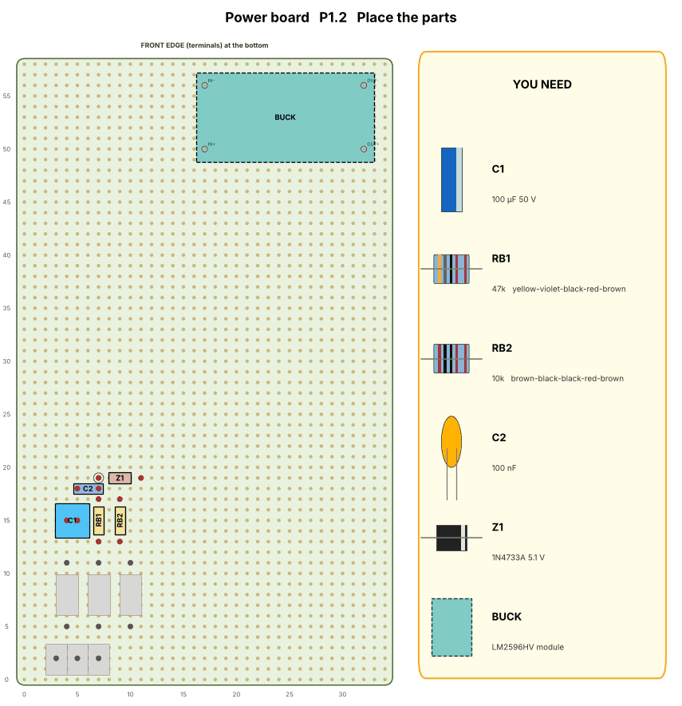

- [ ] **C1**: 100 µF 50 V capacitor → col 4, row 15 and col 5, row 15. Long leg (+) left, stripe (−) right
- [ ] **RB1**: 47k resistor (bands: yellow-violet-black-red-brown) → col 7, row 13 and col 7, row 17. Battery sense, top
- [ ] **RB2**: 10k resistor (bands: brown-black-black-red-brown) → col 9, row 13 and col 9, row 17. Battery sense, bottom
- [ ] **C2**: 100 nF capacitor → col 5, row 18 and col 7, row 18
- [ ] **Z1**: 1N4733A 5.1 V diode → col 11, row 19 and col 7, row 19. Band (K) left
- [ ] **BUCK**: LM2596HV module module → stick it down with foam tape where shown. Foam tape; set to 5.0 V before wiring 5 V anywhere

Push the legs through, bend them out a little underneath, solder, snip.

#### P1.3 — Solder 6 wires (bottom side)

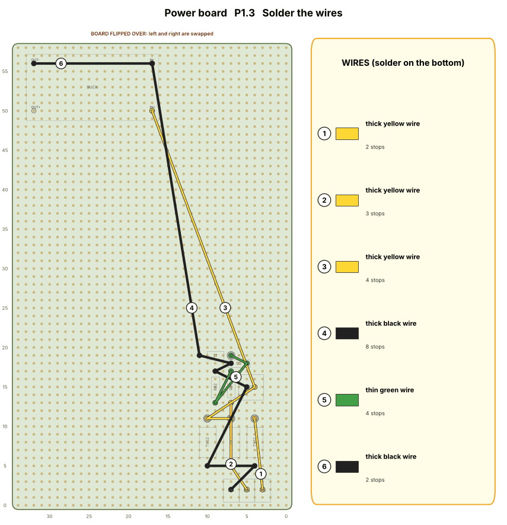

- [ ] **1** yellow 18 AWG: **J1a** (+12 DRV) → **TVS1** band end
- [ ] **2** yellow 20 AWG: **J1b** (+12 LOG) → **D1** plain end → **RB1** at col 7, row 13
- [ ] **3** yellow 20 AWG: **D1** band end → **TVS2** band end → **C1** + leg → **BUCK** IN+
- [ ] **4** black 18 AWG: **J1c** (GND) → **TVS1** plain end → **TVS2** plain end → **C1** − leg → **RB2** at col 9, row 17 → **C2** at col 7, row 18 → **Z1** plain end → **BUCK** IN-
- [ ] **5** green 22 AWG: **RB1** at col 7, row 17 → **RB2** at col 9, row 13 → **C2** at col 5, row 18 → **Z1** band end
- [ ] **6** black 20 AWG: **BUCK** IN- → **BUCK** OUT-

**Now set the 5 V supply** (the buck module comes set to the wrong voltage):
- [ ] Connect the bench 12 V: **+ to J1b**, **− to J1c**.
- [ ] Meter on volts, across the buck module's **OUT+** and **OUT−**.
- [ ] Turn its little brass screw until the meter shows **5.00 V** (many turns, either way).
- [ ] Put a dab of hot glue on the screw so it can't move.

✅ **CHECK:** buck output 4.95–5.05 V. Now swap the bench wires the wrong way round for one
second: the buck output must read **0 V** (the protection works). Put them back.

### Step P2 — Ribbon socket

#### P2.1 — Place 1 part

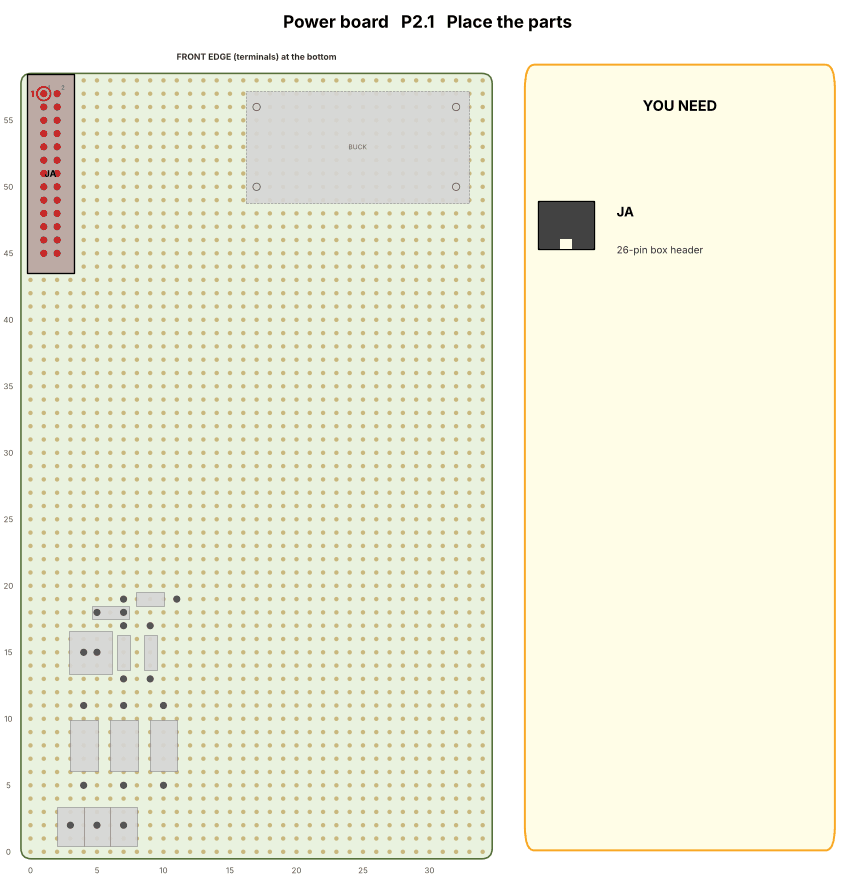

- [ ] **JA**: 26-pin box header box header → pin 1 in col 1, row 57. Notch facing the left edge; pin 1 (square pad) at the back

Push the legs through, bend them out a little underneath, solder, snip.

#### P2.2 — Solder 3 wires (bottom side)

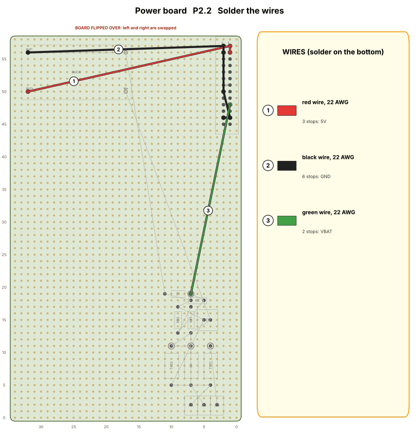

- [ ] **1** red 22 AWG: **BUCK** OUT+ → **JA** pin 1 → **JA** pin 3
- [ ] **2** black 22 AWG: **BUCK** OUT- → **JA** pin 2 → **JA** pin 4 → **JA** pin 16 → **JA** pin 23 → **JA** pin 24
- [ ] **3** green 22 AWG: **Z1** band end → **JA** pin 19

✅ **CHECK** (bench 12 V on J1b/J1c): JA pin 1 and pin 3 read **5 V** (black probe on JA pin 2).

### Step P3 — Relays

**Before soldering the relays, do the beep test (2 minutes):**
- [ ] Each relay has 2 pins on their own at one end (the **coil**) and 3 pins down each side.
- [ ] Meter on beep. On each side, the pin **nearest the coil** and the **middle** pin beep:
  those are **NC** and **COM**.
- [ ] Put 12 V on the two coil pins (it clicks). Now the **middle** pin and the **far** pin
  beep: **COM** and **NO**.
- [ ] That matches the pictures. If yours is different, write the real names on the template.

#### P3.1 — Place 6 parts

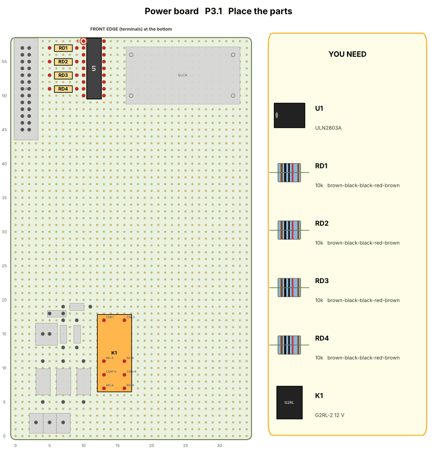

- [ ] **U1**: ULN2803A chip → pin 1 in col 10, row 58. Notch / dot (pin 1) at the back-left
- [ ] **RD1**: 10k resistor (bands: brown-black-black-red-brown) → col 5, row 57 and col 9, row 57. Pull-down, D6
- [ ] **RD2**: 10k resistor (bands: brown-black-black-red-brown) → col 5, row 55 and col 9, row 55. Pull-down, D8
- [ ] **RD3**: 10k resistor (bands: brown-black-black-red-brown) → col 5, row 53 and col 9, row 53. Pull-down, D9
- [ ] **RD4**: 10k resistor (bands: brown-black-black-red-brown) → col 5, row 51 and col 9, row 51. Pull-down, D10
- [ ] **K1**: G2RL-2 12 V relay → COIL1 in col 13, row 17. Coil end at the back

Push the legs through, bend them out a little underneath, solder, snip.

#### P3.2 — Place 2 parts

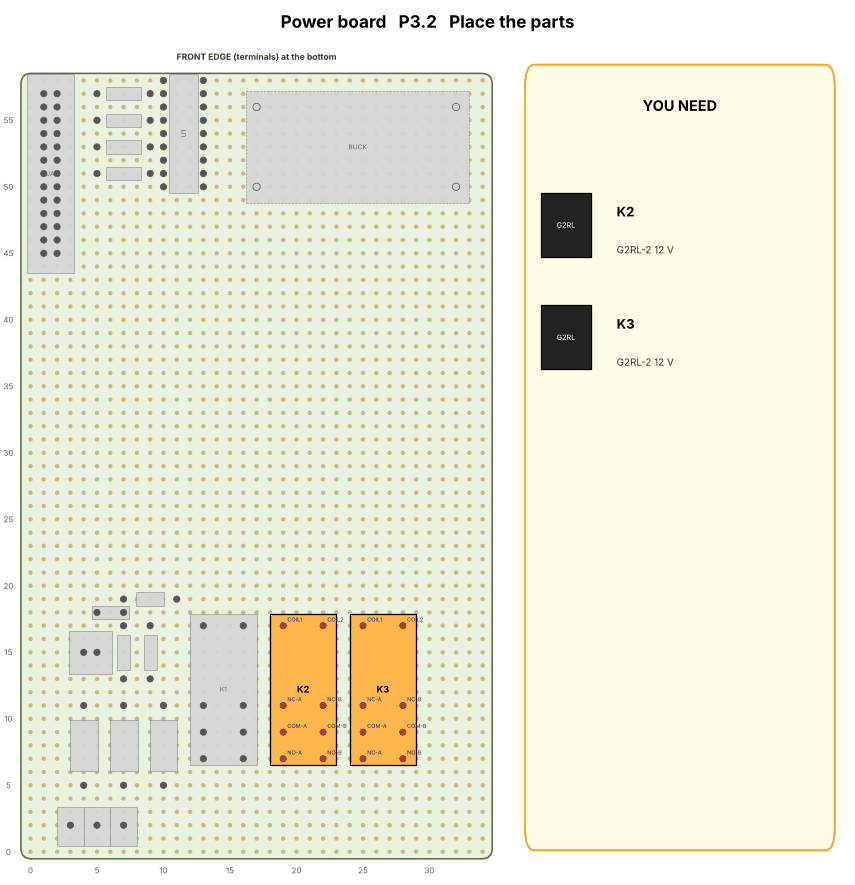

- [ ] **K2**: G2RL-2 12 V relay → COIL1 in col 19, row 17. Coil end at the back
- [ ] **K3**: G2RL-2 12 V relay → COIL1 in col 25, row 17. Coil end at the back

Push the legs through, bend them out a little underneath, solder, snip.

#### P3.3 — Solder 6 wires (bottom side)

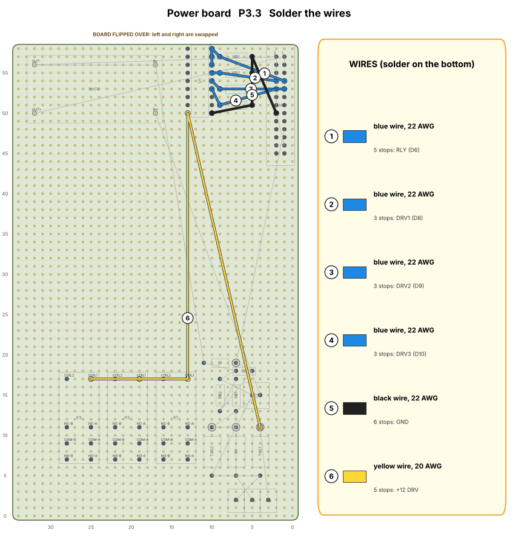

- [ ] **1** blue 22 AWG: **JA** pin 7 → **RD1** at col 9, row 57 → **U1** pin 1 → **U1** pin 2 → **U1** pin 3
- [ ] **2** blue 22 AWG: **JA** pin 8 → **RD2** at col 9, row 55 → **U1** pin 4
- [ ] **3** blue 22 AWG: **JA** pin 9 → **RD3** at col 9, row 53 → **U1** pin 5
- [ ] **4** blue 22 AWG: **JA** pin 10 → **RD4** at col 9, row 51 → **U1** pin 6
- [ ] **5** black 22 AWG: **JA** pin 16 → **RD1** at col 5, row 57 → **RD2** at col 5, row 55 → **RD3** at col 5, row 53 → **RD4** at col 5, row 51 → **U1** pin 9
- [ ] **6** yellow 20 AWG: **TVS1** band end → **U1** pin 10 → **K1** COIL1 → **K2** COIL1 → **K3** COIL1

#### P3.4 — Solder 3 wires (bottom side)

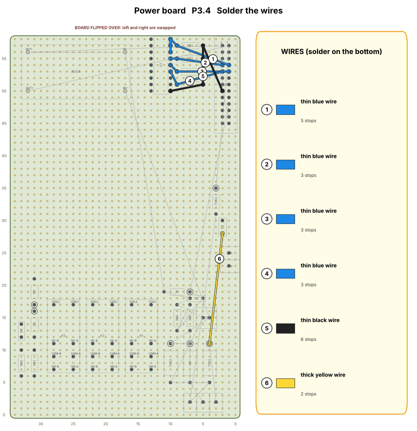

- [ ] **1** green 22 AWG: **U1** pin 18 → **K1** COIL2
- [ ] **2** green 22 AWG: **U1** pin 17 → **K2** COIL2
- [ ] **3** green 22 AWG: **U1** pin 16 → **K3** COIL2

✅ **CHECK** (12 V on J1a **and** J1b, − on J1c): touch a wire from JA pin 1 to **JA pin 7**.
All three relays **click**. Take it away: they click off.

### Step P4 — Solenoid terminals

#### P4.1 — Place 6 parts

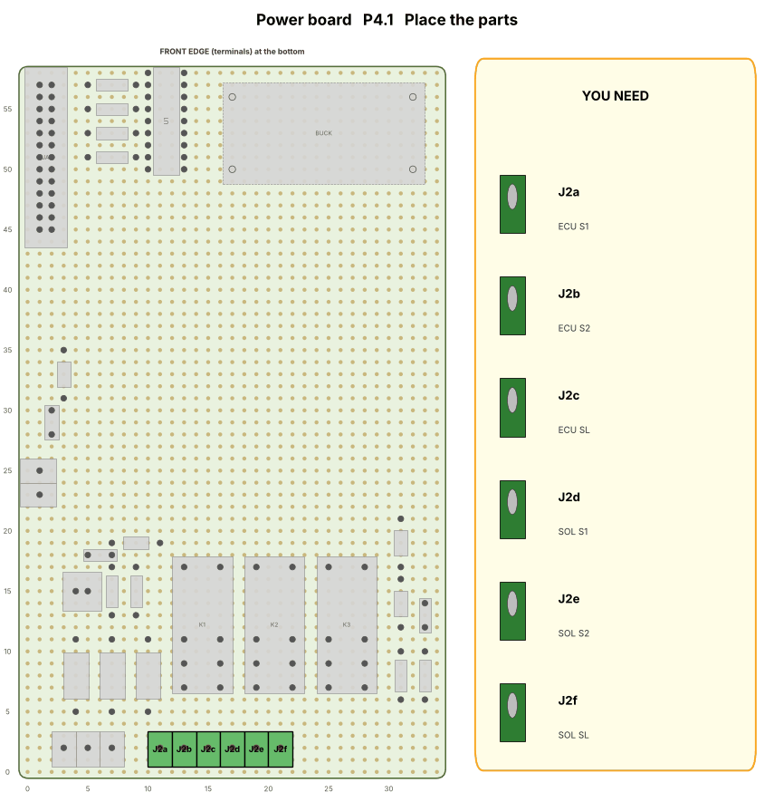

- [ ] **J2a**: ECU S1 screw terminal → col 11, row 2. X2-1
- [ ] **J2b**: ECU S2 screw terminal → col 13, row 2. X2-2
- [ ] **J2c**: ECU SL screw terminal → col 15, row 2. X2-3
- [ ] **J2d**: SOL S1 screw terminal → col 17, row 2. X2-4
- [ ] **J2e**: SOL S2 screw terminal → col 19, row 2. X2-5
- [ ] **J2f**: SOL SL screw terminal → col 21, row 2. X2-6

Push the legs through, bend them out a little underneath, solder, snip.

#### P4.2 — Place 4 parts

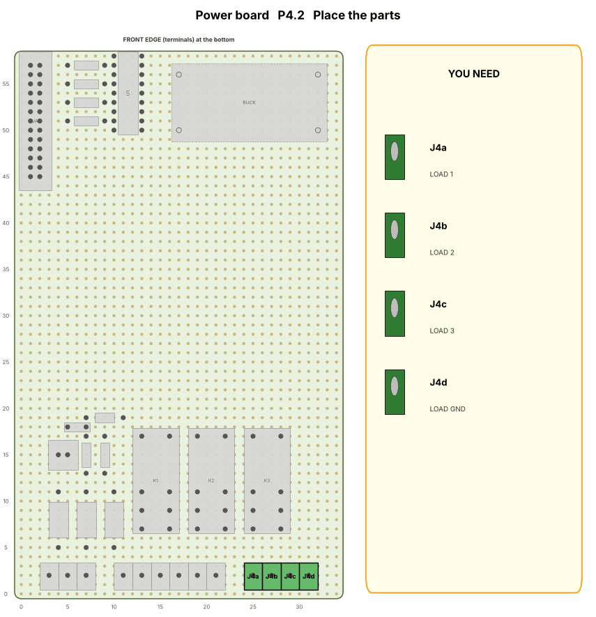

- [ ] **J4a**: LOAD 1 screw terminal → col 25, row 2. To dummy resistor 1
- [ ] **J4b**: LOAD 2 screw terminal → col 27, row 2. To 2
- [ ] **J4c**: LOAD 3 screw terminal → col 29, row 2. To 3
- [ ] **J4d**: LOAD GND screw terminal → col 31, row 2. Resistors' common

Push the legs through, bend them out a little underneath, solder, snip.

#### P4.3 — Solder 6 wires (bottom side)

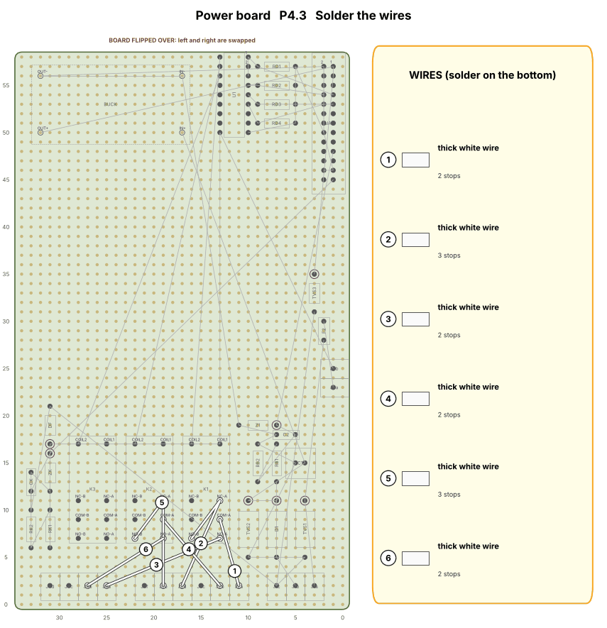

- [ ] **1** white 20 AWG: **J2a** (ECU S1) → **K1** COM-A
- [ ] **2** white 20 AWG: **J2d** (SOL S1) → **K1** NC-A → **K1** NO-B
- [ ] **3** white 20 AWG: **J4a** (LOAD 1) → **K1** NO-A
- [ ] **4** white 20 AWG: **J2b** (ECU S2) → **K2** COM-A
- [ ] **5** white 20 AWG: **J2e** (SOL S2) → **K2** NC-A → **K2** NO-B
- [ ] **6** white 20 AWG: **J4b** (LOAD 2) → **K2** NO-A

#### P4.4 — Solder 4 wires (bottom side)

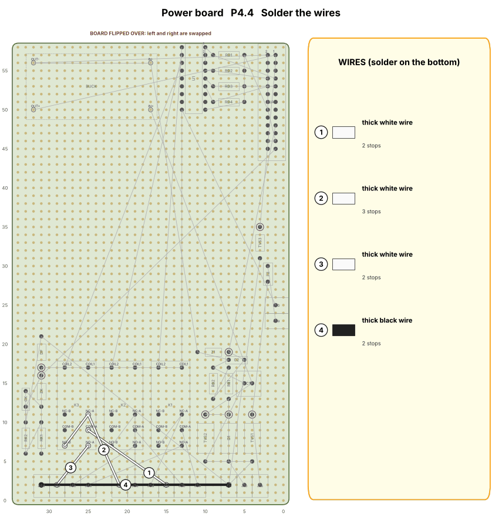

- [ ] **1** white 20 AWG: **J2c** (ECU SL) → **K3** COM-A
- [ ] **2** white 20 AWG: **J2f** (SOL SL) → **K3** NC-A → **K3** NO-B
- [ ] **3** white 20 AWG: **J4c** (LOAD 3) → **K3** NO-A
- [ ] **4** black 18 AWG: **J1c** (GND) → **J4d** (LOAD GND)

✅ **CHECK** (power off, meter on beep):
- [ ] J2a ↔ J2d beep, J2b ↔ J2e beep, J2c ↔ J2f beep (relays off: factory computer straight
  through).
- [ ] Now power on and touch JA pin 1 to JA pin 7 (relays on): J2a ↔ J2d **stop** beeping, and
  J2a ↔ J4a **beep**.

### Step P5 — Solenoid drivers

#### P5.1 — Place 6 parts

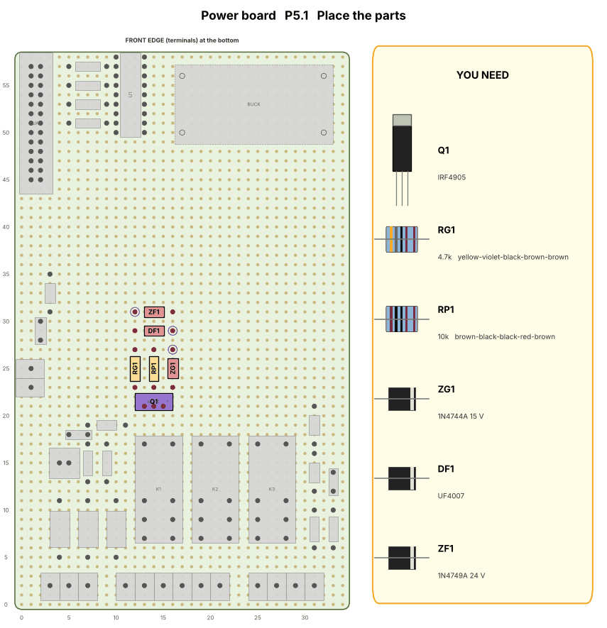

- [ ] **Q1**: IRF4905 MOSFET → G in col 13, row 21. Metal tab towards the back
- [ ] **RG1**: 4.7k resistor (bands: yellow-violet-black-brown-brown) → col 12, row 23 and col 12, row 27. Gate drive
- [ ] **RP1**: 10k resistor (bands: brown-black-black-red-brown) → col 14, row 23 and col 14, row 27. Gate pull-up (= off)
- [ ] **ZG1**: 1N4744A 15 V diode → col 16, row 23 and col 16, row 27. Band (K) towards the back
- [ ] **DF1**: UF4007 diode → col 12, row 29 and col 16, row 29. Band (K) right
- [ ] **ZF1**: 1N4749A 24 V diode → col 16, row 31 and col 12, row 31. Band (K) left

Push the legs through, bend them out a little underneath, solder, snip.

#### P5.2 — Place 6 parts

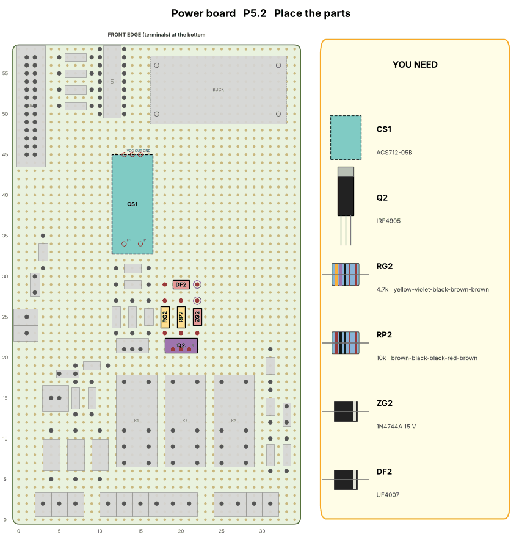

- [ ] **CS1**: ACS712-05B module → stick it down with foam tape where shown. Foam tape; screw terminals towards the front
- [ ] **Q2**: IRF4905 MOSFET → G in col 19, row 21. Metal tab towards the back
- [ ] **RG2**: 4.7k resistor (bands: yellow-violet-black-brown-brown) → col 18, row 23 and col 18, row 27. Gate drive
- [ ] **RP2**: 10k resistor (bands: brown-black-black-red-brown) → col 20, row 23 and col 20, row 27. Gate pull-up (= off)
- [ ] **ZG2**: 1N4744A 15 V diode → col 22, row 23 and col 22, row 27. Band (K) towards the back
- [ ] **DF2**: UF4007 diode → col 18, row 29 and col 22, row 29. Band (K) right

Push the legs through, bend them out a little underneath, solder, snip.

#### P5.3 — Place 6 parts

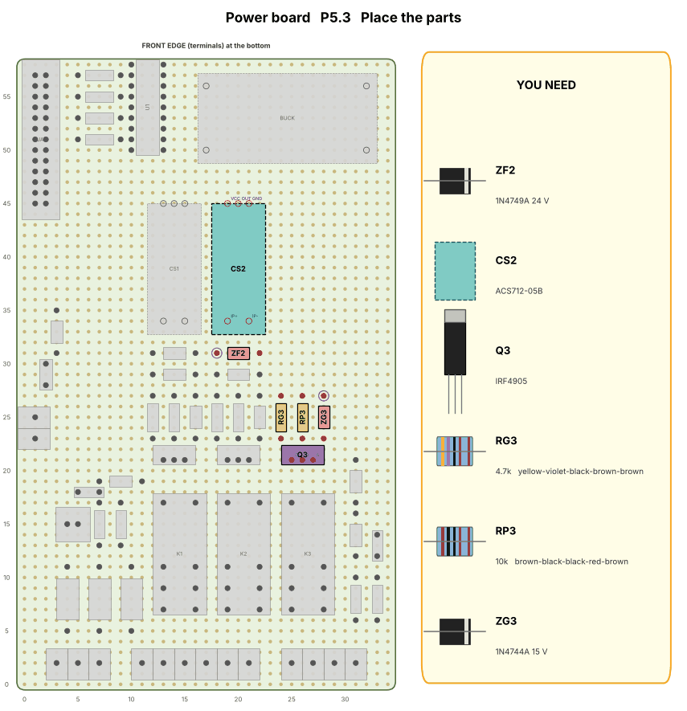

- [ ] **ZF2**: 1N4749A 24 V diode → col 22, row 31 and col 18, row 31. Band (K) left
- [ ] **CS2**: ACS712-05B module → stick it down with foam tape where shown. Foam tape; screw terminals towards the front
- [ ] **Q3**: IRF4905 MOSFET → G in col 25, row 21. Metal tab towards the back
- [ ] **RG3**: 4.7k resistor (bands: yellow-violet-black-brown-brown) → col 24, row 23 and col 24, row 27. Gate drive
- [ ] **RP3**: 10k resistor (bands: brown-black-black-red-brown) → col 26, row 23 and col 26, row 27. Gate pull-up (= off)
- [ ] **ZG3**: 1N4744A 15 V diode → col 28, row 23 and col 28, row 27. Band (K) towards the back

Push the legs through, bend them out a little underneath, solder, snip.

#### P5.4 — Place 3 parts

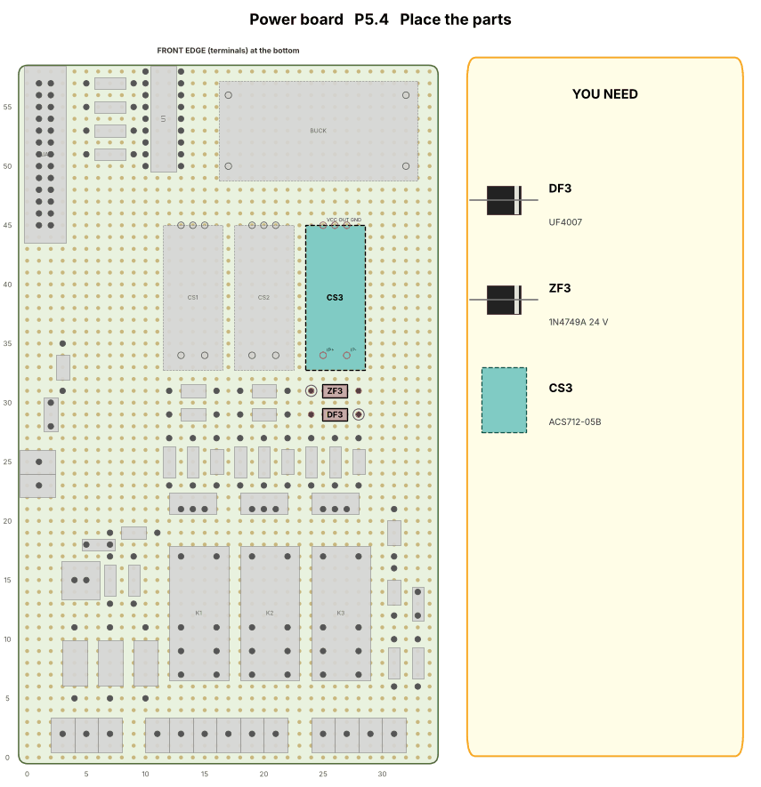

- [ ] **DF3**: UF4007 diode → col 24, row 29 and col 28, row 29. Band (K) right
- [ ] **ZF3**: 1N4749A 24 V diode → col 28, row 31 and col 24, row 31. Band (K) left
- [ ] **CS3**: ACS712-05B module → stick it down with foam tape where shown. Foam tape; screw terminals towards the front

Push the legs through, bend them out a little underneath, solder, snip.

#### P5.5 — Solder 6 wires (bottom side)

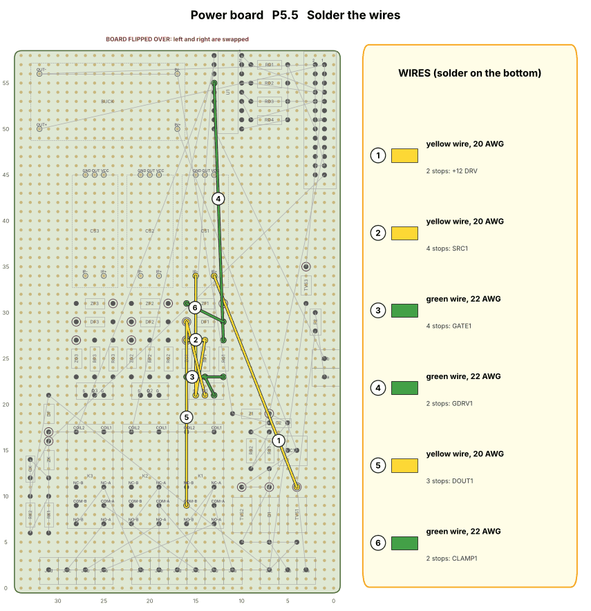

- [ ] **1** yellow 20 AWG: **TVS1** band end → **CS1** IP+
- [ ] **2** yellow 20 AWG: **CS1** IP- → **Q1** S → **RP1** at col 14, row 27 → **ZG1** band end
- [ ] **3** green 22 AWG: **Q1** G → **RP1** at col 14, row 23 → **ZG1** plain end → **RG1** at col 12, row 23
- [ ] **4** green 22 AWG: **RG1** at col 12, row 27 → **U1** pin 15
- [ ] **5** yellow 20 AWG: **Q1** D → **DF1** band end → **K1** COM-B
- [ ] **6** green 22 AWG: **DF1** plain end → **ZF1** plain end

#### P5.6 — Solder 6 wires (bottom side)

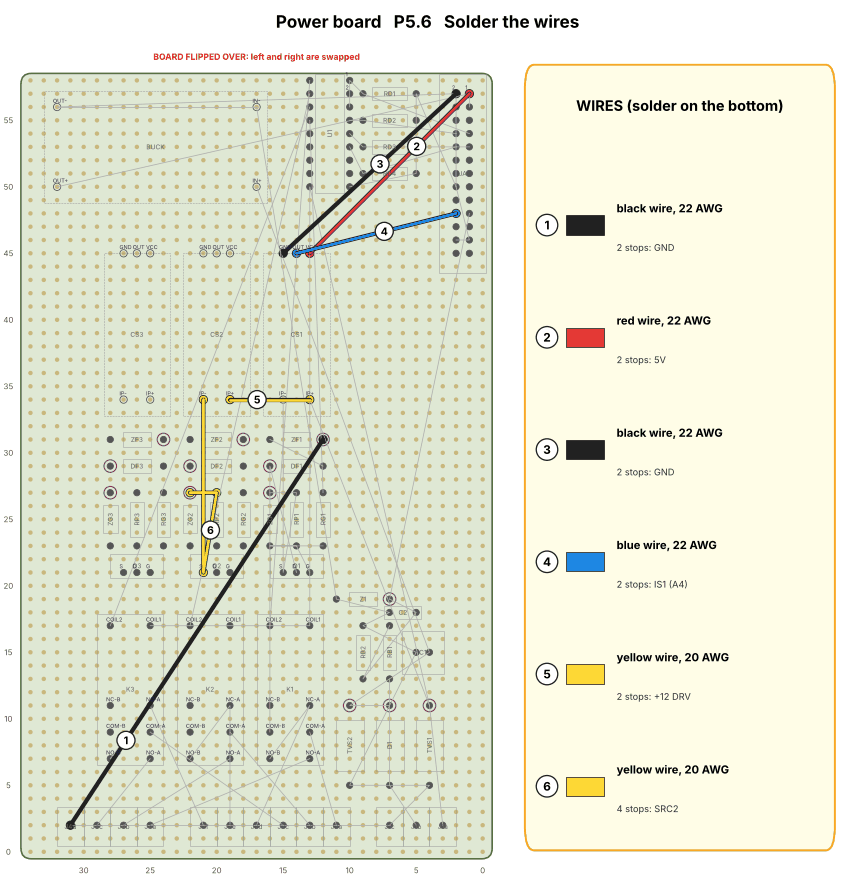

- [ ] **1** black 22 AWG: **J4d** (LOAD GND) → **ZF1** band end
- [ ] **2** red 22 AWG: **JA** pin 1 → **CS1** VCC
- [ ] **3** black 22 AWG: **JA** pin 2 → **CS1** GND
- [ ] **4** blue 22 AWG: **CS1** OUT → **JA** pin 20
- [ ] **5** yellow 20 AWG: **CS1** IP+ → **CS2** IP+
- [ ] **6** yellow 20 AWG: **CS2** IP- → **Q2** S → **RP2** at col 20, row 27 → **ZG2** band end

#### P5.7 — Solder 6 wires (bottom side)

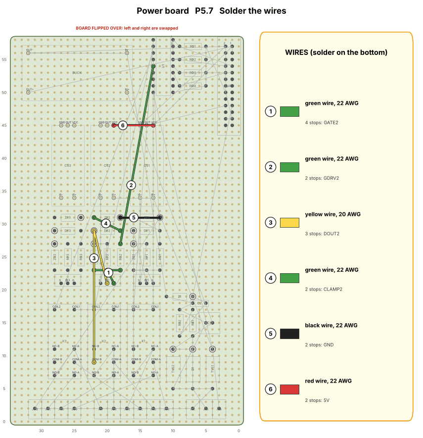

- [ ] **1** green 22 AWG: **Q2** G → **RP2** at col 20, row 23 → **ZG2** plain end → **RG2** at col 18, row 23
- [ ] **2** green 22 AWG: **RG2** at col 18, row 27 → **U1** pin 14
- [ ] **3** yellow 20 AWG: **Q2** D → **DF2** band end → **K2** COM-B
- [ ] **4** green 22 AWG: **DF2** plain end → **ZF2** plain end
- [ ] **5** black 22 AWG: **ZF1** band end → **ZF2** band end
- [ ] **6** red 22 AWG: **CS1** VCC → **CS2** VCC

#### P5.8 — Solder 6 wires (bottom side)

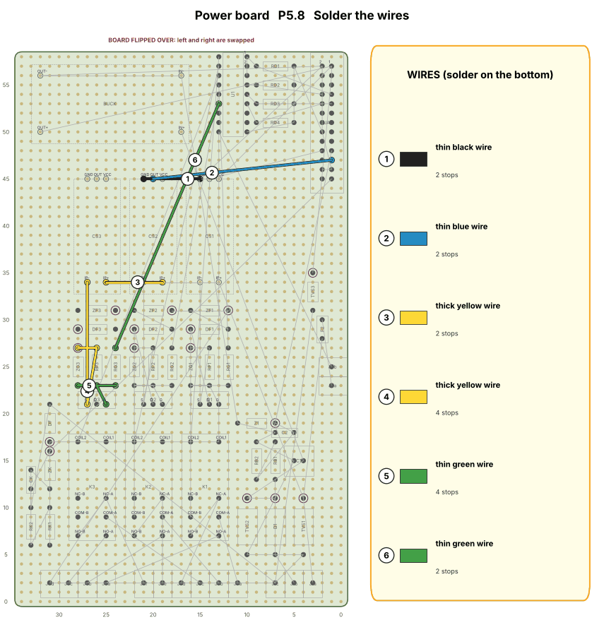

- [ ] **1** black 22 AWG: **CS1** GND → **CS2** GND
- [ ] **2** blue 22 AWG: **CS2** OUT → **JA** pin 21
- [ ] **3** yellow 20 AWG: **CS2** IP+ → **CS3** IP+
- [ ] **4** yellow 20 AWG: **CS3** IP- → **Q3** S → **RP3** at col 26, row 27 → **ZG3** band end
- [ ] **5** green 22 AWG: **Q3** G → **RP3** at col 26, row 23 → **ZG3** plain end → **RG3** at col 24, row 23
- [ ] **6** green 22 AWG: **RG3** at col 24, row 27 → **U1** pin 13

#### P5.9 — Solder 6 wires (bottom side)

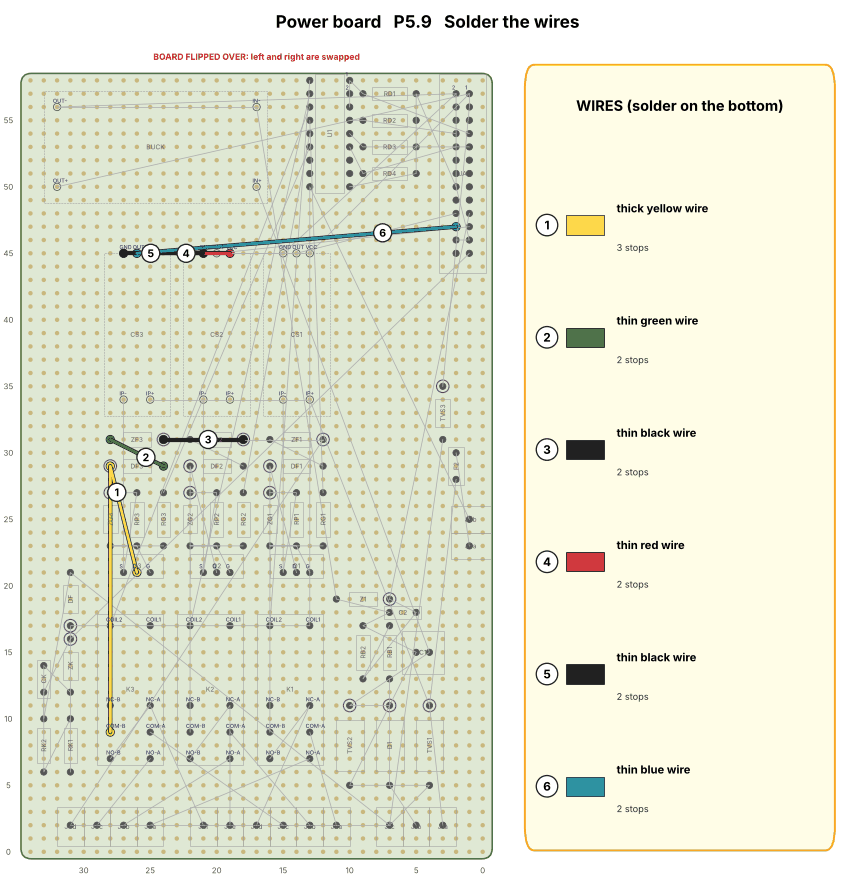

- [ ] **1** yellow 20 AWG: **Q3** D → **DF3** band end → **K3** COM-B
- [ ] **2** green 22 AWG: **DF3** plain end → **ZF3** plain end
- [ ] **3** black 22 AWG: **ZF2** band end → **ZF3** band end
- [ ] **4** red 22 AWG: **CS2** VCC → **CS3** VCC
- [ ] **5** black 22 AWG: **CS2** GND → **CS3** GND
- [ ] **6** blue 22 AWG: **CS3** OUT → **JA** pin 22

✅ **CHECK:** clip one 15 Ω big resistor between **J2d** and **J1c**, lying on the heatsink (it
gets warm). Bench 12 V on J1a, J1b, J1c.
- [ ] JA pin 1 to **JA pin 7** (relays on) and **JA pin 8**: J2d reads **about 12 V**. The current
  sensor CS1's OUT pin goes from about 2.50 V to about 2.65 V.
- [ ] Take away JA pin 8: J2d drops to **0 V**.
- [ ] Relays off, JA pin 8 on: J2d stays at **0 V**.
- [ ] Same for S2 (JA pin 9, resistor on **J2e**) and SL (JA pin 10, resistor on **J2f**).

### Step P6 — Car signal inputs

#### P6.1 — Place 6 parts

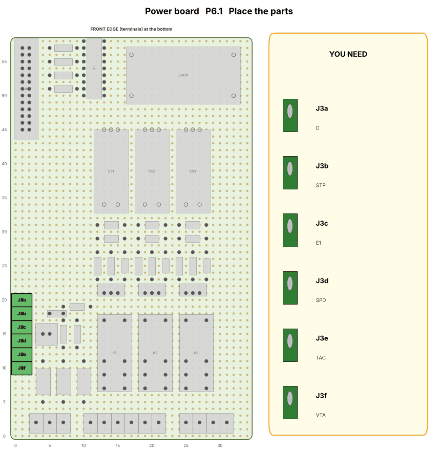

- [ ] **J3a**: D screw terminal → col 1, row 20. X3-1 lever in D
- [ ] **J3b**: STP screw terminal → col 1, row 18. X3-2 brake
- [ ] **J3c**: E1 screw terminal → col 1, row 16. X3-3 ECM ground
- [ ] **J3d**: SPD screw terminal → col 1, row 14. X3-4 speed
- [ ] **J3e**: TAC screw terminal → col 1, row 12. X3-5 tach
- [ ] **J3f**: VTA screw terminal → col 1, row 10. X3-6 throttle

Push the legs through, bend them out a little underneath, solder, snip.

#### P6.2 — Place 6 parts

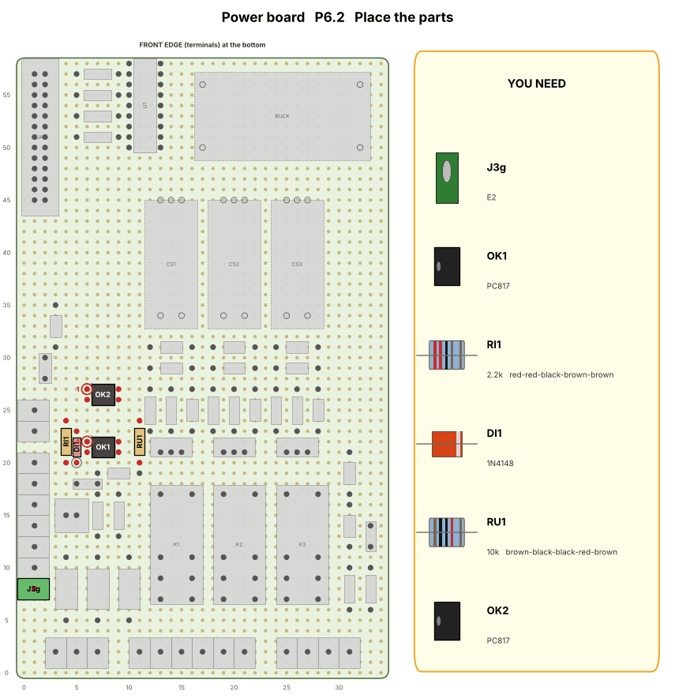

- [ ] **J3g**: E2 screw terminal → col 1, row 8. X3-7 throttle ground
- [ ] **OK1**: PC817 chip → pin 1 in col 6, row 22. Dot (pin 1) top-left
- [ ] **RI1**: 2.2k resistor (bands: red-red-black-brown-brown) → col 4, row 20 and col 4, row 24. Input
- [ ] **DI1**: 1N4148 diode → col 5, row 23 and col 5, row 20. Band (K) towards the front
- [ ] **RU1**: 10k resistor (bands: brown-black-black-red-brown) → col 11, row 20 and col 11, row 24. Output pull-up
- [ ] **OK2**: PC817 chip → pin 1 in col 6, row 27. Dot (pin 1) top-left

Push the legs through, bend them out a little underneath, solder, snip.

#### P6.3 — Place 6 parts

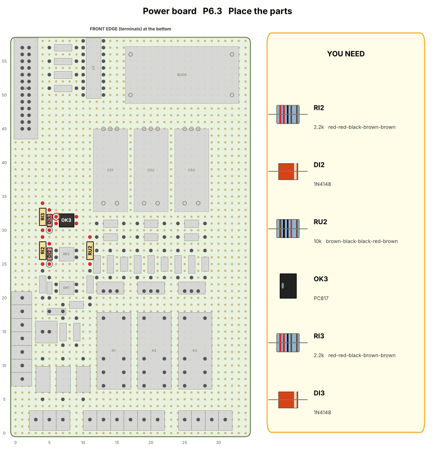

- [ ] **RI2**: 2.2k resistor (bands: red-red-black-brown-brown) → col 4, row 25 and col 4, row 29. Input
- [ ] **DI2**: 1N4148 diode → col 5, row 28 and col 5, row 25. Band (K) towards the front
- [ ] **RU2**: 10k resistor (bands: brown-black-black-red-brown) → col 11, row 25 and col 11, row 29. Output pull-up
- [ ] **OK3**: PC817 chip → pin 1 in col 6, row 32. Dot (pin 1) top-left
- [ ] **RI3**: 2.2k resistor (bands: red-red-black-brown-brown) → col 4, row 30 and col 4, row 34. Input
- [ ] **DI3**: 1N4148 diode → col 5, row 33 and col 5, row 30. Band (K) towards the front

Push the legs through, bend them out a little underneath, solder, snip.

#### P6.4 — Place 6 parts

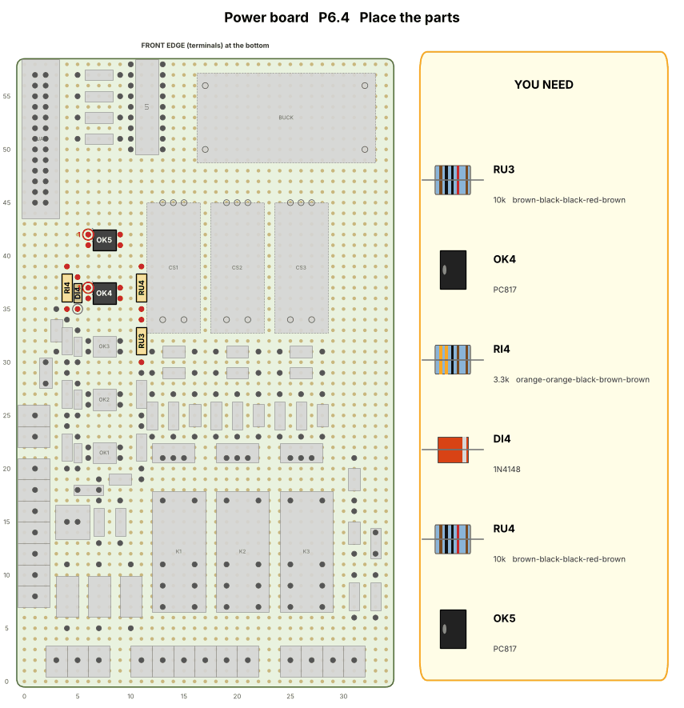

- [ ] **RU3**: 10k resistor (bands: brown-black-black-red-brown) → col 11, row 30 and col 11, row 34. Output pull-up
- [ ] **OK4**: PC817 chip → pin 1 in col 6, row 37. Dot (pin 1) top-left
- [ ] **RI4**: 3.3k resistor (bands: orange-orange-black-brown-brown) → col 4, row 35 and col 4, row 39. Input
- [ ] **DI4**: 1N4148 diode → col 5, row 38 and col 5, row 35. Band (K) towards the front
- [ ] **RU4**: 10k resistor (bands: brown-black-black-red-brown) → col 11, row 35 and col 11, row 39. Output pull-up
- [ ] **OK5**: PC817 chip → pin 1 in col 6, row 42. Dot (pin 1) top-left

Push the legs through, bend them out a little underneath, solder, snip.

#### P6.5 — Place 6 parts

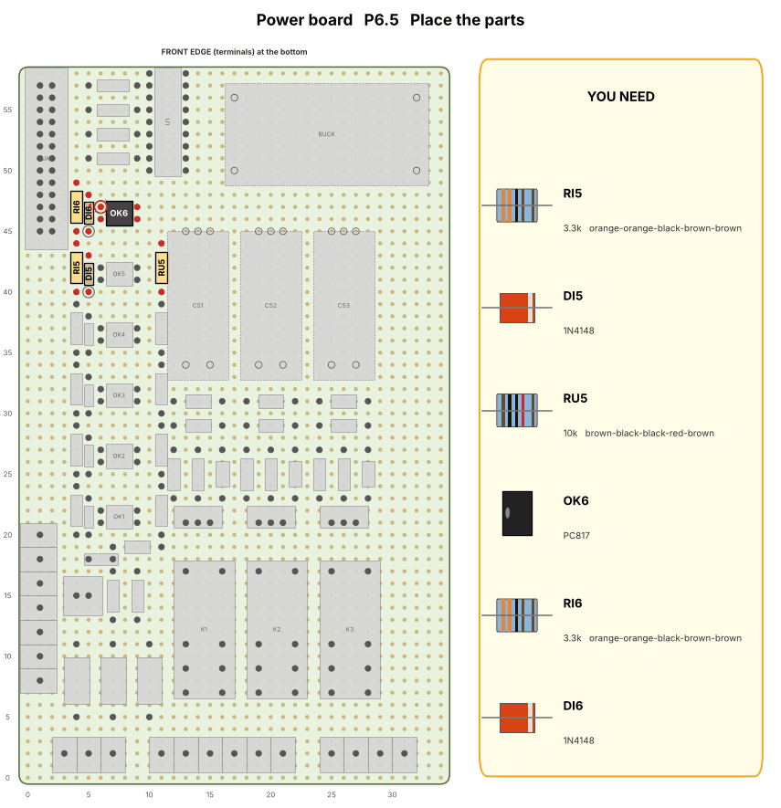

- [ ] **RI5**: 3.3k resistor (bands: orange-orange-black-brown-brown) → col 4, row 40 and col 4, row 44. Input
- [ ] **DI5**: 1N4148 diode → col 5, row 43 and col 5, row 40. Band (K) towards the front
- [ ] **RU5**: 10k resistor (bands: brown-black-black-red-brown) → col 11, row 40 and col 11, row 44. Output pull-up
- [ ] **OK6**: PC817 chip → pin 1 in col 6, row 47. Dot (pin 1) top-left
- [ ] **RI6**: 3.3k resistor (bands: orange-orange-black-brown-brown) → col 4, row 45 and col 4, row 49. Input
- [ ] **DI6**: 1N4148 diode → col 5, row 48 and col 5, row 45. Band (K) towards the front

Push the legs through, bend them out a little underneath, solder, snip.

#### P6.6 — Place 1 part

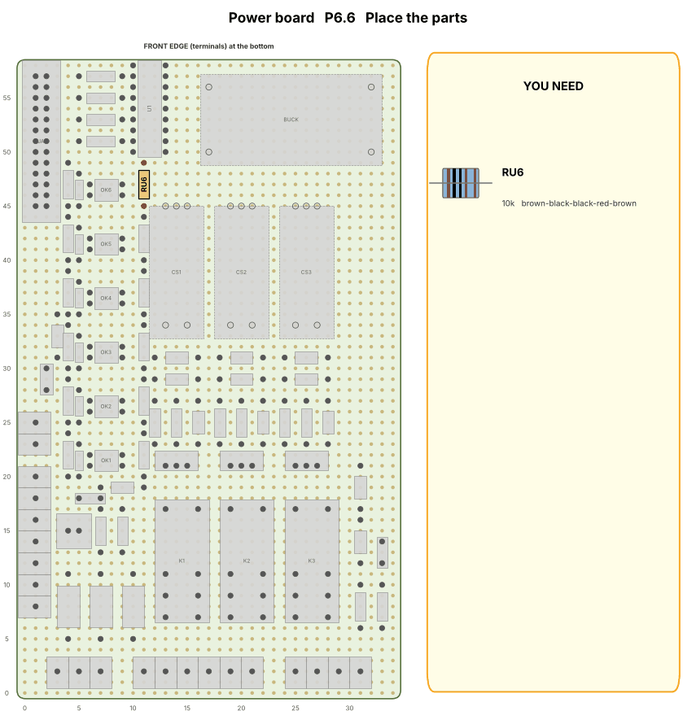

- [ ] **RU6**: 10k resistor (bands: brown-black-black-red-brown) → col 11, row 45 and col 11, row 49. Output pull-up

Push the legs through, bend them out a little underneath, solder, snip.

#### P6.7 — Solder 6 wires (bottom side)

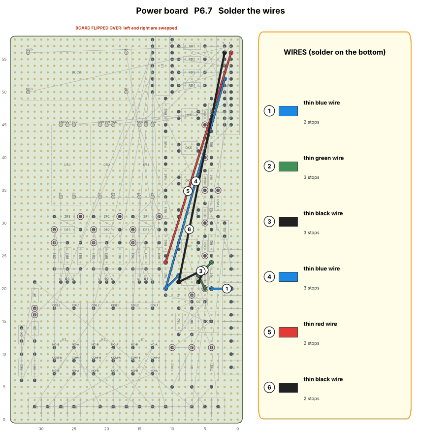

- [ ] **1** blue 22 AWG: **J3a** (D) → **RI1** at col 4, row 20
- [ ] **2** green 22 AWG: **RI1** at col 4, row 24 → **OK1** pin 1 → **DI1** band end
- [ ] **3** black 22 AWG: **OK1** pin 2 → **DI1** plain end → **OK1** pin 3
- [ ] **4** blue 22 AWG: **OK1** pin 4 → **RU1** at col 11, row 20 → **JA** pin 12
- [ ] **5** red 22 AWG: **JA** pin 3 → **RU1** at col 11, row 24
- [ ] **6** black 22 AWG: **JA** pin 4 → **OK1** pin 3

#### P6.8 — Solder 6 wires (bottom side)

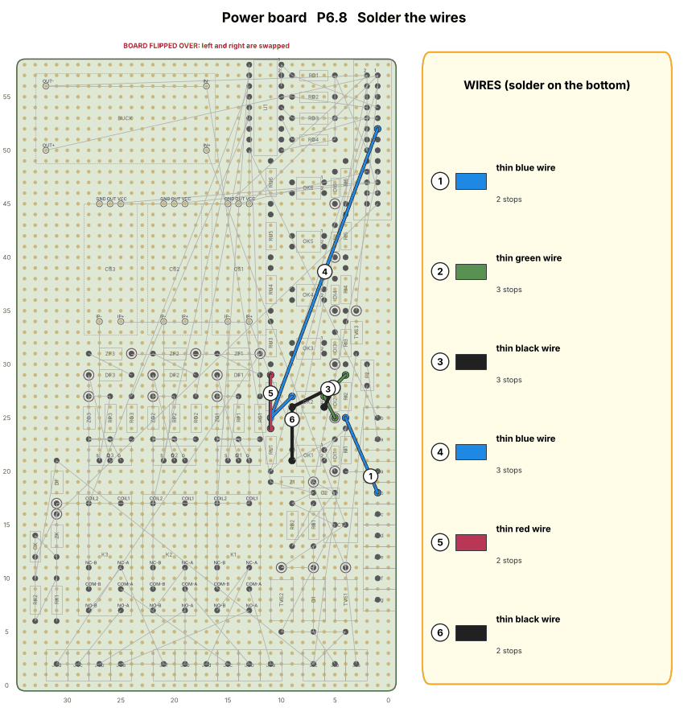

- [ ] **1** blue 22 AWG: **J3b** (STP) → **RI2** at col 4, row 25
- [ ] **2** green 22 AWG: **RI2** at col 4, row 29 → **OK2** pin 1 → **DI2** band end
- [ ] **3** black 22 AWG: **OK2** pin 2 → **DI2** plain end → **OK2** pin 3
- [ ] **4** blue 22 AWG: **OK2** pin 4 → **RU2** at col 11, row 25 → **JA** pin 11
- [ ] **5** red 22 AWG: **RU1** at col 11, row 24 → **RU2** at col 11, row 29
- [ ] **6** black 22 AWG: **OK1** pin 3 → **OK2** pin 3

#### P6.9 — Solder 6 wires (bottom side)

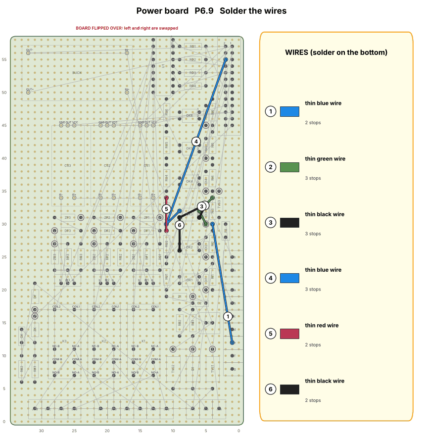

- [ ] **1** blue 22 AWG: **J3e** (TAC) → **RI3** at col 4, row 30
- [ ] **2** green 22 AWG: **RI3** at col 4, row 34 → **OK3** pin 1 → **DI3** band end
- [ ] **3** black 22 AWG: **OK3** pin 2 → **DI3** plain end → **OK3** pin 3
- [ ] **4** blue 22 AWG: **OK3** pin 4 → **RU3** at col 11, row 30 → **JA** pin 6
- [ ] **5** red 22 AWG: **RU2** at col 11, row 29 → **RU3** at col 11, row 34
- [ ] **6** black 22 AWG: **OK2** pin 3 → **OK3** pin 3

#### P6.10 — Solder 6 wires (bottom side)

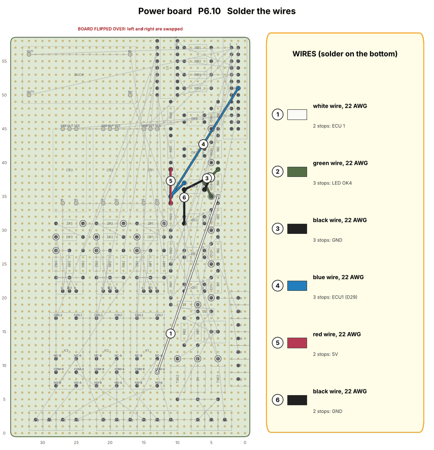

- [ ] **1** white 22 AWG: **K1** COM-A → **RI4** at col 4, row 35
- [ ] **2** green 22 AWG: **RI4** at col 4, row 39 → **OK4** pin 1 → **DI4** band end
- [ ] **3** black 22 AWG: **OK4** pin 2 → **DI4** plain end → **OK4** pin 3
- [ ] **4** blue 22 AWG: **OK4** pin 4 → **RU4** at col 11, row 35 → **JA** pin 13
- [ ] **5** red 22 AWG: **RU3** at col 11, row 34 → **RU4** at col 11, row 39
- [ ] **6** black 22 AWG: **OK3** pin 3 → **OK4** pin 3

#### P6.11 — Solder 6 wires (bottom side)

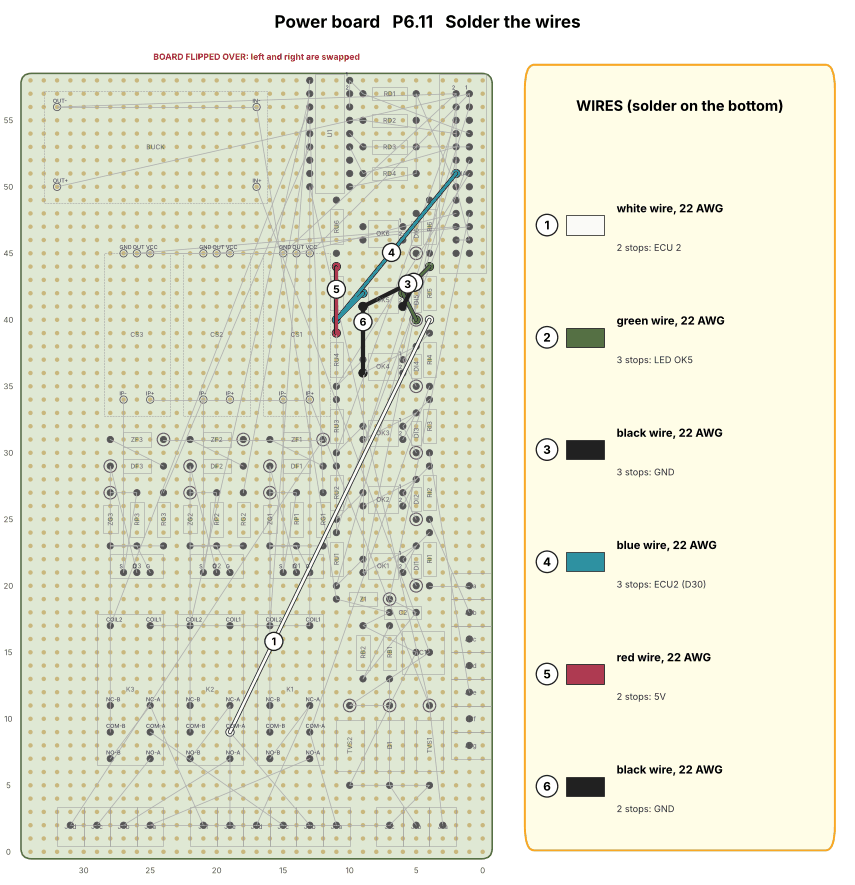

- [ ] **1** white 22 AWG: **K2** COM-A → **RI5** at col 4, row 40
- [ ] **2** green 22 AWG: **RI5** at col 4, row 44 → **OK5** pin 1 → **DI5** band end
- [ ] **3** black 22 AWG: **OK5** pin 2 → **DI5** plain end → **OK5** pin 3
- [ ] **4** blue 22 AWG: **OK5** pin 4 → **RU5** at col 11, row 40 → **JA** pin 14
- [ ] **5** red 22 AWG: **RU4** at col 11, row 39 → **RU5** at col 11, row 44
- [ ] **6** black 22 AWG: **OK4** pin 3 → **OK5** pin 3

#### P6.12 — Solder 6 wires (bottom side)

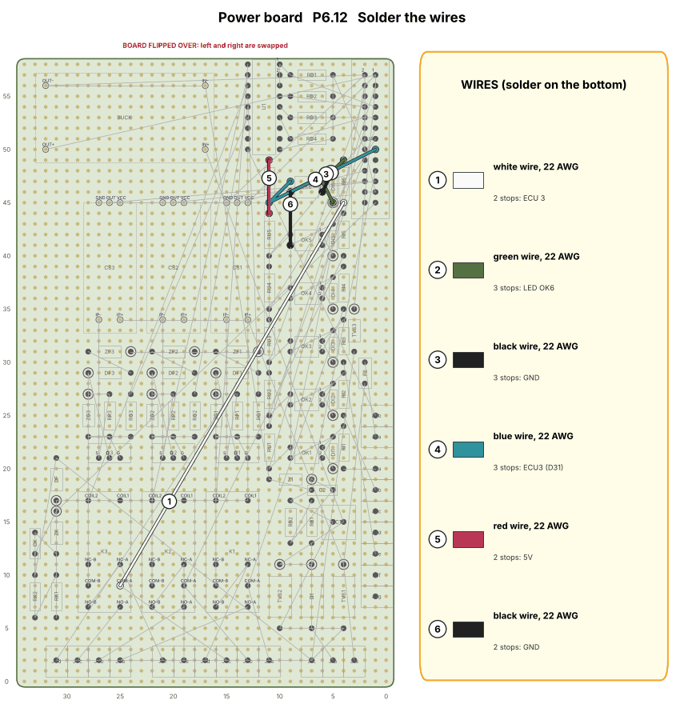

- [ ] **1** white 22 AWG: **K3** COM-A → **RI6** at col 4, row 45
- [ ] **2** green 22 AWG: **RI6** at col 4, row 49 → **OK6** pin 1 → **DI6** band end
- [ ] **3** black 22 AWG: **OK6** pin 2 → **DI6** plain end → **OK6** pin 3
- [ ] **4** blue 22 AWG: **OK6** pin 4 → **RU6** at col 11, row 45 → **JA** pin 15
- [ ] **5** red 22 AWG: **RU5** at col 11, row 44 → **RU6** at col 11, row 49
- [ ] **6** black 22 AWG: **OK5** pin 3 → **OK6** pin 3

#### P6.13 — Solder 1 wire (bottom side)

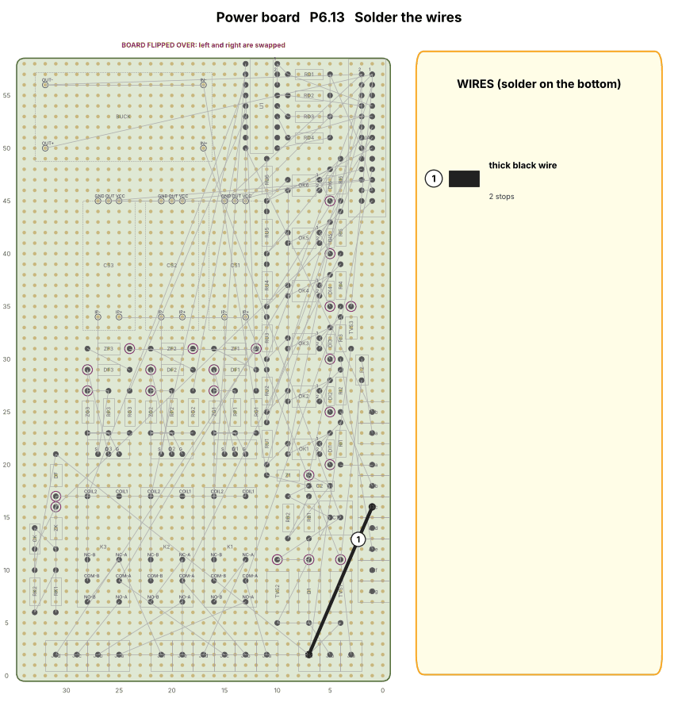

- [ ] **1** black 20 AWG: **J3c** (E1) → **J1c** (GND)

✅ **CHECK** (bench 12 V on): each pin below reads **5 V**, then **under 0.5 V** when you touch
12 V to its input.
- [ ] J3a → JA pin 12
- [ ] J3b → JA pin 11
- [ ] J3e → JA pin 6
- [ ] J2a → JA pin 13
- [ ] J2b → JA pin 14
- [ ] J2c → JA pin 15

### Step P7 — Speed signal

#### P7.1 — Place 6 parts

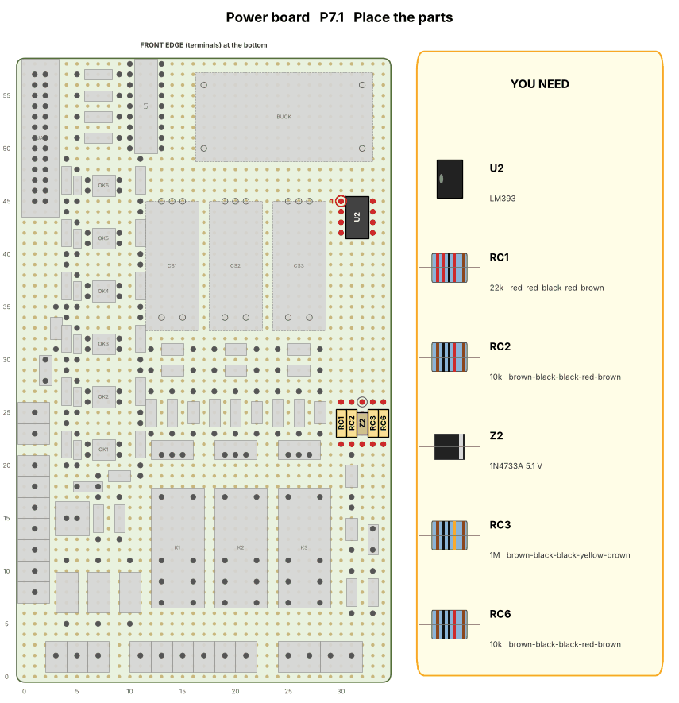

- [ ] **U2**: LM393 chip → pin 1 in col 30, row 45. Notch / dot (pin 1) top-left
- [ ] **RC1**: 22k resistor (bands: red-red-black-red-brown) → col 30, row 22 and col 30, row 26. SPD in
- [ ] **RC2**: 10k resistor (bands: brown-black-black-red-brown) → col 31, row 22 and col 31, row 26. SPD to ground
- [ ] **Z2**: 1N4733A 5.1 V diode → col 32, row 22 and col 32, row 26. Band (K) towards the back
- [ ] **RC3**: 1M resistor (bands: brown-black-black-yellow-brown) → col 33, row 22 and col 33, row 26. Hysteresis
- [ ] **RC6**: 10k resistor (bands: brown-black-black-red-brown) → col 34, row 22 and col 34, row 26. Output pull-up

Push the legs through, bend them out a little underneath, solder, snip.

#### P7.2 — Place 2 parts

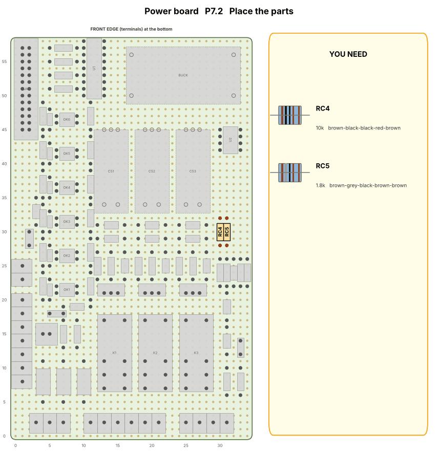

- [ ] **RC4**: 10k resistor (bands: brown-black-black-red-brown) → col 30, row 28 and col 30, row 32. Threshold, top
- [ ] **RC5**: 1.8k resistor (bands: brown-grey-black-brown-brown) → col 31, row 28 and col 31, row 32. Threshold, bottom (0.76 V)

Push the legs through, bend them out a little underneath, solder, snip.

#### P7.3 — Solder 6 wires (bottom side)

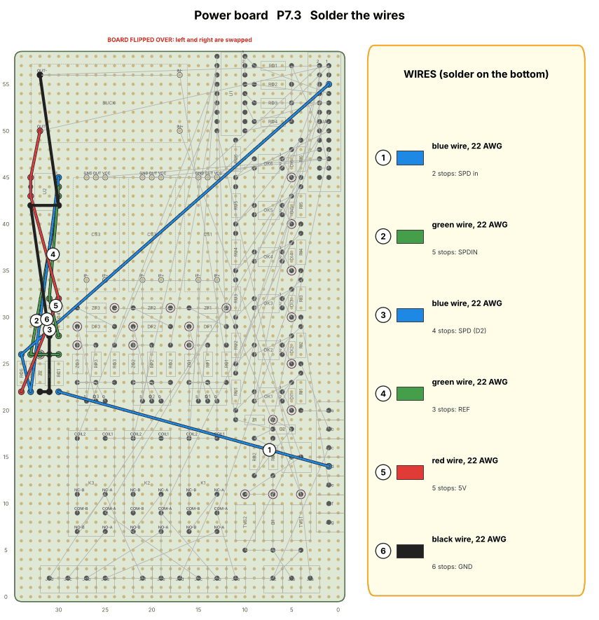

- [ ] **1** blue 22 AWG: **J3d** (SPD) → **RC1** at col 30, row 22
- [ ] **2** green 22 AWG: **RC1** at col 30, row 26 → **RC2** at col 31, row 26 → **Z2** band end → **RC3** at col 33, row 26 → **U2** pin 3
- [ ] **3** blue 22 AWG: **U2** pin 1 → **RC3** at col 33, row 22 → **RC6** at col 34, row 26 → **JA** pin 5
- [ ] **4** green 22 AWG: **RC4** at col 30, row 28 → **RC5** at col 31, row 32 → **U2** pin 2
- [ ] **5** red 22 AWG: **BUCK** OUT+ → **U2** pin 8 → **U2** pin 6 → **RC4** at col 30, row 32 → **RC6** at col 34, row 22
- [ ] **6** black 22 AWG: **BUCK** OUT- → **U2** pin 4 → **U2** pin 5 → **RC5** at col 31, row 28 → **RC2** at col 31, row 22 → **Z2** plain end

✅ **CHECK:** nothing on J3d → JA pin 5 reads **0 V**. 5 V on J3d → **5 V**. 12 V on J3d → **5 V**.

### Step P8 — Throttle signal

#### P8.1 — Place 6 parts

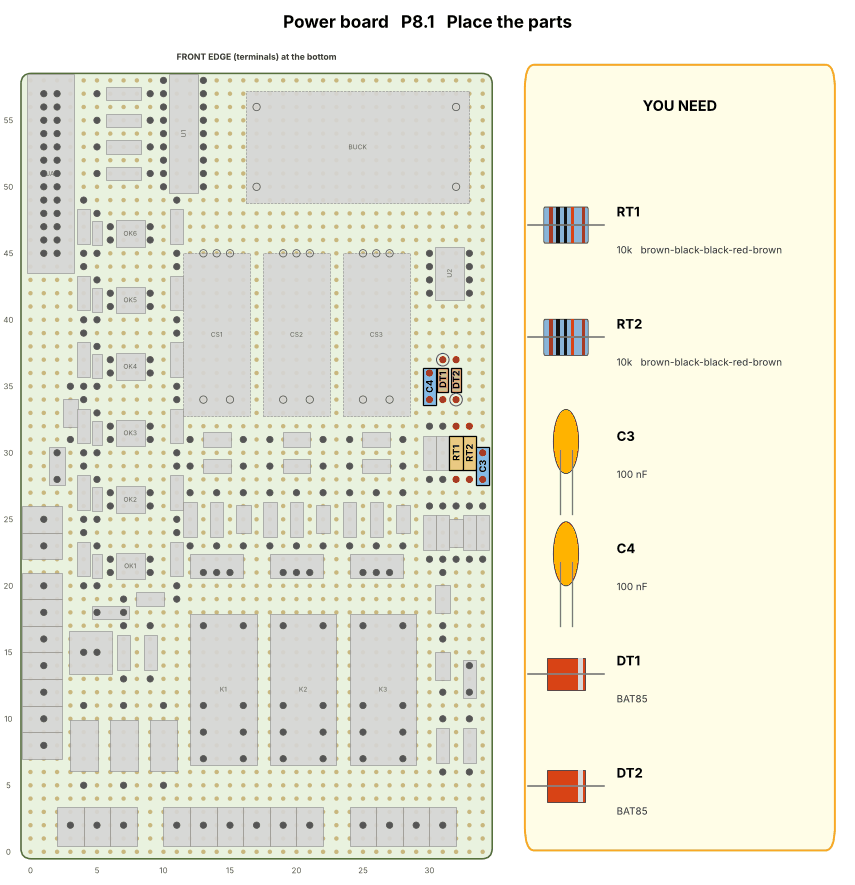

- [ ] **RT1**: 10k resistor (bands: brown-black-black-red-brown) → col 32, row 28 and col 32, row 32. VTA series
- [ ] **RT2**: 10k resistor (bands: brown-black-black-red-brown) → col 33, row 28 and col 33, row 32. E2 series
- [ ] **C3**: 100 nF capacitor → col 34, row 28 and col 34, row 30. VTA filter
- [ ] **C4**: 100 nF capacitor → col 30, row 34 and col 30, row 36. E2 filter
- [ ] **DT1**: BAT85 diode → col 31, row 34 and col 31, row 37. VTA to 5 V; band (K) towards the back
- [ ] **DT2**: BAT85 diode → col 32, row 37 and col 32, row 34. GND to VTA; band (K) towards the front

Push the legs through, bend them out a little underneath, solder, snip.

#### P8.2 — Place 2 parts

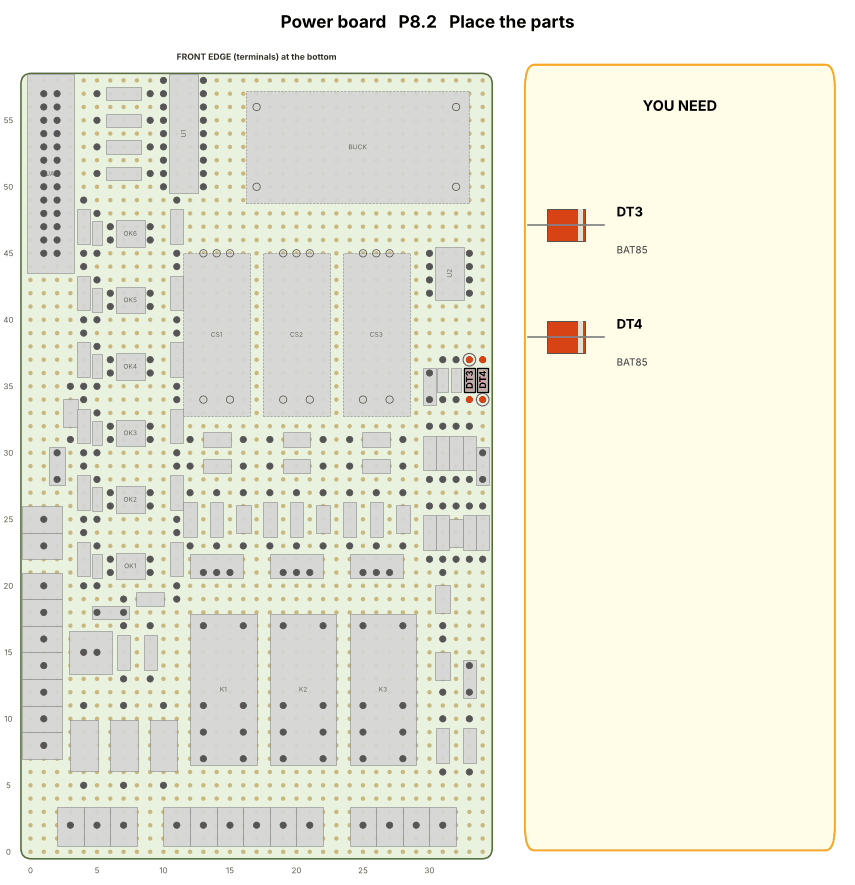

- [ ] **DT3**: BAT85 diode → col 33, row 34 and col 33, row 37. E2 to 5 V; band (K) towards the back
- [ ] **DT4**: BAT85 diode → col 34, row 37 and col 34, row 34. GND to E2; band (K) towards the front

Push the legs through, bend them out a little underneath, solder, snip.

#### P8.3 — Solder 6 wires (bottom side)

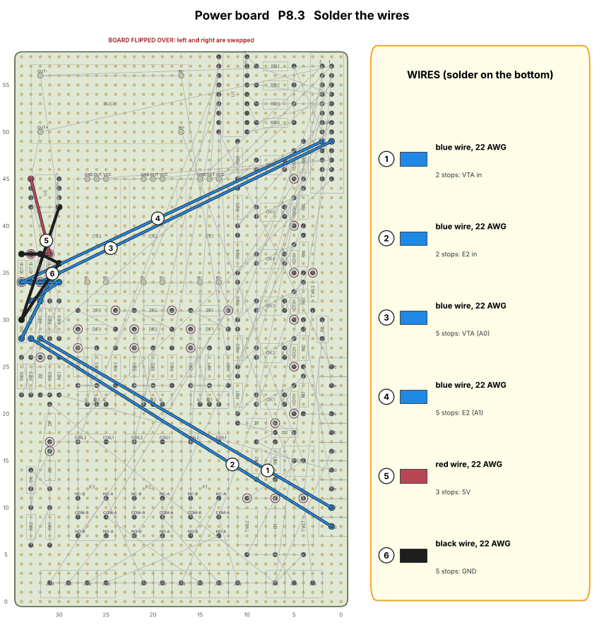

- [ ] **1** blue 22 AWG: **J3f** (VTA) → **RT1** at col 32, row 28
- [ ] **2** blue 22 AWG: **J3g** (E2) → **RT2** at col 33, row 28
- [ ] **3** blue 22 AWG: **RT1** at col 32, row 32 → **C3** at col 34, row 28 → **DT1** plain end → **DT2** band end → **JA** pin 17
- [ ] **4** blue 22 AWG: **RT2** at col 33, row 32 → **C4** at col 30, row 34 → **DT3** plain end → **DT4** band end → **JA** pin 18
- [ ] **5** red 22 AWG: **U2** pin 8 → **DT1** band end → **DT3** band end
- [ ] **6** black 22 AWG: **U2** pin 4 → **C3** at col 34, row 30 → **C4** at col 30, row 36 → **DT2** plain end → **DT4** plain end

✅ **CHECK:** 5 V (from JA pin 1) on J3f → JA pin 17 reads **about 5 V**. J3f to ground → **0 V**.
Same for J3g → JA pin 18.

**The power board is done.** Look over the underside under a bright light for blobs of solder
joining two pads. Write **POWER** on it.

---

## Part 5 — Logic board

The small board: switches, screen, ATF probe and the gyro.

For its checks, feed it 5 V from the power board: two jumper wires, **JA pin 1 → JB pin 1** and
**JA pin 2 → JB pin 2**.

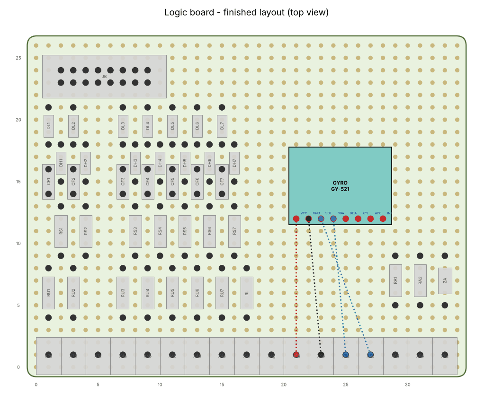

### Step L1 — Terminals and ribbon socket

#### L1.1 — Place 6 parts

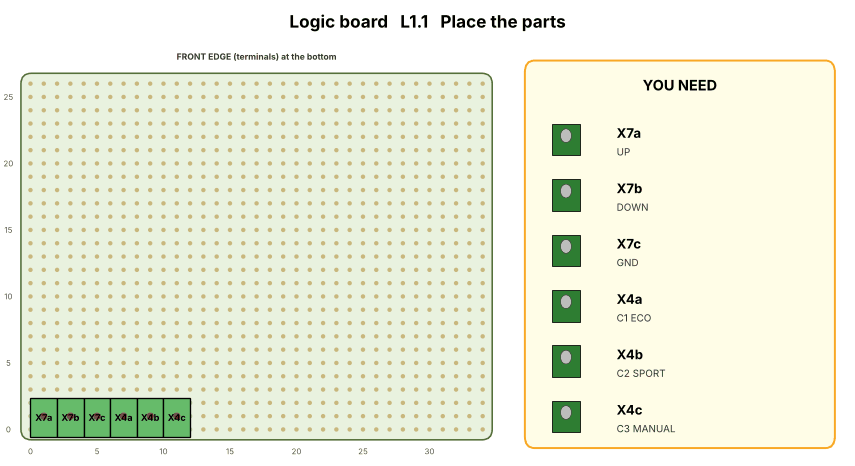

- [ ] **X7a**: UP screw terminal → col 1, row 1. X7-1 shifter UP
- [ ] **X7b**: DOWN screw terminal → col 3, row 1. X7-2 shifter DOWN
- [ ] **X7c**: GND screw terminal → col 5, row 1. X7-3 shifter GND
- [ ] **X4a**: C1 ECO screw terminal → col 7, row 1. X4-1: C1 ECO
- [ ] **X4b**: C2 SPORT screw terminal → col 9, row 1. X4-2: C2 SPORT
- [ ] **X4c**: C3 MANUAL screw terminal → col 11, row 1. X4-3: C3 MANUAL

Push the legs through, bend them out a little underneath, solder, snip.

#### L1.2 — Place 6 parts

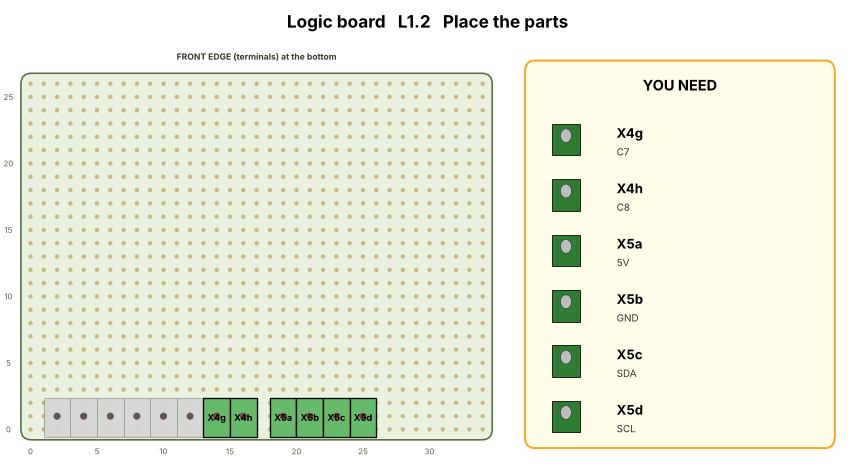

- [ ] **X4d**: C4 TEST screw terminal → col 13, row 1. X4-4: C4 TEST
- [ ] **X4e**: C5 ON/OFF screw terminal → col 15, row 1. X4-5: C5 ON/OFF
- [ ] **X4f**: C6 GND screw terminal → col 17, row 1. X4-6: C6 GND
- [ ] **X5a**: 5V screw terminal → col 21, row 1. X5-1 screen
- [ ] **X5b**: GND screw terminal → col 23, row 1. X5-2 screen
- [ ] **X5c**: SDA screw terminal → col 25, row 1. X5-3 screen

Push the legs through, bend them out a little underneath, solder, snip.

#### L1.3 — Place 5 parts

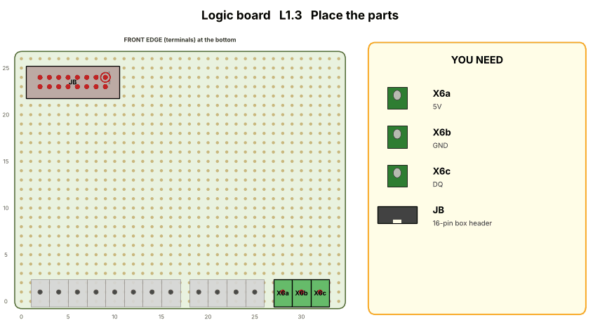

- [ ] **X5d**: SCL screw terminal → col 27, row 1. X5-4 screen
- [ ] **X6a**: 5V screw terminal → col 29, row 1. X6-1 ATF probe
- [ ] **X6b**: GND screw terminal → col 31, row 1. X6-2 ATF probe
- [ ] **X6c**: DQ screw terminal → col 33, row 1. X6-3 ATF probe
- [ ] **JB**: 16-pin box header box header → pin 1 in col 9, row 24. Notch facing the back edge; pin 1 (square pad) at the right-hand end, back row

Push the legs through, bend them out a little underneath, solder, snip.

#### L1.4 — Solder 4 wires (bottom side)

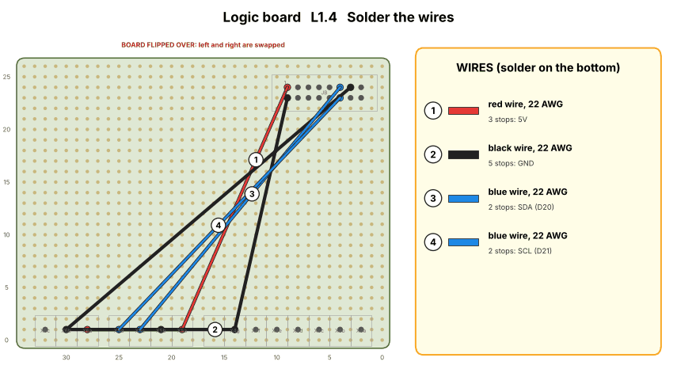

- [ ] **1** red 22 AWG: **JB** pin 1 → **X5a** (5V) → **X6a** (5V)
- [ ] **2** black 22 AWG: **JB** pin 2 → **X7c** (GND) → **X4f** (C6 GND) → **X5b** (GND) → **X6b** (GND) → **JB** pin 13
- [ ] **3** blue 22 AWG: **JB** pin 11 → **X5c** (SDA)
- [ ] **4** blue 22 AWG: **JB** pin 12 → **X5d** (SCL)

✅ **CHECK** (5 V on): X5a and X6a read **5 V**.

### Step L2 — Switch inputs

#### L2.1 — Place 6 parts

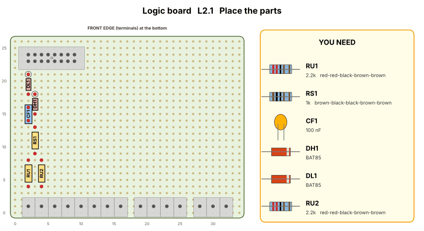

- [ ] **RU1**: 2.2k resistor (bands: red-red-black-brown-brown) → col 1, row 4 and col 1, row 8. Pull-up
- [ ] **RS1**: 1k resistor (bands: brown-black-black-brown-brown) → col 2, row 9 and col 2, row 13. Series
- [ ] **CF1**: 100 nF capacitor → col 1, row 14 and col 1, row 16
- [ ] **DH1**: BAT85 diode → col 2, row 15 and col 2, row 18. Band (K) towards the back
- [ ] **DL1**: BAT85 diode → col 1, row 18 and col 1, row 21. Band (K) towards the back
- [ ] **RU2**: 2.2k resistor (bands: red-red-black-brown-brown) → col 3, row 4 and col 3, row 8. Pull-up

Push the legs through, bend them out a little underneath, solder, snip.

#### L2.2 — Place 6 parts

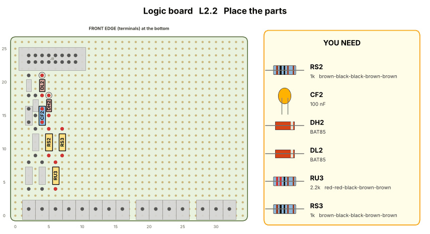

- [ ] **RS2**: 1k resistor (bands: brown-black-black-brown-brown) → col 4, row 9 and col 4, row 13. Series
- [ ] **CF2**: 100 nF capacitor → col 3, row 14 and col 3, row 16
- [ ] **DH2**: BAT85 diode → col 4, row 15 and col 4, row 18. Band (K) towards the back
- [ ] **DL2**: BAT85 diode → col 3, row 18 and col 3, row 21. Band (K) towards the back
- [ ] **RU3**: 2.2k resistor (bands: red-red-black-brown-brown) → col 7, row 4 and col 7, row 8. Pull-up
- [ ] **RS3**: 1k resistor (bands: brown-black-black-brown-brown) → col 8, row 9 and col 8, row 13. Series

Push the legs through, bend them out a little underneath, solder, snip.

#### L2.3 — Place 6 parts

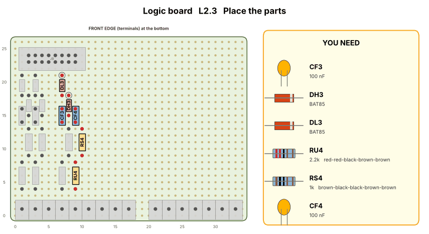

- [ ] **CF3**: 100 nF capacitor → col 7, row 14 and col 7, row 16
- [ ] **DH3**: BAT85 diode → col 8, row 15 and col 8, row 18. Band (K) towards the back
- [ ] **DL3**: BAT85 diode → col 7, row 18 and col 7, row 21. Band (K) towards the back
- [ ] **RU4**: 2.2k resistor (bands: red-red-black-brown-brown) → col 9, row 4 and col 9, row 8. Pull-up
- [ ] **RS4**: 1k resistor (bands: brown-black-black-brown-brown) → col 10, row 9 and col 10, row 13. Series
- [ ] **CF4**: 100 nF capacitor → col 9, row 14 and col 9, row 16

Push the legs through, bend them out a little underneath, solder, snip.

#### L2.4 — Place 6 parts

- [ ] **DH4**: BAT85 diode → col 10, row 15 and col 10, row 18. Band (K) towards the back
- [ ] **DL4**: BAT85 diode → col 9, row 18 and col 9, row 21. Band (K) towards the back
- [ ] **RU5**: 2.2k resistor (bands: red-red-black-brown-brown) → col 11, row 4 and col 11, row 8. Pull-up
- [ ] **RS5**: 1k resistor (bands: brown-black-black-brown-brown) → col 12, row 9 and col 12, row 13. Series
- [ ] **CF5**: 100 nF capacitor → col 11, row 14 and col 11, row 16
- [ ] **DH5**: BAT85 diode → col 12, row 15 and col 12, row 18. Band (K) towards the back

Push the legs through, bend them out a little underneath, solder, snip.

#### L2.5 — Place 6 parts

- [ ] **DL5**: BAT85 diode → col 11, row 18 and col 11, row 21. Band (K) towards the back
- [ ] **RU6**: 2.2k resistor (bands: red-red-black-brown-brown) → col 13, row 4 and col 13, row 8. Pull-up
- [ ] **RS6**: 1k resistor (bands: brown-black-black-brown-brown) → col 14, row 9 and col 14, row 13. Series
- [ ] **CF6**: 100 nF capacitor → col 13, row 14 and col 13, row 16
- [ ] **DH6**: BAT85 diode → col 14, row 15 and col 14, row 18. Band (K) towards the back
- [ ] **DL6**: BAT85 diode → col 13, row 18 and col 13, row 21. Band (K) towards the back

Push the legs through, bend them out a little underneath, solder, snip.

#### L2.6 — Place 5 parts

- [ ] **RU7**: 2.2k resistor (bands: red-red-black-brown-brown) → col 15, row 4 and col 15, row 8. Pull-up
- [ ] **RS7**: 1k resistor (bands: brown-black-black-brown-brown) → col 16, row 9 and col 16, row 13. Series
- [ ] **CF7**: 100 nF capacitor → col 15, row 14 and col 15, row 16
- [ ] **DH7**: BAT85 diode → col 16, row 15 and col 16, row 18. Band (K) towards the back
- [ ] **DL7**: BAT85 diode → col 15, row 18 and col 15, row 21. Band (K) towards the back

Push the legs through, bend them out a little underneath, solder, snip.

#### L2.7 — Solder 6 wires (bottom side)

- [ ] **1** blue 22 AWG: **X7a** (UP) → **RU1** at col 1, row 4 → **RS1** at col 2, row 9
- [ ] **2** blue 22 AWG: **RS1** at col 2, row 13 → **DH1** plain end → **CF1** at col 1, row 14 → **DL1** band end → **JB** pin 3
- [ ] **3** blue 22 AWG: **X7b** (DOWN) → **RU2** at col 3, row 4 → **RS2** at col 4, row 9
- [ ] **4** blue 22 AWG: **RS2** at col 4, row 13 → **DH2** plain end → **CF2** at col 3, row 14 → **DL2** band end → **JB** pin 4
- [ ] **5** blue 22 AWG: **X4a** (C1 ECO) → **RU3** at col 7, row 4 → **RS3** at col 8, row 9
- [ ] **6** blue 22 AWG: **RS3** at col 8, row 13 → **DH3** plain end → **CF3** at col 7, row 14 → **DL3** band end → **JB** pin 5

#### L2.8 — Solder 6 wires (bottom side)

- [ ] **1** blue 22 AWG: **X4b** (C2 SPORT) → **RU4** at col 9, row 4 → **RS4** at col 10, row 9
- [ ] **2** blue 22 AWG: **RS4** at col 10, row 13 → **DH4** plain end → **CF4** at col 9, row 14 → **DL4** band end → **JB** pin 6
- [ ] **3** blue 22 AWG: **X4c** (C3 MANUAL) → **RU5** at col 11, row 4 → **RS5** at col 12, row 9
- [ ] **4** blue 22 AWG: **RS5** at col 12, row 13 → **DH5** plain end → **CF5** at col 11, row 14 → **DL5** band end → **JB** pin 15
- [ ] **5** blue 22 AWG: **X4d** (C4 TEST) → **RU6** at col 13, row 4 → **RS6** at col 14, row 9
- [ ] **6** blue 22 AWG: **RS6** at col 14, row 13 → **DH6** plain end → **CF6** at col 13, row 14 → **DL6** band end → **JB** pin 8

#### L2.9 — Solder 4 wires (bottom side)

- [ ] **1** blue 22 AWG: **X4e** (C5 ON/OFF) → **RU7** at col 15, row 4 → **RS7** at col 16, row 9
- [ ] **2** blue 22 AWG: **RS7** at col 16, row 13 → **DH7** plain end → **CF7** at col 15, row 14 → **DL7** band end → **JB** pin 7
- [ ] **3** red 22 AWG: **JB** pin 1 → **RU1** at col 1, row 8 → **RU2** at col 3, row 8 → **RU3** at col 7, row 8 → **RU4** at col 9, row 8 → **RU5** at col 11, row 8 → **RU6** at col 13, row 8 → **RU7** at col 15, row 8 → **DH7** band end → **DH6** band end → **DH5** band end → **DH4** band end → **DH3** band end → **DH2** band end → **DH1** band end
- [ ] **4** black 22 AWG: **JB** pin 14 → **DL1** plain end → **DL2** plain end → **DL3** plain end → **DL4** plain end → **DL5** plain end → **DL6** plain end → **DL7** plain end → **CF7** at col 15, row 16 → **CF6** at col 13, row 16 → **CF5** at col 11, row 16 → **CF4** at col 9, row 16 → **CF3** at col 7, row 16 → **CF2** at col 3, row 16 → **CF1** at col 1, row 16

✅ **CHECK** (5 V on): terminals **X7a, X7b and X4a to X4e** each read **5 V**. Touch each one to
a ground terminal (X7c or X4f) and check its JB pin drops to **0 V**:

| Terminal | X7a UP | X7b DOWN | X4a ECO | X4b SPORT | X4c MANUAL | X4d TEST | X4e ON/OFF |
|---|---|---|---|---|---|---|---|
| JB pin | 3 | 4 | 5 | 6 | 15 | 8 | 7 |

### Step L3 — ATF probe

#### L3.1 — Place 3 parts

- [ ] **RA1**: 4.7k resistor (bands: yellow-violet-black-brown-brown) → col 29, row 5 and col 29, row 9. ATF pull-up
- [ ] **RA2**: 100 resistor (bands: brown-black-black-black-brown) → col 31, row 5 and col 31, row 9. ATF series
- [ ] **ZA**: 1N4733A 5.1 V diode → col 33, row 5 and col 33, row 9. Band (K) towards the back

Push the legs through, bend them out a little underneath, solder, snip.

#### L3.2 — Solder 4 wires (bottom side)

- [ ] **1** green 22 AWG: **X6c** (DQ) → **RA1** at col 29, row 5 → **RA2** at col 31, row 5 → **ZA** band end
- [ ] **2** blue 22 AWG: **RA2** at col 31, row 9 → **JB** pin 10
- [ ] **3** red 22 AWG: **X6a** (5V) → **RA1** at col 29, row 9
- [ ] **4** black 22 AWG: **X6b** (GND) → **ZA** plain end

✅ **CHECK** (5 V on): X6c reads **5 V**.

### Step L4 — Gyro

#### L4.1 — Place 1 part

- [ ] **GYRO**: GY-521 module → VCC in col 21, row 12. Chip side up, flat on its header + a dab of hot glue

Push the legs through, bend them out a little underneath, solder, snip.

#### L4.2 — Solder 4 wires (bottom side)

- [ ] **1** red 22 AWG: **X5a** (5V) → **GYRO** VCC
- [ ] **2** black 22 AWG: **X5b** (GND) → **GYRO** GND
- [ ] **3** blue 22 AWG: **X5d** (SCL) → **GYRO** SCL
- [ ] **4** blue 22 AWG: **X5c** (SDA) → **GYRO** SDA

Push the gyro down **flat**, chip side up, before soldering. Then put a dab of hot glue under its
far edge.

✅ **CHECK** (5 V on): the gyro's small light comes on.

---

## Part 6 — Hub on the Mega

The hub is the prototype shield that plugs onto the Mega. The two ribbon cables plug into it.

- [ ] Put a piece of electrical tape on top of the Mega's metal USB socket.
- [ ] Solder **socket A** (26 pins) near the shield's right-hand end, and **socket B** (16 pins)
  along its front edge. The pin with the square pad is **pin 1**.
- [ ] Solder one short wire from each socket pin to its Mega pin, ticking each one:

**Header A** (26-way, to the power board):

- [ ] A1 → **5V** (5V)
- [ ] A2 → **GND** (GND)
- [ ] A3 → **5V** (5V)
- [ ] A4 → **GND** (GND)
- [ ] A5 → **D2** (SPD (speed))
- [ ] A6 → **D3** (TAC (tach))
- [ ] A7 → **D6** (RLY (relays))
- [ ] A8 → **D8** (DRV1 (S1 driver))
- [ ] A9 → **D9** (DRV2 (S2 driver))
- [ ] A10 → **D10** (DRV3 (SL driver))
- [ ] A11 → **D27** (STP (brake))
- [ ] A12 → **D28** (LEVD (lever in D))
- [ ] A13 → **D29** (ECU1 (ECU S1))
- [ ] A14 → **D30** (ECU2 (ECU S2))
- [ ] A15 → **D31** (ECU3 (ECU SL))
- [ ] A16 → **GND** (GND)
- [ ] A17 → **A0** (VTA (throttle))
- [ ] A18 → **A1** (E2 (throttle ground))
- [ ] A19 → **A3** (VBAT (battery))
- [ ] A20 → **A4** (IS1 (S1 current))
- [ ] A21 → **A5** (IS2 (S2 current))
- [ ] A22 → **A6** (IS3 (SL current))
- [ ] A23 → **GND** (GND)
- [ ] A24 → **GND** (GND)

**Header B** (16-way, to the logic board):

- [ ] B1 → **5V** (5V)
- [ ] B2 → **GND** (GND)
- [ ] B3 → **D22** (shifter UP)
- [ ] B4 → **D23** (shifter DOWN)
- [ ] B5 → **D24** (ECO)
- [ ] B6 → **D25** (SPORT)
- [ ] B7 → **D26** (ON/OFF)
- [ ] B8 → **D32** (TEST)
- [ ] B10 → **D33** (ATF probe)
- [ ] B11 → **D20 (SDA)** (SDA)
- [ ] B12 → **D21 (SCL)** (SCL)
- [ ] B13 → **GND** (GND)
- [ ] B14 → **GND** (GND)
- [ ] B15 → **D34** (MANUAL)

Pins A25, A26, B9 and B16 stay empty.

✅ **CHECK** (meter on beep, shield plugged onto the Mega): each socket pin beeps to its Mega pin,
and no two neighbouring socket pins beep to each other (except 5 V to 5 V and GND to GND).

---

## Part 7 — Screen

The 2.42" screen shows the **gear as a big digit** (18 mm tall) and the mode beside it.

- [ ] **Set it to I²C.** On the back, near the corner, two tiny resistors choose "SPI" or "I2C"
  (it's printed on the board). Move both to the **I2C** position: heat one end, slide it off,
  solder it onto the I2C pads. *(Skip this if you bought it already set to I²C.)*
- [ ] Solder the 4-core screen cable: **VCC → red** core, **GND → black**, **DIN (SDA)** and
  **CLK (SCL)** → the other two. Write down which colour is which.
- [ ] Solder a short wire from **DC** to **GND**, and another from **CS** to **GND**.
- [ ] Solder a **10k resistor** from **RES** to **VCC**, and the **1 µF capacitor** from **RES** to
  **GND** (if it has a stripe, the stripe side goes to GND).

Don't stick it into the pod yet: it's tested in part 10 first.

---

## Part 8 — Dash pod and shifter base

Two separate pieces, each with its own cable to the TCU box: the **dash pod** (screen and every
switch) and the **shifter base** (the lever). Neither needs the box yet.

**About the toggles.** A 3-pin toggle has a middle pin and two outer pins. With the meter on
beep and the lever **up**, find the outer pin that beeps to the middle one. Use those two pins:
**lever up = on**. For the ON/OFF switch, closing its red cover pushes the lever down (off).

### The dash pod

**8.1 Inserts.** Heat-set the 4 brass inserts into the ends of the corner posts, at the open back
(iron at 230–250 °C, push in straight, stop when flush).

**8.2 Screen and switches.** Left to right on the front: the **screen** drops into the pocket
behind its window, face first, stuck with double-sided foam tape on its black glass border (it
only goes in one way). Then **ECO**, **SPORT**, **MANUAL** (the three
small toggles), **TEST** (push button) and **ON/OFF** (big toggle, red cover hinge at the top).
Tighten the nuts from inside. The names are engraved under each hole.

**8.3 Cables.** Fit the 2 glands in the back cover: **SWITCHES** and **SCREEN**. Push the **8-core
cable** through SWITCHES and the screen's **4-core cable** (from part 7) through SCREEN. Cut the
8-core's eighth core short and tape it. Join each core with a lever connector:

| Core | Goes to |
|---|---|
| C1 | ECO switch |
| C2 | SPORT switch |
| C3 | MANUAL switch |
| C4 | TEST button |
| C5 | ON/OFF switch |
| C6 (ground) | the other pin of **every** switch and the button. Easiest: one black wire soldered from switch to switch, ECO → SPORT → MANUAL → TEST → ON/OFF, with C6 joined to its end |

**8.4 Back cover.** Screw the back cover on (4 × M3 × 10 countersunk). The two hinge lugs stick
out of the back.

**8.5 Mount:** later, in the car (part 12.4).

✅ **CHECK** (meter on beep, at the 8-core's far end): C1 ↔ C6 beeps only with ECO on; C2 with
SPORT; C3 with MANUAL; C4 with TEST pressed; C5 with ON/OFF on.

### The shifter base

**8.6 Inserts.** Heat-set 4 brass inserts into the base's corner posts, from underneath.

**8.7 Lever.** Build the Beavis lever as its guide and
[assembly video](https://www.youtube.com/watch?v=a-w8Zu3LSlE) show: shaft into the body, pivot
tube or M12 bolt, travel-stop bolts with the springs over them, then each **V-155-1C25** switch
between two spacers on two M3 × 70 bolts. Leave out the Arduino. Drill the body's four mounting
holes to **6.5 mm**. Drop 4 M6 nuts into the hex slots under the base's deck, cut the M6 bolts to
**shifter body flange thickness + 6 mm**, and bolt the lever down with its long side matching
the base's. Feed its switch wires down the rectangular hole.

**8.8 Cable.** Fit a PG7 gland in the back wall (**TO TCU**) and push the **3-core cable** through.
Join with 3 lever connectors:

| Core | Goes to |
|---|---|
| UP | the upshift switch's **NO** pin |
| DOWN | the downshift switch's **NO** pin |
| GND | **both** switches' **COM** pins |

Leave each switch's NC pin empty. Write down which colour is UP, DOWN and GND.

**8.9 Bottom plate:** later, in the car (part 12.4).

✅ **CHECK** (meter on beep, at the 3-core's far end): UP ↔ GND beeps only with the lever pulled
for an upshift, DOWN ↔ GND only with it pushed for a downshift.

---

## Part 9 — Dummy loads

- [ ] Paste under each **15 Ω 50 W resistor**, then bolt each to the heatsink (2 × M3).
- [ ] Join one end of all three with a black silicone wire: **LOAD GND**.
- [ ] A white silicone wire on the other end of each: **LOAD 1, LOAD 2, LOAD 3**. Label them.

✅ **CHECK:** each LOAD wire reads **15 Ω** to LOAD GND, and doesn't beep to the heatsink.

---

## Part 10 — Test everything on the bench

Everything is connected on the table, outside the box.

- [ ] Plug the hub onto the Mega. Plug **ribbon A** (power board ↔ socket A) and **ribbon B**
  (logic board ↔ socket B). The red stripe is pin 1.
- [ ] Shifter cable → **X7a/X7b/X7c** (UP, DOWN, GND). Dash cable C1–C6 → **X4a–X4f**. Screen
  cable → **X5** (5V, GND, SDA, SCL). ATF probe → **X6** (red 5V, black GND, yellow DQ).
- [ ] Dummy loads: LOAD 1/2/3/GND → **J4a/J4b/J4c/J4d**. For this test only, add three jumpers
  **J2d → J4a, J2e → J4b, J2f → J4c** (the resistors stand in for the solenoids).
- [ ] **Load the software:** install the Arduino IDE, open `firmware/tcu/tcu.ino`, choose
  **Tools → Board → Arduino Mega 2560** and the USB port, press **Upload**.
- [ ] Bench 12 V → **J1a and J1b** (+), **J1c** (−). The USB cable can stay plugged in.

✅ **CHECKS:**
- [ ] The screen shows a big **–**, **STOCK**, "TCU IS OFF: STOCK SHIFTING", and **TRANS** with
  the room temperature in °F.
- [ ] Flip ON/OFF on with ECO on: it says **NOT READY / NOT CALIBRATED** (correct for now). Flip
  ECO and SPORT both on: after a second it says **MODE ERROR**. ON/OFF back off.
- [ ] Tap TEST: the **SENSORS** page shows battery about 12 V, trans temp at room temperature,
  gas pedal 0 %, speed 0.
- [ ] With ON/OFF **off**, hold TEST for 2 seconds: the self-test runs. When it tests the
  solenoids, each should read about **0.8 A** (12 V ÷ 15 Ω). If they're more than 10 % out,
  change `IS_AMPS_PER_VOLT` in `firmware/tcu/config.h`, upload again, retest.
- [ ] Follow the prompts on the screen: **UPSHIFT THE LEVER**, **DOWNSHIFT THE LEVER**, **TURN ON
  ONLY ECO**, **TURN ON ONLY SPORT**, **TURN ON ONLY MANUAL**, then **PRESS THE BRAKE** (touch
  12 V to J3b).
- [ ] The result says **ALL OK** ("SCREEN CHECK" is normal: it's asking you to confirm the
  screen flashed).

---

## Part 11 — Close the box

- [ ] **11.1** Heat-set the 4 brass inserts into the box's corner posts.

- [ ] **11.2** Fit the 8 glands (the round holes in the front wall, each with its name above it):
  the small ones (PG7) in **SHIFT, DASH, SCREEN, ATF**, the big ones (PG9) in **SIG, PWR, SOL,
  LOAD**. The box has no switches: they're all on the dash pod.

- [ ] **11.3** Screw down the Mega, the power board (right) and the logic board (front left):
  14 × M3 × 6. The names are printed on the floor. Plug the hub and both ribbons back in.
- [ ] **11.4** Make the cable ends. For each gland, push a cable through, wire it inside, and fit
  the **box half** of its plug on the outside end, about 30 cm out ([wiring guide §3](03-wiring-guide.md)):

| Gland | Cable | Inside, to | Plug outside |
|---|---|---|---|
| SHIFT | 3-core from the shifter base | X7a–X7c | (straight to the shifter base) |
| DASH | 8-core from the dash pod | X4a–X4f (cut the 2 spare cores) | (straight to the dash pod) |
| SCREEN | 4-core from the dash pod | X5a–X5d | (straight to the dash pod) |
| ATF | 3-core | X6a–X6c | X6, 3-way |
| SIG | 7 thin wires: D, STP, E1, SPD, TAC, VTA, E2 | J3a–J3g | X3, 8-way |
| PWR | red, red, black (16 AWG) | J1a, J1b, J1c | X1, 3-way |
| SOL | 6 wires (18 AWG) | J2a–J2f | X2, 6-way |
| LOAD | the heatsink's 4 wires | J4a–J4d | (straight to the heatsink) |

- [ ] **11.5** Make the **bypass plug**: a 6-way plug that fits the car's half of X2, with three
  short wires inside: **1 to 4, 2 to 5, 3 to 6**. Label it **BYPASS**. Keep it in the glovebox.

- [ ] **11.6** Tighten every gland. Screw the lid on (4 × M3).

✅ **CHECK:** do part 10's self-test again, through the plugs. It passes.

---

## Part 12 — Put it in the car

**One job per evening.** After each one the car drives exactly as before. The box can't take
over until the very last job, and only when its ON/OFF switch is on.

**Battery negative OFF before every job.** Solder and heat-shrink every join; no crimp-on
"Scotch-lock" taps.

### 12.1 Mount
- [ ] Bolt the box **flat** under the passenger side of the dash (or behind the glovebox), on the
  spot from part 0. Check it with a phone's level app (within 5°).
- [ ] Optional: a USB extension from the box's USB socket into the glovebox, for the laptop.
- [ ] Bolt the heatsink where air moves, at least 50 mm from plastic and wires.

### 12.2 Power
- [ ] Fuse tap in the **key-ON fuse** from part 0 → **5 A** inline fuse → X1 pin 1, and **2 A**
  inline fuse → X1 pin 2. X1 pin 3 → a body ground bolt (bare metal).
- [ ] Battery on. **ON/OFF off.** Key ON.

✅ **CHECK:** the screen lights up within a second. Key OFF: it goes dark.

### 12.3 Signal wires
- [ ] At the ECM, join a wire to each wire in your part 0 table (D, STP, E1, SPD, TAC, VTA, E2),
  without cutting them, and run them to the X3 plug. Twist SPD with TAC, and VTA with E2.

✅ **CHECK** (SENSORS page): throttle goes 0 % → about 100 % as you press the pedal; rpm about
700–800 at idle; brake shows when pressed; D shows only in D.

### 12.4 Dash pod and shifter base
- [ ] **Dash pod mount** on the dash top, driver's side: 2 screws into the dash pad's frame, or
  VHB tape on a cleaned spot, arm pointing up ([wiring guide §9](03-wiring-guide.md#the-dash-pod)).
- [ ] **Hang the pod.** Slide the mount's knuckle between the pod's two lugs. M5 × 25 bolt through
  all three, nyloc nut into the hex pocket. Tilt the screen to face you, then tighten until it
  holds that angle over bumps.
- [ ] **Shifter base.** Bolt its bottom plate to the console next to the gear lever (4 bolts, big
  washers), then screw the base onto it from underneath (4 × M3).
- [ ] Hide all three cables under the trim, to the box. The dash pod's two cables go down behind
  the dash trim.

✅ **CHECK:** hold TEST 2 s: every shifter and switch prompt passes.

### 12.5 ATF probe (cold engine)
- [ ] Follow [wiring guide §9](03-wiring-guide.md#the-atf-temperature-probe): cut the **hot** hose,
  fit the tee, probe pointing sideways, clamps tight. Run the cable through a firewall grommet
  to X6.
- [ ] Engine on, shift through every gear, check for drips, check the ATF level hot. Top up.

✅ **CHECK:** ATF temperature rises as the engine warms. No drips after a drive.

### 12.6 Solenoid wires (the last job)
- [ ] Battery off. Check S1, S2, SL once more with the beep test (4WD transaxle pins **B3, B6,
  B5**).
- [ ] Cut each of the three wires. ECM side → X2 pins 1–3, solenoid side → X2 pins 4–6.
- [ ] Plug in X2. **ON/OFF stays off.**

✅ **CHECK:** go for a drive. It must feel **exactly** as before. Swap in the **BYPASS** plug and
drive again: also the same. Plug in the OBD-II scanner: **no trouble codes**.

---

## Part 13 — Calibrate and drive

1. [ ] **Calibrate** with ON/OFF **off**: drive normally for a few days with the laptop logging
   ([spec §8](02-revised-spec.md)). Use a phone GPS app to check the speed.
2. [ ] **Unlock:** set `CALIBRATED = true` in `firmware/tcu/config.h` and upload again.
3. [ ] **Test step by step** ([spec §9](02-revised-spec.md)), stopping at the first problem:
   - [ ] In the driveway: hold TEST for the self-test.
   - [ ] **All four wheels on jack stands** (full-time 4WD: never only the front), ON/OFF on:
     go through the gears and watch the screen.
   - [ ] An empty car park: **ECO**, then **SPORT**, then **MANUAL** (only one on at a time) and
     shift with the lever. In ECO or SPORT the lever does nothing (the screen says MANUAL OFF).
   - [ ] The road.

✅ **CHECK:** flip ON/OFF off at any time: the car goes straight back to the factory computer.
Keep a hand near it for the first drives.

---

*The board pages are drawn from [`tools/boards.py`](../tools/boards.py), the 3D pictures from
the models in [`hardware/`](../hardware/), and the shopping list from
[`tools/shopping_list.py`](../tools/shopping_list.py).*
