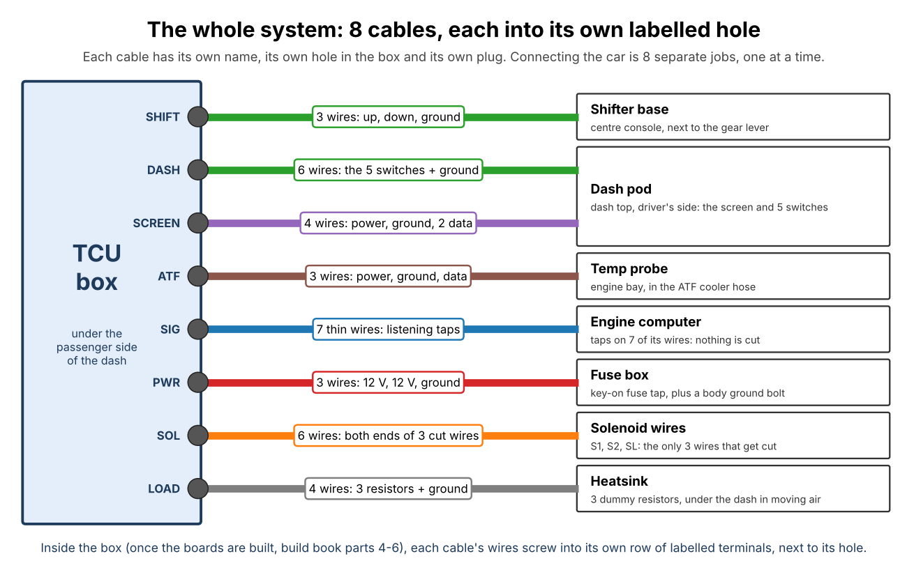

# System review: fail-safes, fallbacks and integrity

A whole-system review of the RAV4 transmission controller before it goes on a custom circuit
board. It covers how the parts fit together, what happens when each one fails, how every
behaviour is tested, and the risks that are left.

**Verdict:** every failure we can think of ends with the factory computer in charge, and nearly
all of them are also reported on the screen. All tests pass (§6). There are no known open
defects. The remaining risks (§7) can't be designed out, or can only be checked on the real car.
The design is ready to become a circuit board once the bench checks in §8 have been done on the
hand-built prototype.

---

## 1. The system on one page



| Piece | Where | What it does |
|---|---|---|
| **TCU box** | Under the passenger side of the dash | An Arduino Mega with three boards: power board (relays, drivers, inputs), logic board (switch inputs, screen, temperature probe, gyro) and a hub on the Mega. It listens to the engine computer and can take over the transmission's three solenoids. |
| **Dash pod** | Dash top, driver's side | The screen, then ECO, SPORT, MANUAL, TEST and ON/OFF in a row. |
| **Shifter base** | Centre console | The Beavis sequential lever (two microswitches). |
| **Car side** | — | 7 listening taps (nothing cut), the 3 solenoid wires (cut and taken through the box), key-on power, the ATF temperature probe, a heatsink with 3 dummy resistors. |

**How control works.** Each of the three solenoids (S1, S2, SL) has its own two-pole relay:

```
relay OFF (no coil power):  factory ECU ──────────────► solenoid      the car as built
relay ON  (coil powered):   factory ECU ──► 15 Ω dummy (ECU sees a normal load, no trouble code)
                            TCU driver  ──────────────► solenoid
```

The relays are only ON while the TCU is in charge. Everything in this review comes back to one
rule: **anything that goes wrong turns the relays off.**

---

## 2. The safety chain

The layers below each work on their own. The ones at the top don't need the Arduino to work.

| # | Layer | What it does | Needs the Arduino? |
|---|---|---|---|
| 1 | **Bypass plug** | Unplug the TCU, plug the BYPASS plug into the car's X2: the solenoids are wired straight to the ECU. The car is 100 % stock. | No |
| 2 | **Relays rest in the factory position** | No power, a dead Mega, a blown fuse, a cut wire: the relays drop out and the ECU drives. | No |
| 3 | **ON/OFF cuts the relays' power directly** | The switch has two poles. Pole 2 carries the relay coils' 12 V (through the dash cable, C7/C8), so OFF drops the relays even if the Mega has crashed with its outputs ON or a driver chip has failed shorted. | No |
| 4 | **Pull-downs on every output** | 10 kΩ on D6, D8, D9, D10: while the Mega resets or boots, every relay and driver reads OFF. | No |
| 5 | **Watchdog, 250 ms** | A hung program resets the Mega within a quarter of a second; the reset turns everything OFF (layer 4). The self-test proves the watchdog works. | Its own timer |
| 6 | **Faults hand back and latch** | Every fault in §4 turns the relays off and stays off until you flip ON/OFF off (or, for stuck hardware, until the next key-on). | Yes |
| 7 | **Rules for taking over** | Only after a fresh OFF→ON flip (≥ 100 ms off), only in D, only with exactly one of ECO/SPORT/MANUAL on, only when calibrated, only when the sensed gear agrees with engine rpm. Never by itself at key-on or after a reset. | Yes |
| 8 | **Self-tests** | At every key-on (PBIT), all the time (CBIT) and when you hold TEST (IBIT). Detailed in spec §7. | Yes |

Layers 1–5 mean that a software bug can't keep the relays on against your will: **ON/OFF off
always wins.**

---

## 3. Fallbacks: what you get when

| Situation | Who shifts | Screen |
|---|---|---|
| ON/OFF off | Factory ECU | TCU IS OFF |
| Key-on with ON/OFF already on | Factory ECU until you flip it off and on | WAITING |
| No mode switch on / two or more on (> 1 s) | Factory ECU; the TCU takes back over by itself when fixed | PICK MODE / MODE ERROR |
| Lever moved out of D | Factory ECU; back to TCU when you return to D (synced to the ECU's gear) | STOCK |
| Takeover asked for on the move, but the sensed gear doesn't fit engine rpm | Factory ECU until the car stops | STOP FIRST |
| Any fault (§4) | Factory ECU | PROBLEM + what's wrong |
| Not calibrated yet | Factory ECU | NOT READY |
| Screen dead or unplugged | TCU carries on (the screen is information only) | — |
| ATF probe or tach lost | TCU carries on, using safe defaults | warning |
| Box unplugged or removed | Factory ECU, via the bypass plug | — |

---

## 4. Failure modes and what happens

How to read this table: **Detected by** is what notices; **Result** is the state the car ends up
in; **Tested by** names the automated test that proves it (unit test function in `test/`,
system scenario in `test/system/`, or cross-check in `tools/system_check.py`). "Hardware" means
it is physics, not software: it happens even if the Mega is dead.

### Power and the Arduino

| Failure | Detected by | Result | Tested by |
|---|---|---|---|
| Key-on power lost / fuse blows | Hardware | Relays drop: ECU | system: *battery voltage collapses* |
| Battery below 10.5 V or above 16 V for 0.5 s | `FAULT_SUPPLY` | ECU, PROBLEM | unit `test_supply_and_tps_faults`; system: *battery voltage collapses* |
| Load dump / spikes on 12 V | TVS1/TVS2 (27 V) | Clamped | — (part choice) |
| Wires reversed at X1 | D1 blocks on the logic feed; TVS1 conducts on the driver feed and blows its 5 A fuse | Logic protected, nothing powered | — (part choice) |
| 5 V buck fails shorted (12 V on 5 V) | TVS3 clamps, the 2 A fuse blows | Mega off: relays drop, ECU | — (part choice) |
| Program hangs | Watchdog (250 ms) | Reset, everything off, ECU | system: *firmware hung with relays on*; IBIT watchdog step |
| Reset mid-drive (any cause) | Pull-downs + arming rule | Relays drop; **no** automatic re-takeover | unit `test_boot_requires_switch_cycle`, `test_boot_glitch_does_not_arm`; system: *reset at 50 mph* |
| Mega's outputs stuck ON (crash, damaged pin, shorted ULN2803) | You flip ON/OFF off | Relays drop in hardware | system: *firmware hung with relays on* |

### The ON/OFF switch and its wiring

| Failure | Detected by | Result | Tested by |
|---|---|---|---|
| Read pole's wire (C5) broken | Reads OFF | ECU (safe direction) | system: *ON/OFF turned OFF while driving* |
| Read pole's wire shorted to ground (reads ON) | Power pole still cuts; A7 vs D26 disagree | Relays drop in hardware, `FAULT_ONOFF` | unit `test_onoff_two_poles_and_relay`; system: *ON/OFF read wire shorted* |
| Power pole wire (C7/C8) broken, F2 blown | A7 sees no coil power with D26 ON | ECU, `FAULT_ONOFF` | system: *relay coil fuse blown* |
| Power pole welded or shorted (no hardware cut) | A7 sees coil power with D26 OFF; key-on and IBIT cut checks | `FAULT_ONOFF` on the screen; the firmware's own OFF still works | system: *ON/OFF power pole shorted*; IBIT *ON/OFF CUT* |
| C7/C8 shorted to ground | F2 (PTC) trips | No coil power: ECU, `FAULT_ONOFF` | cross-check 5 (PTC in the feed) |
| Switch bounce, a glitch at boot | Debounce + ≥ 100 ms OFF before arming | Not armed | unit `test_debouncer`, `test_boot_glitch_does_not_arm` |

### Relays, drivers and solenoids

| Failure | Detected by | Result | Tested by |
|---|---|---|---|
| Relay welded / stuck in the TCU position | Key-on relay-release check (drivers on, relays off: any current = stuck) | No takeover all drive, RELAY STUCK | unit `test_onoff_two_poles_and_relay`, `test_detects_faults`; system: *relay welded* |
| Relay doesn't pull in | Current check (commanded on, < 0.6 A) | ECU, `FAULT_SOLENOID` | unit `test_cbit_solenoid_fault` |
| Solenoid wire broken (open) | Current check | ECU, `FAULT_SOLENOID` | system: *solenoid wire breaks while driving* |
| Solenoid wire shorted to ground | Current check (> over-current limit) | ECU, `FAULT_SOLENOID` | unit `test_cbit_solenoid_short`; system: *solenoid wire shorted* |
| Driver MOSFET fails shorted | Current check (commanded off, > 0.2 A) | ECU (the relay disconnects the driver) | unit `test_cbit_solenoid_short` |
| Wrong gear engaged (swapped S1/S2, hydraulic fault, bad sensor) | Ratio check: rpm vs speed × gear, with lockup on | ECU, `FAULT_RATIO` / WRONG GEAR | unit `test_ratio_fault` |
| Relay coil flyback when ON/OFF opens | DF (UF4007) and the ULN2803's diodes | Clamped | cross-check 5 (DF on the coil feed) |

### Sensors and inputs

| Failure | Detected by | Result | Tested by |
|---|---|---|---|
| Speed signal lost at speed | Speed drops faster than any car can brake | ECU, `FAULT_VSS` | unit `test_vss_faults`; system: *speed signal lost at 45 mph* |
| Speed signal dead from the start | Engine working hard in 2nd+ at "0 mph" for 3 s | ECU, `FAULT_VSS` | unit `test_vss_faults` |
| Throttle sensor open/short | Voltage out of range for 0.2 s | ECU, `FAULT_TPS` | unit `test_supply_and_tps_faults` |
| Tach lost | No rpm above 15 mph for 2 s | TCU carries on: over-rev guards use speed × ratio, ratio check pauses; NO RPM warning | unit `test_onoff_two_poles_and_relay`; system: *tach lost* |
| ECU sense input dead or mis-wired | Sensed gear vs engine rpm at takeover | Waits for a stop, then starts in 1st | unit `test_entry_plausibility`, `test_entry_sync`; system: *ECU sense dead* |
| Lever-D input broken (reads "not D") | Reads not-D | ECU (safe direction) | system: *lever out of D* |
| **Lever-D input stuck on** (reads D in P, R, N, 2, L) | Engine starts while it reads D (the starter only turns in P or N) | No takeover until the next key-on, LEVER SENSOR | unit `test_lever_stuck_at_start`; system: *lever-D input stuck on* |
| Brake input dead | Self-test prompt PRESS THE BRAKE | Lockup still releases on throttle-off rules; found at the next self-test | IBIT prompts |
| ATF probe unplugged | Bad readings | Warning; lockup uses the normal rules | system: *ATF probe unplugged* |
| ATF overheats | 110 °C / 125 °C | Warning; lockup held on to cool | system: *ATF overheats*; unit `test_hot_atf_widens_lockup` |
| Gyro dead | Self-test, `latValid` false | Corner hold switched off; everything else carries on | unit `test_corner_hold` |

### Driver controls

| Failure | Detected by | Result | Tested by |
|---|---|---|---|
| Two mode switches on, or none | Exactly-one rule, 1 s grace | ECU until fixed, MODE ERROR / PICK MODE | unit `test_mode_switch_fault_and_stuck_button`; system: *two mode switches on* |
| Mode switch wire broken | Reads off: none on | ECU, PICK MODE | same |
| Shifter microswitch stuck | Held 10 s | Warning (SHIFTER?); no repeat shifts | unit `test_mode_switch_fault_and_stuck_button`, `test_no_autorepeat_and_interval` |
| Dangerous shift asked for | Over-rev check (5,800 rpm), 1st capped at 28 mph, rev-limit upshift at 6,200 rpm | Refused or corrected | unit `test_downshift_overrev_guard`, `test_rev_limit_upshift`, `test_manual_auto_downshift_to_stop` |
| Screen cable cut / screen dead | I²C timeout (3 ms) | Control unaffected, loop never stalls | system: *screen cable cut* |

### The self-test itself

| Failure | Detected by | Result | Tested by |
|---|---|---|---|
| Self-test started with the engine running | Two checks: rpm **and** charging voltage | Refused (CAN'T TEST) | unit `test_interlocks`; system: *self-test refused with the engine running* |
| Car moves / lever to D / engine starts mid-test | Checked every loop | Test aborts, everything off at once | unit `test_abort` |

---

## 5. Integrity: does everything agree?

`tools/system_check.py` checks the things no single test sees, by reading the actual board
layouts, firmware, housings and documents:

1. Every Mega pin the firmware uses is wired through the hub to the board signal that means the
   same thing, and nothing on the hub is unused.
2. Every net at a ribbon-header pin carries that pin's Mega signal.
3. Every output that drives a relay or a solenoid driver has its 10 kΩ pull-down.
4. Every switch input has its pull-up, series resistor, capacitor and clamps.
5. The ON/OFF hardware cut: the relay coils are fed **only** through J5 (the switch's power pole),
   through the PTC, with the flyback diode, and the sense reaches A7.
6. The box's glands, the boards' terminal groups and the cable map agree.
7. Every screen text fits where it's drawn.
8. Part counts on the shopping list match the boards.
9. The spec's pin table lists every pin the firmware uses.
10. Every link in the documents points at a file that exists.

The checker was itself tested by breaking things on purpose (a wrong hub pin, relay coils fed
straight from 12 V, an over-long screen line, a missing pull-down): it caught every one.

**Physical fit** (`tools/build_stl.sh`): each housing's fit check intersects every part, wire
bundle, plug and gland with the housing and with each other, and must come out empty:

- **TCU box:** boards, Mega and hub, both ribbons with their plugs, every cable's wires fanning
  from its gland to its terminals (including the dash cable's C7/C8 to J5), the lid lip, and at
  least 15 mm of working room in front of the terminals.
- **Dash pod:** every switch body with its terminals and a wire bend (ON/OFF modelled as a
  2-pole switch, 18 × 22 × 50 mm), the screen, 8 lever connectors, both glands, the ON/OFF
  cover, and the pod tilting through its whole range on the hinge.
- **Shifter base:** bolt tips, mounting bolts, the gland and cable, connectors, and the real
  Beavis shifter body standing on the deck with its wire hole opening into the body's pocket.

All three pass.

---

## 6. Test results

| Suite | What | Result |
|---|---|---|
| `make test` | Unit tests: every control rule, fault, interlock and self-test step (`test/test_tcu_logic.cpp`, `test/test_self_test.cpp`) | **1,134 + 122 checks, 0 failures** |
| `make system` | The real `tcu.ino`, compiled for a PC, wired to a simulated car (engine, gears that follow the solenoids, relays that follow coil power, welded contacts, broken wires), one failure per scenario | **25 scenarios, 0 failures** |
| `make calibrate-test` | The calibration helper on a simulated parked session and drive, with a speed sensor 6 % off and an engine 5 % off: it must find both, write a `config.h` that compiles, and refuse bad recordings | **29 checks, 0 failures** |
| `python3 tools/system_check.py` | Cross-checks (§5) | **all pass, 0 problems** |
| `tools/build_stl.sh` | Fit checks (§5), STLs, renders | **all pass** |
| `make avr` | Compile for the Mega 2560, warnings as errors | **OK**: 15 % flash, 51 % RAM |

`make check` runs the unit tests, system test, calibration test and cross-checks together. Run it
after any change.

**System scenarios** (each in its own process, from a cold boot):

| Scenario | Shows |
|---|---|
| boots parked | key-on checks pass, factory ECU drives |
| ON/OFF already ON at key-on | waits for a fresh flip |
| normal drive | takes over in D, shifts 1-4, watchdog kicked |
| ON/OFF turned OFF while driving | ECU back within 60 ms |
| firmware hung with relays on | ON/OFF still cuts them in hardware |
| ON/OFF read wire shorted | power pole cuts, mismatch reported |
| ON/OFF power pole shorted | found at key-on and reported |
| relay coil fuse blown | no takeover, reported |
| relay welded | found at key-on, no takeover |
| solenoid wire breaks while driving | ECU back, reported |
| two mode switches on | ECU after 1 s, back when fixed |
| lever out of D | ECU back |
| lever-D input stuck on | found at engine start, no takeover |
| speed signal lost at 45 mph | ECU back |
| tach lost | still in control, warned |
| screen cable cut | control unaffected, loop never stalls |
| battery voltage collapses | ECU back |
| ECU sense dead, takeover on the move | waits for a stop |
| reset at 50 mph | relays drop, no takeover after the reboot |
| solenoid wire shorted | over-current, ECU back |
| ATF probe unplugged | warned, still in control |
| ATF overheats | warned, lockup held to cool it |
| self-test (IBIT) | every check passes, including the hardware cut |
| self-test refused with the engine running | refused |
| build book 13.4 (jack stands), step by step | the screen says what the book says at each step |

### What this review found and fixed

| Found | Fix |
|---|---|
| ON/OFF only *asked* the Mega to hand back: a crashed Mega or a shorted driver chip could keep the relays on | Two-pole switch; pole 2 carries the coils' power (J5, F2, DF), A7 checks it, `FAULT_ONOFF`, IBIT step ON/OFF CUT |
| **Bug:** the switch filters started at "off", so a switch already ON at key-on (or after a reset at speed) looked like a fresh flip and armed the TCU | Filters start from the real pin level; arming needs ≥ 100 ms of OFF first |
| A dead ECU-sense input reads as "4th gear": a takeover on the move could start in the wrong gear | Sensed gear must agree with engine rpm, else wait for a stop |
| A welded relay was only found when you ran the self-test | Relay-release check at every key-on, `FAULT_RELAY` |
| Losing the tach while driving was silent | NO RPM warning |
| A lever-D input stuck on was never noticed | Checked at every engine start, `FAULT_LEVER` |
| A failed 5 V regulator could put 12 V into the Mega | TVS3 across the 5 V rail |
| Several screen lines were too long for the display | Shortened; now checked automatically |
| The dash cable's C7/C8 route to J5 crossed the logic board | Routed along the front gap, then back between the boards; fit check passes |
| The ON/OFF switch was modelled as a 1-pole switch; the pod had room for only 5 connectors | Modelled as a larger 2-pole switch with 8 connectors; pod fit check passes |
| Before calibration the self-test marked CALIBRATED as **BAD**, so the bench test could never say ALL OK, and the main screen said SELF-TEST BAD | "Not calibrated yet" is now a CHECK (a reminder) |
| On the bench nothing drives the gas pedal input, so the self-test always reported GAS PEDAL BAD | Build book 10.1: a two-resistor gas pedal stand-in for the bench |

---

## 7. What's left: honest residual risks

Nothing on this list has a known fix that wouldn't add a new risk of its own.

1. **A dummy resistor goes open while the TCU is in charge.** The ECU sees an open solenoid
   circuit, stores a trouble code, lights the check-engine light, and may run its own limp mode
   after you hand back, until the next key cycle. The TCU can't see it (it senses the ECU's
   command voltage, not the current into the dummy). *Mitigation:* 50 W resistors on a
   heatsink, checked in build book part 9; the light tells you. Not dangerous.
2. **Relay contact gap at handover.** Break-before-make takes about 5–10 ms with no drive to the
   solenoid. That's shorter than the hydraulics respond, so no shift happens, but it's not zero.
3. **The screen going dark doesn't hand back.** By design: the screen is information, not
   safety. Faults still hand back; ON/OFF still works by feel (the cover).
4. **A relay that sticks *during* a drive** (rather than at key-on). If it sticks in the TCU
   position after you hand back, that solenoid gets no command from either side until it's
   found at the next key-on (RELAY STUCK). The relays switch about 1 A against an 8 A rating,
   so welding is very unlikely. *Recovery:* the bypass plug.
5. **The solenoid wire itself (outside the box) shorted to +12 V.** The solenoid is on whatever
   either computer says. This is the same as on a stock car; the ratio check catches the wrong
   gear while the TCU is in charge.
6. **Brake input dead.** Lockup then releases only on the throttle rules, not on the brake. A
   stall is still prevented by the low-speed lockup release, and the next self-test finds it.
7. **What the manual valve does in 2, L and R with D-range solenoid commands** (only possible
   with a stuck lever-D input, which is now caught at engine start). Toyota's hydraulics are
   expected to block it; **VERIFY** in the repair manual.
8. **Untested on real hardware.** Every number above comes from simulation and the design.
   Calibration (spec §8) and the staged test plan (spec §9) are required before driving.
9. **Zero risk isn't possible.** A double failure (for example a hung Mega *and* a welded
   ON/OFF power pole) defeats two layers at once. The bypass plug, and pulling the TCU's
   fuse, are always there.

---

## 8. Before the custom circuit board

The design is complete and consistent. Before the layout is frozen into a PCB, build the
hand-made perfboard version and confirm on the bench (build book part 10):

- [ ] `IS_AMPS_PER_VOLT` calibrated; each solenoid channel reads about 0.8 A into 15 Ω.
- [ ] The full self-test passes, including **ON/OFF CUT** and **SAFETY RESET** (the watchdog
      reset comes back up, the bootloader doesn't boot-loop).
- [ ] J5 jumper out: the relays drop and JA 25 reads 0 V; jumper in: about 2 V.
- [ ] The 2-pole ON/OFF switch you bought fits the pod (18 × 22 mm body or smaller) and its
      cover clears.
- [ ] Relay coil current measured (for sizing F2 on the PCB; the G2RL-2 is about 33 mA each).
- [ ] Everything in spec §10 (open items to VERIFY) ticked off.

Then the PCB can reuse the same schematic (the nets in `tools/boards.py`) and keep the same
connectors, so the cables, housings and tests carry over unchanged.
