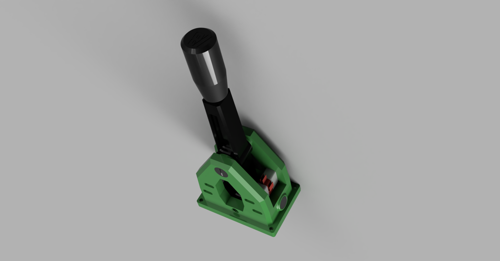

# DIY Racing Sim Sequential Shifter (by Beavis Motorsport)

The shifter lever in this project is **not our design**. It is the **DIY Racing Sim Sequential
Shifter** by **bbeavis (Beavis Motorsport)**, shared on Thingiverse as
[thing 4557771](https://www.thingiverse.com/thing:4557771) and on Printables as
[model 371496](https://www.printables.com/model/371496-diy-racing-sim-sequential-shifter), with a
build guide at [beavismotorsport.com](https://beavismotorsport.com/sim-racing/diy-sequential-shifter/)
and an assembly video on [YouTube](https://www.youtube.com/watch?v=a-w8Zu3LSlE). Thank you to
its author for designing it and sharing it for free.

## License

Creative Commons **Attribution-NonCommercial** (CC BY-NC), as stated in [LICENSE.txt](LICENSE.txt).
The STL files in this folder are the author's, unchanged, copied from the Thingiverse download
so the project's 3D models can show the real shifter on our [shifter base](../README.md#shifter-base).
You may print and share them for **non-commercial** use, with credit to bbeavis. Don't sell
them or anything made from them.

| File | What it is | Print it? |
|---|---|---|
| `MainBody.stl` | Main body | Yes |
| `ShifterShaft.stl` | Shift lever | Yes |
| `SwitchSpacer.stl` | Switch spacer | Yes, **4** |
| `PivotPin.stl`, `PivotCap.stl` | Pivot pin and cap (if you use the metal pivot tube) | Optional |
| `Knob.stl` | Shift knob (the author used a real one with an M10 × 1.5 thread) | Optional |
| `BottomCover.stl` | Cover for the Arduino pocket | **Not needed here**: the TCU reads the switches directly, and our shifter base's deck closes the pocket |

The STLs keep the positions the author exported them in (the whole shifter assembled, upside
down), which is how `hardware/shifter_base.scad` places them on the base for the pictures.

## What changes for the car

- **Print in PETG or ASA, not PLA.** The author used PLA on a sim rig; a car's cabin gets hotter
  than PLA's ~55 °C softening point. Keep the author's 3 walls and ~50 % infill for the body and
  shaft.
- **No Arduino Pro Micro.** Its two V-155-1C25 switches wire straight to our cable (wiring
  guide §8).
- **Mounting holes:** the body's four holes print at 6.0 mm. Drill them to 6.5 mm so the M6
  bolts pass freely into the nut traps in our shifter base.
- **Height:** assembled with the printed knob it stands about **33 cm** above our base (about
  35 cm above the console). Check it clears the dash and the radio and suits your arm before
  you drill anything. A shorter M10 stud or a lower knob brings it down a few centimetres.
- **Direction:** the lever swings along the body's long side, so the long side of the shifter
  base points front-to-back in the car.
