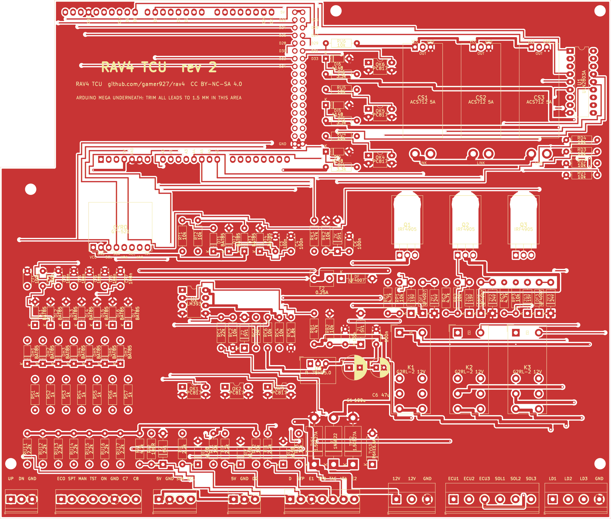

# The TCU circuit board

One 2-layer board, 200 × 170 mm, that plugs straight onto the Arduino Mega and carries the
whole TCU circuit. You order it bare and solder the parts in yourself
([build book](../../docs/05-build-book.md), parts 4–6): every connection between the parts is
already a copper track, so there's no wiring on the bench.

## Ordering it

Upload **[`rav4-tcu-gerbers.zip`](rav4-tcu-gerbers.zip)** as it is (don't unzip it) to a board
maker such as JLCPCB, PCBWay, OSH Park or Aisler. Their website reads the size and the number
of layers from the zip. Pick these options:

| Option | Choose |
|---|---|
| Layers | **2** |
| Size | 200 × 170 mm (read from the zip) |
| Thickness | **1.6 mm** |
| Copper weight | **1 oz** |
| Surface finish | **HASL lead-free** (or ENIG) |
| Solder mask colour | Any. Green is usually the cheapest and fastest |
| Quantity | **5** (the usual minimum) |
| Everything else | Leave at the default. You do **not** want assembly or a stencil |

It costs about **$20–40 for five boards**, shipping included, and arrives in 1–2 weeks. Boards
over 100 × 100 mm cost a bit more at some makers. That's normal. Before you pay, look at the
maker's preview of the board: it should match the picture above, with a notch in the back-left
corner and 5 mounting holes.

## What's in this folder

| File | What it is |
|---|---|
| `rav4-tcu-gerbers.zip` | **The file to upload**: copper, solder mask, labels, outline and drill files |
| `gerbers/` | The same files unzipped, to look at in a Gerber viewer |
| `rav4-tcu.kicad_pcb`, `.kicad_pro` | The board in KiCad 7 or later, if you want to look closer or change it |
| `rav4tcu.pretty/` | The board's own footprints: the Mega's pins, the current-sensor module, the gyro module |
| `bom.csv` | Every part on the board with its reference, value and footprint |
| `drc.txt` | KiCad's design-rule check report: 0 errors and 0 unconnected pads |
| `part_fit.md` | **Will the real parts fit?** Every part checked at the largest size it's sold in: legs vs holes, bodies vs neighbours, heights. 0 problems |
| `placement.png`, `routed.png` | Pictures of where every part goes, and of every track |

The [shopping list](../../docs/04-shopping-list.md) has every part with where to buy it. The
build book's six soldering steps say which parts go in at each step.

## About the design

- **It is generated.** [`tools/pcb.py`](../../tools/pcb.py) builds the board from the tested
  circuit in [`tools/boards.py`](../../tools/boards.py): it places every part, routes every
  track with [`tools/pcb_router.py`](../../tools/pcb_router.py), fills both sides with ground,
  and refuses to write anything if KiCad's design-rule check finds an error or an unconnected
  pad. It needs KiCad 7's Python module (`python3 tools/pcb.py`). Don't edit the board by hand:
  change the script and run it again. `make check` then checks that every pad is on the net the
  circuit says.
- **Made to be easy to solder:** through-hole only, with big pads (a 0.6 mm copper ring round
  each hole where there's room, long oval pads on the chips), every part's **name and value**
  printed next to it (RU11 2.2k, DL1 BAT85…), the Mega's used pins labelled, every screw
  terminal labelled with its signal, sockets for the two bigger chips, and no ground pad joined
  solidly to the ground copper (those soak up the iron's heat).
- **Tracks sized for the current:** 1.5 mm for the solenoid supply, 1.0 mm for the solenoid,
  dummy-load and 12 V lines, 0.8 mm for the relay coils and the 5 V rail, 0.4 mm for signals.
- **The screw terminals** run along the front edge in the same order as the box's glands:
  SHIFT, DASH, SCREEN, ATF, SIG, PWR, SOL, LOAD.
- **The Mega sits underneath,** joined by plain male header strips soldered into the board. A
  notch leaves its USB and power jacks free.
- **5 V** comes from a fixed RECOM R-78HB5.0-0.5 regulator (9–72 V in): nothing to adjust.

**Nothing has been made from these files yet.** The first board you build is the first test of
the layout: check it carefully, step by step, with the build book's meter checks, and see the
[system review §8](../../docs/06-system-review.md#8-the-circuit-board).

---

*RAV4 TCU by gamer927 · [CC BY-NC-SA 4.0](../../LICENSE): free to build, not to sell. That
includes the board: you may have boards made for your own build, but not sell them.*
