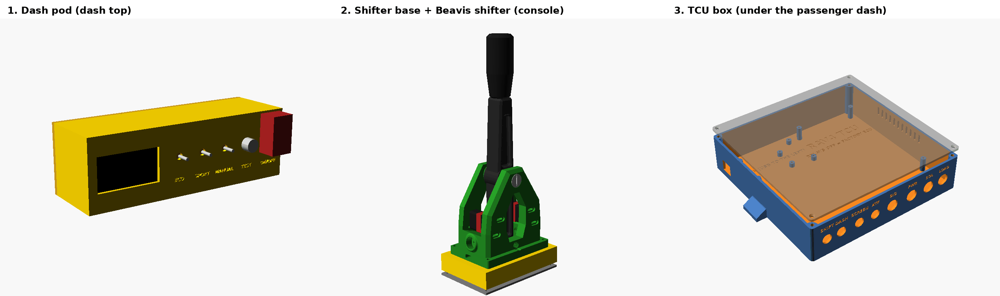

# Build book: 1999 RAV4 transmission controller

<!-- Generated by tools/boards.py from tools/build_book_template.md. Edit the template, then run
     python3 tools/boards.py -->

**Use it like a Lego book.** Do one small step at a time, in order. Each step has a picture, a
list of what you need, and boxes to tick.

Lots of steps end with a **✅ CHECK**. **Don't move on until the check passes.** A mistake
caught straight away takes a minute to fix. Caught at the end, it takes a whole weekend.

You don't need to understand electronics. If you can match a picture to a board, use a
multimeter and solder, you can build this.

| Part | What you do | How long |
|---|---|---|
| [0](#part-0--look-at-the-car) | Look at the car and measure. Nothing gets cut. | 1 evening |
| [1](#part-1--buy-the-parts) | Buy the parts | 1 evening + delivery |
| [2](#part-2--start-printing) | Start the 3D prints (they print while you solder) | about 45 h of printing |
| [3](#part-3--get-ready) | Set up the table, sort the parts into bags | 1 hour |
| [4](#part-4--power-board) | Build the big board | 3 evenings |
| [5](#part-5--logic-board) | Build the small board | 1 evening |
| [6](#part-6--hub-on-the-mega) | Build the hub that sits on the Arduino | 1 evening |
| [7](#part-7--screen) | Wire the screen | 1 hour |
| [8](#part-8--dash-pod-and-shifter-base) | Build the dash pod and the shifter base | 1 evening |
| [9](#part-9--dummy-loads) | Bolt the 3 big resistors to the heatsink | 30 min |
| [10](#part-10--test-everything-on-the-bench) | Test everything on the table | 1 evening |
| [11](#part-11--close-the-box) | Put it all in the box | 1 evening |
| [12](#part-12--put-it-in-the-car) | Put it in the car | 4 evenings, one job each |
| [13](#part-13--calibrate-and-drive) | Teach it your car, then test drive in 4 stages | 2 evenings + a week of normal driving |

---

## Before you start

### Words you'll see

| Word | What it means |
|---|---|
| **TCU** | This project: the box that can shift the transmission. |
| **Engine computer (ECM)** | The car's own computer, under the dash. It normally shifts the transmission. It stays in the car, untouched. |
| **Solenoid** | An electric valve inside the transmission. Three of them (called **S1, S2, SL**) choose the gear. These are the only 3 car wires that get cut. |
| **Mega** | The Arduino Mega: the little computer inside the TCU box. |
| **Board** | A flat card full of holes. The parts push through the holes and get soldered underneath. |
| **col / row** | Which hole. The board pictures have numbers along the edges. "col 5, row 57" means 5 holes across, 57 holes up. |
| **Screw terminal** | A small block where a wire is held by a screw. Each one has a name such as **J2a** printed in the pictures. |
| **Ribbon socket (JA, JB)** | A plastic socket with two rows of pins, for a flat ribbon cable. **Pin 1 is the square pad.** Odd pins (1, 3, 5…) are in one row and even pins (2, 4, 6…) in the other. |
| **Ground (GND)** | The minus (−) side of the 12 V. On a meter, the black probe goes on ground. |
| **12 V / 5 V** | Voltages. 12 V is the car battery. 5 V is what the Mega runs on. |
| **Relay** | A switch moved by a magnet. It clicks when it gets power. |
| **Resistor** | A small part with coloured stripes. The stripes tell you its value. Each step lists the colours to look for. |
| **Diode** | A small part that only works one way round. **The end with the stripe matters.** |
| **Chip** | A black part with legs. It has a **notch or dot at one end**: match it to the picture. |
| **Module** | A small ready-made board you stick down with foam tape and wire to. |
| **Gland** | The round plastic fitting a cable goes through in the box wall. Tighten it and it grips the cable. |
| **Insert** | A small brass nut you press into the plastic with the hot soldering iron. Screws then go into it. |

### Three skills

**1. The multimeter.** You only need two settings.
- **Beep** (the setting with a speaker symbol). Touch the two probes to two points. A beep
  means they are connected.
- **Volts DC** (V with a straight line). Put the black probe on ground and the red probe on
  the point you're measuring.

**2. Soldering a part.**
1. Push the legs through the holes.
2. Turn the board over. Bend the legs out a little so the part can't fall out.
3. Touch the iron to the leg **and** the copper ring around it, together, for 2 seconds.
4. Feed in solder until it flows around the leg like a little volcano.
5. Take the solder away first, then the iron.
6. Snip the leg off just above the joint.

**3. Soldering a wire.**
1. Strip 4 mm of plastic off the end. Twist the strands.
2. Melt a little solder into the strands.
3. Hold the wire against the leg on the underside, and touch the iron to both. They join.

A wire that visits several stops: strip a short window of plastic at each stop. Or use
separate short wires from stop to stop. Both work.

### If a check fails

1. **Stop.** Don't go on to the next step.
2. Compare the board with the picture, part by part. Is anything in the wrong holes, or the
   wrong way round (diodes, chips, the big capacitor)?
3. Look at the underside under a bright light. Look for a **blob of solder joining two pads
   that shouldn't touch**. This is the most common fault. Heat it and drag the iron away to
   split it.
4. Look for a joint that looks dull or lumpy, or a leg with no solder. Reheat it.
5. Do the check again.

### Stay safe

- **Disconnect the car battery's negative (−) terminal before every job on the car.**
- The iron is hot: put it back in its stand every time.
- Wear glasses when snipping legs. Snipped legs fly.

---

## Part 0 — Look at the car

Nothing gets cut or changed today. You're finding things and writing them down.

**You need:** a multimeter, a tape measure, a pen, your phone (for photos), and the factory
repair manual and wiring diagram for your car (search for "1999 RAV4 repair manual" and
"1999 RAV4 EWD").

- [ ] **Transmission code.** Find the metal ID plate on the transmission. Write down the code. On
  a 4WD it's A241H or A540H.
- [ ] **Fuse size.** Pull one fuse out of the fuse box inside the car. Is it a **standard** or a
  **mini** fuse? Write it down.
- [ ] **A key-ON fuse.** Find a fuse that only has power when the key is ON. Check it with the
  meter: about 12 V with the key ON, 0 V with the key OFF. Write down which fuse it is.
- [ ] **Cooler hose size.** At the radiator, find the two transmission cooler hoses
  ([where they are](03-wiring-guide.md#the-atf-temperature-probe)). Measure the rubber hose's
  inside size: **5/16"** or **3/8"**.
- [ ] **Which hose is hot.** Start the cold engine and wait 2 minutes. Feel both hoses. The one
  that warms up first is the **hot hose**. Put a piece of tape on it.
- [ ] **A spot for the TCU box.** Kneel in the passenger footwell and look up under the dash,
  below the glovebox. You need:
  - a metal spot to bolt to (the dash frame, or somewhere to hang a steel bracket)
  - room for a box **216 × 192 × 51 mm** (244 mm wide with its mounting ears)
  - about 10 cm of free space in front of it for the cables
  - nothing in the way of the passenger's knees or the heater ducts

  No room? Take the glovebox out and look behind it instead.
  ([Why this spot](03-wiring-guide.md#where-the-tcu-box-goes).)
- [ ] **A spot for the heatsink** (100 × 100 × 25 mm) near the box, where air moves.
- [ ] **A spot for the dash pod** (200 × 64 × 64 mm) on the **dash top, driver's side**. Sit in
  the driver's seat. You must be able to see it without it blocking the road or the gauges.
  **Never put it over the passenger airbag** (the right-hand half of the dash top).
- [ ] **Room for the shifter base** (150 × 100 mm) on the centre console, next to the gear
  lever, long side pointing front-to-back. With the shifter on top it stands about **35 cm
  tall**: check it clears the dash and the radio. Move your hand through where the lever will
  swing: it mustn't hit the gear lever, handbrake, cup holder or your knee.
- [ ] **The engine computer's wires.** Find the engine computer (the repair manual's "location
  of components" page). For each wire below, do its meter test from
  [wiring guide §5](03-wiring-guide.md) and fill in the table. **Don't cut anything.** Take
  photos.

| Signal | What it is | Terminal | Wire colour | Test OK? |
|---|---|---|---|---|
| S1 | Solenoid 1 | | | ☐ |
| S2 | Solenoid 2 | | | ☐ |
| SL | Lockup solenoid | | | ☐ |
| SPD | Speed | | | ☐ |
| TAC | Engine rpm | | | ☐ |
| VTA | Gas pedal | | | ☐ |
| E2 | Gas pedal sensor ground | | | ☐ |
| E1 | Engine computer ground | | | ☐ |
| STP | Brake light | | | ☐ |
| D | Gear lever in D | | | ☐ |

✅ **CHECK:** every box ticked.
**If not:** stop here. Work out why before you buy anything. Every later step depends on
these wires being the right ones.

---

## Part 1 — Buy the parts

- [ ] Open the [shopping list](04-shopping-list.md) (about $650 of parts).
- [ ] Pick the brass tee that matches **your hose size**, and the fuse tap that matches **your
  fuse size** (both from part 0).
- [ ] Order the small electronic parts from **DigiKey or Mouser**.
- [ ] Order the modules and kits from **Amazon** (or AliExpress: cheaper but slower).
- [ ] Get the rest at a **hardware store** and an **auto-parts store**.

✅ **CHECK:** as boxes arrive, tick off each line of the shopping list.

---

## Part 2 — Start printing

The prints take a long time, so start them first. They can print while you solder parts 4
to 7.

**Use PETG or ASA plastic. Never PLA**: it goes soft in a hot car.
Printer settings: 0.2 mm layers, 4 walls, 30–40 % infill, no supports.
(More detail: [hardware/README.md](../hardware/README.md).)

The files are in `hardware/stl/`.

- [ ] **First, the test panel**: `dash_pod_panel_test.stl` (about 1 hour). It's a flat copy of
  the dash pod's front. When your switches and screen arrive, push each one into its hole. If
  one is too tight, the hole size can be changed in `hardware/dash_pod.scad` before you print
  the real pod.
- [ ] TCU box: `tcu_enclosure_box.stl` (about 12 h). If your printer bed is only 220 mm, print
  `tcu_enclosure_box_no_ears.stl` instead.
- [ ] TCU lid: `tcu_enclosure_lid.stl` (about 4 h).
- [ ] Dash pod: `dash_pod_shell.stl` (about 7 h, front face down on the bed).
- [ ] Dash pod back cover: `dash_pod_back.stl` (about 2 h).
- [ ] Dash pod mount: `dash_pod_mount.stl` (about 1 h).
- [ ] Shifter base: `shifter_base_box.stl` (about 5 h, upside down on the bed).
- [ ] Shifter base bottom plate: `shifter_base_bottom.stl` (about 2 h).
- [ ] The shifter's own parts, from [`hardware/beavis_shifter/`](../hardware/beavis_shifter/README.md)
  (designed by bbeavis; about 1.5 days of printing):
  - `MainBody.stl` and `ShifterShaft.stl`, with 3 walls and about 50 % infill
  - `SwitchSpacer.stl`, **4 times**
  - if you want them: `PivotPin.stl`, `PivotCap.stl`, `Knob.stl`
  - skip `BottomCover.stl`
  - use PETG, not the PLA its designer used

✅ **CHECK:** each print lies flat on the table without rocking.
**If not:** it warped. Print it again with the bed a little hotter, or a brim turned on.

---

## Part 3 — Get ready

- [ ] Clear a table. Lay out: soldering iron (set to about 330 °C), solder, flux, wire cutters,
  wire strippers, multimeter, hot-glue gun.
- [ ] **Make your bench power lead:** 12 V adapter → the screw-terminal plug → a **5 A fuse** on
  the + wire. Every test on the table goes through this fuse.
- [ ] **Print the two board templates** at **100 % size** (turn "fit to page" OFF):
  [big board](build/power-template.svg), [small board](build/logic-template.svg). Measure the
  prints with a ruler: they must be **90 × 150 mm** and **90 × 70 mm**. Tape each one to its
  board.
- [ ] If a board has no holes in its corners, drill four 3 mm holes, 3 mm in from each corner.
- [ ] **Sort the parts into bags.** One bag per step. Write the step name on each bag. Then
  every step starts with "open the bag":

{{BAGS}}

✅ **CHECK:** the meter reads about 12 V after the fuse, and every bag is full.
**If a bag is short:** order the missing part now, before you start soldering.

---

## Part 4 — Power board

This is the big board. Everything that connects to the car's wiring goes on it.

**How to read the pictures:**
- **"Place the parts" pictures** show the board from the **top**. New parts are coloured;
  parts you already fitted are grey. Red dots are the holes the new legs go through.
- **"Solder the wires" pictures** show the board **flipped over**, so left and right are
  swapped, like in a mirror. Each numbered wire starts at its number and follows the coloured
  line, stopping at every dot.
- **Diodes:** the purple circle shows where the **stripe** goes.
- **Chips:** the red circle with a "1" shows where the **notch or dot** goes.
- **Resistors:** match the coloured stripes listed for each one. Not sure? Measure it with the
  meter on Ω.
- **Thin wire** = the 22 AWG hook-up wire. **Thick wire** = the 18 AWG wire.

### Step P1 — Power in

{{STEP P1}}

**Now set the 5 V supply.** The power module comes set to the wrong voltage.
- [ ] Connect the bench 12 V: **+ to J1b**, **− to J1c**.
- [ ] Meter on volts, across the power module's **OUT+** and **OUT−**.
- [ ] Turn the little brass screw on the module until the meter shows **5.00 V**. It takes many
  turns. If the number goes the wrong way, turn the other way.
- [ ] Put a dab of hot glue on the screw so it can't move.

✅ **CHECK:** the module's output reads between 4.95 and 5.05 V.
Then swap the bench wires the wrong way round for one second: the output must read **0 V**.
That proves the wrong-way-round protection works. Put the wires back the right way.
**If not:** check the big diode **D1** is the right way round (stripe as in the picture).

### Step P2 — Ribbon socket

{{STEP P2}}

✅ **CHECK** (bench 12 V on J1b and J1c, black probe on **JA pin 2**): **JA pin 1** and **JA pin 3**
both read **5 V**.
**If not:** check the socket's notch faces the way the picture shows.

### Step P3 — Relays

**First, a 2-minute beep test on one relay**, to make sure it matches the pictures:
- [ ] Look at the bottom. There are **2 pins on their own at one end**: these are for the magnet
  (the "coil"). Down each side there are **3 pins**.
- [ ] Meter on beep. On each side, the **middle** pin beeps to the pin **nearest the 2-pin
  end**.
- [ ] Put 12 V on the two lonely pins. The relay **clicks**. Now on each side the **middle** pin
  beeps to the pin **furthest from the 2-pin end** instead.
- [ ] If yours does all that, it matches. **If it doesn't, stop**: it's a different relay from
  the one on the shopping list.

{{STEP P3}}

**Why J5a and J5b?** The relays don't get their 12 V directly. It goes out through **J5a** to the
ON/OFF switch on the dash, and comes back through **J5b**. So switching ON/OFF off cuts the
relays' power by itself, even if the Mega has frozen. On the table, put a short wire from
**J5a to J5b** to stand in for the switch.

✅ **CHECK** (12 V on J1a **and** J1b, − on J1c, the J5a–J5b wire in):
- [ ] Touch a wire from **JA pin 1** to **JA pin 7**. All three relays **click**. Take the wire
  away: they click off.
- [ ] Hold JA pin 1 to pin 7 again, and pull out the J5 wire. The relays click off.
- [ ] **JA pin 25** reads about **2 V** with the J5 wire in, and **0 V** with it out.

**If the relays don't click:** check the chip **U1** (notch as in the picture) and its wires.

### Step P4 — Solenoid terminals

{{STEP P4}}

✅ **CHECK** (power off, meter on beep):
- [ ] J2a beeps to J2d. J2b beeps to J2e. J2c beeps to J2f. (Relays off = the engine computer
  is connected straight through to the transmission.)
- [ ] Power on, and touch JA pin 1 to JA pin 7 so the relays click on. Now J2a **stops**
  beeping to J2d, and **beeps** to J4a instead.

### Step P5 — Solenoid drivers

{{STEP P5}}

✅ **CHECK:** clip one of the big 15 Ω resistors between **J2d** and **J1c**, lying on the
heatsink (it gets warm). Bench 12 V on J1a, J1b and J1c.
- [ ] Hold **JA pin 1** to **JA pin 7** (relays on) **and** to **JA pin 8**. J2d reads **about
  12 V**. The current sensor **CS1**'s OUT pin goes from about 2.50 V up to about 2.65 V.
- [ ] Take the wire off JA pin 8: J2d drops to **0 V**.
- [ ] Relays off (no wire on pin 7), wire on JA pin 8: J2d stays at **0 V**.
- [ ] Do the same for the second channel (JA pin 9, resistor on **J2e**) and the third (JA pin 10,
  resistor on **J2f**).

**If J2d stays at 0 V:** check transistor **Q1**'s metal tab faces the back, and its 3 wires.

### Step P6 — Car signal inputs

{{STEP P6}}

✅ **CHECK** (bench 12 V on): each JA pin below reads **5 V**. Then touch 12 V to its terminal:
the JA pin drops to **under 0.5 V**.
- [ ] Terminal J3a → JA pin 12
- [ ] Terminal J3b → JA pin 11
- [ ] Terminal J3e → JA pin 6
- [ ] Terminal J2a → JA pin 13
- [ ] Terminal J2b → JA pin 14
- [ ] Terminal J2c → JA pin 15

**If one stays at 5 V:** check its little 4-legged chip (dot as in the picture).

### Step P7 — Speed signal

{{STEP P7}}

✅ **CHECK:** JA pin 5 reads:
- [ ] **0 V** with nothing on J3d
- [ ] **5 V** with 5 V on J3d
- [ ] **5 V** with 12 V on J3d

### Step P8 — Gas pedal signal

{{STEP P8}}

✅ **CHECK:**
- [ ] 5 V (from JA pin 1) on J3f: JA pin 17 reads **about 5 V**. J3f to ground: **0 V**.
- [ ] The same for J3g and JA pin 18.

**The big board is done.** Look over the underside under a bright light for blobs of solder
joining two pads. Write **POWER** on the board.

---

## Part 5 — Logic board

This is the small board. It handles the switches, the screen, the temperature probe and the
gyro (it senses cornering).

For its checks, give it 5 V from the big board with two jumper wires:
**JA pin 1 → JB pin 1** and **JA pin 2 → JB pin 2**.

### Step L1 — Terminals and ribbon socket

{{STEP L1}}

✅ **CHECK** (5 V on): X5a and X6a read **5 V**.

### Step L2 — Switch inputs

{{STEP L2}}

✅ **CHECK** (5 V on): terminals **X7a, X7b, and X4a to X4e** each read **5 V**. Then touch each
one to a ground terminal (X7c or X4f): its JB pin below drops to **0 V**.

| Terminal | X7a (up) | X7b (down) | X4a (ECO) | X4b (SPORT) | X4c (MANUAL) | X4d (TEST) | X4e (ON/OFF) |
|---|---|---|---|---|---|---|---|
| JB pin | 3 | 4 | 5 | 6 | 15 | 8 | 7 |

### Step L3 — ATF probe

{{STEP L3}}

✅ **CHECK** (5 V on): X6c reads **5 V**.

### Step L4 — Gyro

{{STEP L4}}

Push the gyro down **flat**, chip side up, before soldering. Then put a dab of hot glue under its
far edge.

✅ **CHECK** (5 V on): the gyro's tiny light comes on.

---

## Part 6 — Hub on the Mega

The hub is the extra board that plugs on top of the Mega. Both ribbon cables plug into it.

- [ ] Put a piece of electrical tape on top of the Mega's metal USB socket, so nothing can touch
  it.
- [ ] Solder **socket A** (26 pins) near the hub's right-hand end, and **socket B** (16 pins)
  along its front edge. The square pad is **pin 1**.
- [ ] Solder one short wire from each socket pin to its Mega pin. Tick each one as you go:

{{HUB}}

✅ **CHECK** (meter on beep, hub plugged onto the Mega):
- [ ] Each socket pin beeps to its Mega pin.
- [ ] No two neighbouring socket pins beep to each other (except 5 V to 5 V, and GND to GND).

---

## Part 7 — Screen

The screen shows the **gear as a big number** with the mode beside it.

- [ ] **Set it up.** Look on the back for the setting printed **SPI** and **I2C** (sometimes
  **IIC**). The seller's page shows which tiny parts to move for I2C. Move them: heat one end,
  slide the part off, then solder it onto the I2C pads. *(Skip this if you bought one that's
  already set to I2C.)*
- [ ] Solder the 4-core screen cable: **VCC → red** core, **GND → black**, **DIN** and **CLK**
  to the other two. Write down which colour went where.
- [ ] Solder a short wire from **DC** to **GND**, and another from **CS** to **GND**.
- [ ] Solder a **10k resistor** (brown-black-black-red-brown) from **RES** to **VCC**.
- [ ] Solder the **1 µF capacitor** from **RES** to **GND**. If it has a stripe, the stripe side
  goes to GND.

✅ **CHECK** (meter on beep):
- [ ] **DC** beeps to **GND**, and **CS** beeps to **GND**.
- [ ] **VCC** does **not** beep to **GND**.
- [ ] Meter on Ω: **RES** to **VCC** reads about **10 kΩ**.
- [ ] At the **far end** of the cable, each core beeps to the screen pin you soldered it to
  (VCC, GND, DIN, CLK), and to no other.

Don't put it in the pod yet. It gets tested in part 10 first.

---

## Part 8 — Dash pod and shifter base

These are two separate pieces, each with its own cable to the TCU box:
- the **dash pod**: the screen and all the switches
- the **shifter base**: the lever you pull and push to shift

Neither needs the box yet.

**About the switches.** A small switch has 3 pins: a middle one and two outer ones. Meter on
beep, lever **up**: find the outer pin that beeps to the middle one. Use those two pins. Then
**lever up = on**.

**The ON/OFF switch has two halves.** It has 6 pins (two rows of 3), or 4 on some switches. Each
half is its own switch, and both flip together. Test each half the same way: lever up, find the
outer pin that beeps to that half's middle pin. Its red cover pushes the lever down (off) when
you close it.

### The dash pod

**8.1 Inserts.** Press the 4 brass inserts into the ends of the corner posts at the open back,
with the soldering iron at 230–250 °C. Push straight in; stop when they're flush with the
plastic.

**8.2 Screen and switches.** Left to right on the front:
- [ ] The **screen** goes into the pocket behind its window, face first. Stick it with
  double-sided foam tape on its black glass edge. It only fits one way.
- [ ] **ECO**, **SPORT**, **MANUAL**: the three small switches.
- [ ] **TEST**: the push button.
- [ ] **ON/OFF**: the big switch, with the red cover's hinge at the top.
- [ ] Tighten each nut from inside. The names are engraved under each hole.

**8.3 Cables.**
- [ ] Fit the 2 glands in the back cover: **SWITCHES** and **SCREEN**.
- [ ] Push the **8-core cable** through SWITCHES, and the screen's **4-core cable** (from part 7)
  through SCREEN.
- [ ] Join each core of the 8-core cable to its switch with a lever connector:

| Core | Goes to |
|---|---|
| C1 | ECO switch |
| C2 | SPORT switch |
| C3 | MANUAL switch |
| C4 | TEST button |
| C5 | ON/OFF switch, **first half** |
| C6 (ground) | the other pin of **every** switch and the button. Easiest: one black wire soldered from switch to switch, ECO → SPORT → MANUAL → TEST → ON/OFF (first half), with C6 joined to its end |
| C7 | ON/OFF switch, **second half**, middle pin |
| C8 | ON/OFF switch, **second half**, the outer pin that's on with the lever up |

**Never join the two halves of the ON/OFF switch.** C7 and C8 carry the relays' 12 V; the other
cores carry only 5 V.

**8.4 Back cover.** Screw the back cover on (4 × M3 × 10 countersunk). The two hinge tabs stick
out of the back.

**8.5 Mount:** later, in the car (part 12.4).

✅ **CHECK** (meter on beep, at the far end of the 8-core cable):
- [ ] C1 beeps to C6 only with ECO on.
- [ ] C2 beeps to C6 only with SPORT on.
- [ ] C3 beeps to C6 only with MANUAL on.
- [ ] C4 beeps to C6 only while TEST is pressed.
- [ ] C5 beeps to C6 only with ON/OFF on.
- [ ] **C7 beeps to C8 only with ON/OFF on.**
- [ ] C7 and C8 **never** beep to any of C1–C6.

**If a switch works backwards** (beeps when off): move its wire to the other outer pin.

### The shifter base

**8.6 Inserts.** Press 4 brass inserts into the base's corner posts, from underneath.

**8.7 Lever.** Build the Beavis lever as its guide and
[assembly video](https://www.youtube.com/watch?v=a-w8Zu3LSlE) show:
- [ ] The shaft into the body.
- [ ] The pivot tube or M12 bolt.
- [ ] The travel-stop bolts, with the springs over them.
- [ ] Each **V-155-1C25** switch between two spacers, on two M3 × 70 bolts.
- [ ] Leave out the Arduino it mentions: you don't need it.
- [ ] Drill the body's four mounting holes out to **6.5 mm**.
- [ ] Drop 4 M6 nuts into the hex slots under the base's top.
- [ ] Cut the M6 bolts to **the thickness of the shifter's foot + 6 mm**.
- [ ] Bolt the lever down, its long side matching the base's long side.
- [ ] Feed its switch wires down through the rectangular hole.

**8.8 Cable.**
- [ ] Fit a small gland in the back wall (marked **TO TCU**) and push the **3-core cable**
  through.
- [ ] Join it with 3 lever connectors:

| Core | Goes to |
|---|---|
| UP | the upshift switch's **NO** pin (it's printed on the switch) |
| DOWN | the downshift switch's **NO** pin |
| GND | the **COM** pin of **both** switches |

Leave each switch's **NC** pin empty. Write down which colour is UP, DOWN and GND.

**8.9 Bottom plate:** later, in the car (part 12.4).

✅ **CHECK** (meter on beep, at the far end of the 3-core cable):
- [ ] UP beeps to GND only while you pull the lever for an upshift.
- [ ] DOWN beeps to GND only while you push it for a downshift.

**If it's the wrong way round:** swap the UP and DOWN wires.

---

## Part 9 — Dummy loads

While the TCU is driving the transmission, these 3 big resistors stand in for the solenoids,
so the engine computer doesn't notice anything is different.

- [ ] Put a thin layer of heatsink paste under each **15 Ω 50 W resistor**, then bolt each one to
  the heatsink (2 × M3 each).
- [ ] Join one end of all three with a black silicone wire: label it **LOAD GND**.
- [ ] Put a white silicone wire on the other end of each one. Label them **LOAD 1, LOAD 2,
  LOAD 3**.

✅ **CHECK:**
- [ ] Each LOAD wire reads **15 Ω** to LOAD GND (meter on Ω).
- [ ] None of the wires beeps to the heatsink.

---

## Part 10 — Test everything on the bench

The first time everything runs together. Take it slowly: every stage says what you should see,
and what to do if you don't. Allow an evening.

### 10.1 Connect everything (power off)

- [ ] Plug the hub onto the Mega.
- [ ] Plug in **ribbon A** (big board ↔ socket A) and **ribbon B** (small board ↔ socket B). The
  red stripe on the ribbon goes to pin 1.
- [ ] Shifter cable → **X7a, X7b, X7c** (UP, DOWN, GND).
- [ ] Dash cable: C1–C6 → **X4a–X4f**. C7 → **J5a**, C8 → **J5b**. (Take out the J5 test wire from
  part 4 first.)
- [ ] Screen cable → **X5** (5V, GND, SDA, SCL).
- [ ] ATF probe → **X6** (red = 5V, black = GND, yellow = DQ).
- [ ] Dummy loads: LOAD 1, 2, 3, GND → **J4a, J4b, J4c, J4d**.
- [ ] **For the bench only**, three short wires: **J2d → J4a, J2e → J4b, J2f → J4c**. Now the big
  resistors stand in for the solenoids.
- [ ] **For the bench only, a gas pedal stand-in** (otherwise the self-test reports the
  disconnected gas pedal as bad): one 10k resistor from **X6a** (5 V) to **J3f**, a second 10k
  from **J3f** to **J3g**, and a short wire from **J3g** to **J1c** (ground).
- [ ] Switches: **ON/OFF off**, ECO on, SPORT and MANUAL off.

✅ **CHECK** (meter on beep, power still off): **J1a** and **J1b** don't keep beeping to **J1c**
(a short chirp is fine).

### 10.2 Load the software onto the Mega

- [ ] Install the free **Arduino IDE** (arduino.cc → Software) on a laptop.
- [ ] Plug the Mega into the laptop with its USB cable. Bench power stays off: the USB powers it.
- [ ] In the Arduino IDE: **File → Open** → `firmware/tcu/tcu.ino` (from this project's folder).
- [ ] **Tools → Board → Arduino Mega or Mega 2560**.
- [ ] **Tools → Port** → the port that appeared when you plugged it in.
- [ ] Press **Upload** (the round arrow button, top left). Wait for **"Done uploading"** at the
  bottom.

**If there's no port:** try another USB cable (some only charge). Cheaper "compatible" Megas
need the **CH340** driver: search "CH340 driver" for your computer, install it, and plug in
again.
**If the upload fails:** close every other program that might be using the port (including a
second Arduino window), unplug, plug back in, and try again.

### 10.3 Open the message window

The Mega writes what it's doing to the laptop. That's often the quickest way to see what's wrong.

- [ ] **Tools → Serial Monitor**. In the bottom-right of the new window, pick **115200 baud**.
- [ ] Press the Mega's small reset button. You should see `# TCU boot`, then a `# PBIT` list of
  checks, then lines of numbers scrolling (one every 0.1 s).

### 10.4 First power-on

- [ ] Keep a hand near the bench power plug. Switch the bench 12 V **on**.
- [ ] For 10 seconds, watch and sniff. **Any smoke or a hot smell: power off at once**, and go
  back over the last board step's checks.
- [ ] After 30 seconds, power off and carefully touch the parts. The power module may be warm.
  Nothing should be too hot to keep a finger on. Power back on.

✅ **CHECK:** within a second, the screen shows a big **–**, **STOCK**, "TCU IS OFF: STOCK
SHIFTING", and **TRANS** with the room temperature in °F.

**If the screen stays dark:**
- The message window shows `# TCU boot`? Then the Mega is fine and it's the screen: check the
  X5 wires, and part 7's checks.
- Nothing in the message window either? Check **JA pin 1** reads 5 V (step P2's check).

✅ **CHECK:** in the message window, the `# PBIT` list says **OK** on every line, or `--` (not
tested yet), or **CHECK** for CALIBRATED (that's done in part 13). A line saying **BAD** names
the problem: see the table in 10.8.

### 10.5 The SENSORS page

- [ ] Tap TEST once. The **SENSORS** page shows:

| Line | Should read |
|---|---|
| SPEED | 0 MPH |
| ENGINE | 0 RPM |
| GAS PEDAL | about 55 % (the stand-in) |
| TRANS TEMP | room temperature |
| BATTERY | your bench supply's voltage, ±0.3 V |
| SIDE FORCE | about 0.00 G (keep the table still) |
| BRAKE / LEVER | BRAKE OFF, NOT IN D |

- [ ] Touch a wire from **J1b** (12 V) to **J3b**: it says **BRAKE ON**. Take it away: **OFF**.
- [ ] Touch the wire from **J1b** to **J3a**: it says **LEVER IN D**. Take it away.
- [ ] Tap TEST twice more to get back to the main page.

**If a line is wrong:** gas pedal → the stand-in resistors and step P8; trans temp → X6 and
step L3; brake or lever → J3a/J3b and step P6; side force jumping about → step L4.

### 10.6 The switches

- [ ] Flip **ON/OFF on** (only ECO on): the screen says **NOT READY / NOT CALIBRATED**. That's
  correct: it stays locked until part 13.
- [ ] Turn **SPORT** on as well: after a second, **MODE ERROR**. Turn SPORT off.
- [ ] Turn **ECO** off too (no mode on): after a second, **PICK MODE**. Turn ECO back on.
- [ ] Flip **ON/OFF off**: back to **TCU IS OFF**.

**If a switch does nothing:** check its core in the dash cable (part 8's check) and its
terminal (step L2's check).

### 10.7 The self-test, with the calibration helper

The self-test checks every part of the system in about a minute, asking you to do things as it
goes. The **calibration helper** records it at the same time, and uses the solenoid currents to
set the current sensors.

**Get the helper ready (once):**
- [ ] Install **Python 3** (python.org → Downloads). On Windows, tick **"Add Python to PATH"**
  in the installer.
- [ ] Open a terminal (Windows: Command Prompt; Mac: Terminal) and type:
  `pip install pyserial`
- [ ] In the terminal, go to this project's folder (type `cd ` and drag the folder into the
  window, then press Enter).
- [ ] **Close the Arduino Serial Monitor.** Only one program can use the USB port at a time.

**Run it:**
- [ ] Meter on volts across **J1a** and **J1c**. Write down the reading.
- [ ] In the terminal, type: `python3 tools/calibrate.py bench` (on Windows: `py tools\calibrate.py bench`).
- [ ] Type the meter reading when it asks. For the resistor question, press Enter (or measure one
  big resistor on Ω and type that).
- [ ] **ON/OFF on**, only ECO on. **Hold TEST for 2 seconds.** The screen says **TESTING**.
- [ ] The screen flashes (that's the screen test), then the relays click and each solenoid
  channel is tested in turn.
- [ ] Then it asks you to do things. Do each one when it appears (you have 8 seconds; a quick
  TEST press skips one):

| The screen says | You do |
|---|---|
| UPSHIFT THE LEVER | Pull the shifter lever (upshift) |
| DOWNSHIFT THE LEVER | Push it (downshift) |
| TURN ON ONLY ECO | Only ECO on |
| TURN ON ONLY SPORT | Only SPORT on |
| TURN ON ONLY MANUAL | Only MANUAL on |
| PRESS THE BRAKE | Touch a wire from **J1b** to **J3b** for a second |
| TURN ON/OFF OFF | Flip ON/OFF off. This checks the switch cuts the relays by itself. |

- [ ] The Mega then restarts itself on purpose (it's testing its safety reset). The screen goes
  blank for a moment and comes back.
- [ ] The helper shows the current-sensor number, old and new, and asks to write it. Type **y**.
- [ ] Open the Arduino IDE and press **Upload** again, so the Mega gets the new number.

### 10.8 The result

✅ **CHECK:** the screen says **ALL OK**. Two lines say **CHECK**, which is normal:
- **SCREEN**: it's asking whether you saw the screen flash. Did you? Then it's fine.
- **CALIBRATED**: that's done in part 13.

- [ ] Hold TEST for 2 seconds once more and run the whole test again. This time each solenoid
  reads about **0.8 A** (your bench voltage ÷ 15).

**If a line says BAD** (tap TEST to page through the details):

| BAD line | What to check |
|---|---|
| BATTERY | The bench supply: must be 10.5–16 V |
| GAS PEDAL | The stand-in resistors (10.1), then step P8 |
| TEMP PROBE | X6 wiring, then step L3 |
| GYRO | Step L4 |
| SHIFTER | A shifter switch stuck on: part 8's shifter check |
| SOLENOID 1 / SOLENOID 2 / LOCKUP SOL | That channel: its bench wire to J4, its big resistor, then step P5 |
| RELAYS | A relay contact stuck: steps P3 and P4 |
| SHIFT UP / SHIFT DOWN | The shifter cable and X7, then step L2 |
| ECO / SPORT / MANUAL SWITCH | That switch's core in the dash cable and X4, then step L2 |
| BRAKE | J3b, then step P6 |
| ON/OFF CUT | C7 and C8 at J5a/J5b, and the ON/OFF switch's second half (part 8) |
| SAFETY RESET | The Mega didn't come back by itself after restarting. Re-upload; if it keeps happening, see spec §9 (bootloader) |

**If it says STOPPED BECAUSE…**, the next line says why (for example **ON/OFF IS OFF**: it was
turned off before the last prompt). Fix that and run it again.

- [ ] **Bench test passed.** Power off. Take out the three bench wires (J2d/J2e/J2f → J4) and the
  gas pedal stand-in.

---

## Part 11 — Close the box

- [ ] **11.1** Press the 4 brass inserts into the box's corner posts with the soldering iron.

- [ ] **11.2** Fit the 8 glands in the round holes in the front wall. Each hole has its name above
  it. Small glands go in **SHIFT, DASH, SCREEN, ATF**. Big glands go in **SIG, PWR, SOL, LOAD**.

- [ ] **11.3** Screw down the Mega, the big board (right) and the small board (front left):
  14 screws, M3 × 6. The names are printed on the floor of the box. Plug the hub and both ribbons
  back in.
- [ ] **11.4** Make the cable ends, one gland at a time. Push the cable through its gland, screw
  its wires into their terminals inside, then fit the **box half** of its plug on the outside end,
  about 30 cm out ([which pin is which](03-wiring-guide.md)):

| Gland | Cable | Inside, to | Plug outside |
|---|---|---|---|
| SHIFT | 3-core from the shifter base | X7a–X7c | none (goes straight to the shifter base) |
| DASH | 8-core from the dash pod | C1–C6 → X4a–X4f. C7 and C8 → J5a and J5b: run them along the gap at the front, then back between the two boards | none (straight to the dash pod) |
| SCREEN | 4-core from the dash pod | X5a–X5d | none (straight to the dash pod) |
| ATF | 3-core | X6a–X6c | X6, 3-way |
| SIG | 7 thin wires: D, STP, E1, SPD, TAC, VTA, E2 | J3a–J3g | X3, 8-way |
| PWR | red, red, black (thick) | J1a, J1b, J1c | X1, 3-way |
| SOL | 6 wires (thick) | J2a–J2f | X2, 6-way |
| LOAD | the heatsink's 4 wires | J4a–J4d | none (straight to the heatsink) |

✅ **CHECK each cable as soon as it's done** (meter on beep, nothing plugged in):
- [ ] **Every wire:** one probe on the plug's pin outside, the other on its terminal inside:
  beep. Pin 1 goes to the first terminal (a), pin 2 to the second (b), and so on.
- [ ] **No crossed wires:** no plug pin beeps to the pin next to it.

  These pairs **should** beep, because they're joined inside the box:
  - **X2:** pins 1 and 4, 2 and 5, 3 and 6 (the relays at rest join them).
  - **X3:** pin 3 (E1) beeps to ground (J1c).
- [ ] For cables without a plug (SHIFT, DASH, SCREEN, LOAD), repeat the far-end check from
  part 8, 7 or 9, now through the box's terminals.

- [ ] **11.5** Make the **BYPASS plug**: a 6-way plug that fits the car's half of X2, with three
  short wires inside: **1 to 4, 2 to 5, 3 to 6**. Label it **BYPASS**. Keep it in the glovebox.
  If you ever have a problem, unplug the TCU and plug this in: the car is back to completely
  stock.

- [ ] **11.6** Tighten every gland. Screw the lid on (4 × M3).

✅ **CHECK:** do part 10's self-test again (10.6–10.8), through the plugs. It passes.

---

## Part 12 — Put it in the car

**One job per evening.** After each job the car must drive exactly as before. The TCU can't take
over until the very last job, and only when its ON/OFF switch is on.

**Disconnect the battery's negative (−) terminal before every job.** Solder and heat-shrink
every join. Don't use the clip-on "Scotch-lock" taps.

### 12.1 Mount
- [ ] Bolt the box **flat** in the spot from part 0. Check it with a level app on your phone:
  within 5°.
- [ ] Optional: a USB extension cable from the box into the glovebox, for the laptop.
- [ ] Bolt the heatsink where air moves, at least 50 mm from plastic and from other wires. **It
  gets hot.**

### 12.2 Power
- [ ] Fuse tap into the **key-ON fuse** from part 0.
- [ ] Fuse tap → **5 A** inline fuse → X1 pin 1.
- [ ] Fuse tap → **2 A** inline fuse → X1 pin 2.
- [ ] X1 pin 3 → a body ground bolt (on bare metal).

✅ **CHECK before plugging X1 into the box** (car-side plug):
- [ ] Battery still off, meter on beep: **pin 3** beeps to bare metal on the body. Pins 1 and 2
  do **not** beep to the body.
- [ ] Battery back on, meter on volts, black probe on pin 3:
  - key OFF: pins 1 and 2 read **0 V**
  - key ON: pins 1 and 2 read **about 12 V**
- [ ] Key OFF. Plug X1 into the box. **ON/OFF off.** Key ON.

✅ **CHECK:** the screen lights up within a second. Key OFF: it goes dark.
**If it doesn't light up:** check both fuses, and the ground bolt is on bare metal.

### 12.3 Signal wires
- [ ] At the engine computer, join a new wire to each wire in your part 0 table (D, STP, E1, SPD,
  TAC, VTA, E2). **Don't cut these**: strip a small window, wrap, solder, heat-shrink.
- [ ] Run them to the X3 plug. Twist SPD and TAC together, and VTA and E2 together.

✅ **CHECK before plugging X3 into the box** (car-side plug, battery on):
- [ ] Meter on beep, battery off: each X3 pin beeps to its engine-computer terminal from your
  part 0 table, and **not** to the pins next to it. Pin 3 (E1) beeps to body ground.
- [ ] Battery on, key ON, engine off, meter on volts, black probe on pin 3 (E1):

| X3 pin | Signal | What you should read |
|---|---|---|
| 1 | D | 0 V in P. **About 12 V** with the lever in D (foot on the brake). |
| 2 | STP | 0 V. **About 12 V** with the brake pressed. |
| 6 | VTA | **0.3–0.8 V** with the pedal up, rising smoothly to **3.2–4.9 V** pressed to the floor. |
| 7 | E2 | **Under 0.1 V** |

- [ ] Engine running (in P): pin 5 (TAC) reads a few volts (a pulse signal; the exact number
  depends on your meter).
- [ ] Key OFF, plug X3 into the box.

✅ **CHECK** (SENSORS page):
- [ ] The gas pedal goes from 0 % to about 100 % as you press the pedal.
- [ ] Engine rpm is about 700–800 at idle.
- [ ] BRAKE shows ON while the pedal is pressed.
- [ ] LEVER IN D shows only with the lever in D.

### 12.4 Dash pod and shifter base
- [ ] **Dash pod mount** on the dash top, driver's side: 2 screws into the dash frame, or VHB tape
  on a cleaned spot, arm pointing up ([details](03-wiring-guide.md#the-dash-pod)).
- [ ] **Hang the pod.** Slide the mount's knuckle between the pod's two tabs. Put the M5 × 25 bolt
  through all three, with the nyloc nut in its hex pocket. Tilt the screen to face you, then
  tighten until it holds that angle over bumps.
- [ ] **Shifter base.** Bolt its bottom plate to the console next to the gear lever (4 bolts, big
  washers). Then screw the base onto it from underneath (4 × M3).
- [ ] Hide all three cables under the trim, running to the box. The dash pod's two cables go
  down behind the dash trim.

✅ **CHECK** (engine off, lever in P, ON/OFF on): hold TEST for 2 seconds. Every prompt passes.

### 12.5 ATF probe (engine cold)
- [ ] Follow the [ATF probe instructions](03-wiring-guide.md#the-atf-temperature-probe): cut the
  **hot** hose, fit the tee, probe pointing sideways, clamps tight.
- [ ] Run the cable through a rubber grommet in the firewall, to X6.
- [ ] **Before plugging in:** meter on beep, each X6 pin beeps to its wire at the probe end
  (red, black, yellow), and none beeps to the body.
- [ ] Engine on. Shift through every gear. Look for drips. Check the transmission fluid level
  when it's hot, and top up.

✅ **CHECK:** the trans temperature on the screen rises as the engine warms up. No drips after
a drive.

### 12.6 Solenoid wires (the last job)
- [ ] Battery off. Check the S1, S2 and SL wires once more with the beep test (on the 4WD
  transmission connector they're pins **B3, B6, B5**).
- [ ] Cut each of the three wires.
- [ ] Engine computer side → X2 pins 1, 2, 3. Transmission side → X2 pins 4, 5, 6.

✅ **CHECK before plugging X2 into the box** (car-side plug, battery off, meter on beep):
- [ ] Pins 1, 2, 3 beep to engine computer terminals **S1, S2, SL** (your part 0 table).
- [ ] Pins 4, 5, 6 beep to transmission connector pins **B3, B6, B5** (unplug that connector to
  reach them, then plug it back).
- [ ] Pins 1–3 do **not** beep to pins 4–6 (the cut is clean), and no pin beeps to the body.
- [ ] Meter on Ω: pins 4, 5, 6 each read **11–15 Ω** to the body (that's the solenoid).

- [ ] Plug in X2. **ON/OFF stays off.**

✅ **CHECK:**
- [ ] Go for a drive. It must feel **exactly** as before.
- [ ] Swap in the **BYPASS** plug and drive again. Also exactly as before.
- [ ] Plug in an OBD-II scanner: **no trouble codes**.

**If anything feels different:** put the BYPASS plug in and check the X2 wiring before going
further.

---

## Part 13 — Calibrate and drive

Two halves. First you teach the TCU your car, with the factory computer still shifting (ON/OFF
off the whole time). Then you test it in four stages, from standing still to the road. **Stop at
the first problem.**

You need: the laptop with the Arduino IDE and Python (part 10), the USB cable from the box (or
its extension in the glovebox), and for 13.2 a **passenger** to work the laptop.

### 13.1 Parked: the gas pedal and the battery

About 5 minutes. Car parked, lever in P, **engine OFF**, key **ON**, ON/OFF off.

- [ ] Plug the laptop into the TCU's USB.
- [ ] In the terminal, in the project folder: `python3 tools/calibrate.py parked`
- [ ] Follow it. It asks you to:
  1. keep your foot off the gas pedal for 3 seconds
  2. press the pedal **all the way down** and hold it for 3 seconds
  3. put the meter on the battery's two terminals and type the reading
- [ ] It shows the new numbers next to the old ones. Type **y** to write them.
- [ ] Arduino IDE: **Upload**.

**If it says PROBLEM:** it says what's wrong in words, usually a wire to check from your
part 0 table. Fix it and run the step again.

### 13.2 A drive: speed and engine rpm

About 30 minutes. ON/OFF stays **off**: the factory computer shifts as normal. **Your passenger
works the laptop**; you just drive.

- [ ] Phone on the dash with a GPS speed app (any free "speedometer" app).
- [ ] Before you set off, your passenger types: `python3 tools/calibrate.py drive`
- [ ] Somewhere quiet and safe, at any point in the drive:
  1. Hold a steady **30 mph** on the GPS for **15 seconds**.
  2. Press the **O/D OFF** button on the gear lever (the O/D OFF light comes on). Hold a steady
     **45 mph** for **20 seconds**. Press O/D OFF again (light off).
  3. On a highway, hold a steady **60 mph** on the GPS for **20 seconds**.
- [ ] Then just drive normally for another 20 minutes or so: some gentle, some normal and some
  brisk starts. (It records the factory computer's shift points, for reference.)
- [ ] Parked again, your passenger presses **Ctrl+C**. The helper asks which speeds you held:
  press Enter for "30 60".
- [ ] It shows the new numbers. Type **y** to write them. Arduino IDE: **Upload**.

**If it says PROBLEM:** it tells you which part of the drive to do again, for example "hold
60 mph for longer". The recording is saved in the `calibration` folder.

### 13.3 Unlock

- [ ] In the terminal: `python3 tools/calibrate.py unlock`. It checks all three steps (bench,
  parked, drive) are done and written, then asks you to type **UNLOCK**.
- [ ] Arduino IDE: **Upload**.

✅ **CHECK:** key ON, engine off, lever in P, only ECO on. Flip ON/OFF on: the screen says
**LEVER NOT IN D** instead of NOT CALIBRATED. Run the self-test (hold TEST 2 s): **ALL OK**, and
CALIBRATED now says **OK**.

### 13.4 Test 1: on jack stands

The TCU drives the transmission for the first time, with the car going nowhere.

**Set up safely:**
- [ ] Level, solid ground. **All four wheels** on jack stands, clear of the ground. Your RAV4 is
  full-time 4WD: **never test with only the front or only the rear up.**
- [ ] Parking brake **off** (it would hold the rear wheels while the front ones turn). Nobody
  near the wheels.
- [ ] ON/OFF **off**, ECO on.

**Go:**
1. [ ] Start the engine in P. The screen shows **STOCK** and the trans temperature.
2. [ ] Foot on the brake, lever to **D**. The big number shows **1** (the factory computer's gear).
3. [ ] Flip **ON/OFF on**. The screen says **TCU ON: TCU IS DOING THE SHIFTING**, with **ECO**.
4. [ ] Release the brake: the wheels creep round slowly.
5. [ ] Press the gas gently until the wheels are doing about **25 mph** (tap TEST for the SENSORS
   page to see the speed). Watch the big number go **1 → 2 → 3**. At each shift the engine rpm
   should drop and the wheels keep turning smoothly.
6. [ ] Lift off and brake gently to a stop. The number comes back down to **1**.
7. [ ] Back up to about 20 mph, then flip **ON/OFF off**. The screen says **TCU OFF** and the
   factory computer carries on. Nothing dramatic should happen. Flip it back **on**.
8. [ ] Stop. Turn **ECO off** and **MANUAL on**: the screen says **MANUAL**. Now you shift: at about
   **10 mph** pull the shifter lever: **2**. At about **20 mph** pull again: **3**. Push it: **2**.
   (Pull too early and it says **NO SHIFT: TOO SLOW**: that's correct.)
9. [ ] In 2nd, at about **30 mph**, push the lever for 1st: the screen says **NO SHIFT: TOO FAST
   FOR THAT GEAR**. That's the engine protection working.
10. [ ] Stop, lever to **P**, ON/OFF **off**, engine off.

**Stop at once (flip ON/OFF off) if** the engine revs up without the wheels speeding up (a
"flare"), there's a clunk or grinding, or the screen says **PROBLEM**. Then check the table at
the end of this part.

### 13.5 Test 2: an empty car park

- [ ] Engine on in P, **ON/OFF off**, ECO on. Lever to D, then flip ON/OFF **on**.
- [ ] **ECO:** drive gently around. Shifts should come early and feel as smooth as stock.
- [ ] **SPORT** (stop first, ECO off, SPORT on): the same loop a bit more briskly. Shifts come
  later. Brake firmly from 25 mph: it shifts down as you slow.
- [ ] **MANUAL** (stop, SPORT off, MANUAL on): shift up and down yourself with the lever, between
  10 and 30 mph.
- [ ] At 15 mph, flip **ON/OFF off**: the factory computer takes straight back over.
- [ ] Stopped, turn **two** mode switches on: after a second, **MODE ERROR**, and the factory
  computer shifts. Fix it: the TCU takes back over by itself.

### 13.6 Test 3: the road

- [ ] A short, familiar route, at a quiet time. A passenger to watch the screen helps.
- [ ] Start in **ECO**. Keep a hand near ON/OFF.
- [ ] Afterwards: the trans temperature stayed sensible (usually 160–200 °F; the screen warns
  from 230 °F), and an OBD-II scanner shows **no trouble codes**.

### 13.7 Test 4: normal driving

- [ ] Use it day to day, in each mode. For the first week, check for trouble codes every few
  days.

✅ **CHECK, at any time:** flip ON/OFF off. The car goes straight back to the factory computer.

### If something isn't right

| What happens | What to do |
|---|---|
| Flare (rpm jumps, the car doesn't speed up), clunk or slip | ON/OFF **off** at once. Then check the X2 wiring with 12.6's check. |
| **PROBLEM: WRONG GEAR** | S1 and S2 are probably swapped. ON/OFF off; recheck 12.6's check (pins 1→S1, 2→S2…). |
| **PROBLEM: SOLENOID WIRE** | A solenoid wire or plug: 12.6's check, and the X2 plug's pins. |
| **PROBLEM: NO SPEED SIGNL** | The SPD wire: 12.3's check. |
| **PROBLEM: PEDAL SENSOR** | The VTA or E2 wire: 12.3's check, then redo 13.1. |
| **PROBLEM: ON/OFF SWITCH** | C7/C8 in the dash cable, or the switch's second half (part 8's check). |
| **PROBLEM: RELAY STUCK** | Engine off, P, ON/OFF on, hold TEST: the self-test re-checks the relays. |
| **PROBLEM: LEVER SENSOR** | The D wire reads D all the time: 12.3's check (pin 1). |
| **STOP FIRST** | Normal: the TCU only takes over on the move when it's sure of the gear. Stop, and it takes over. |
| **WAITING** | ON/OFF was already on at key-on. Flip it off, then on. |
| **NO RPM** | The TAC wire: 12.3's check. It's still safe to drive. |
| **SHIFT UP!** (in MANUAL) | Not a fault: the engine is at the redline and the TCU leaves the upshift to you. Pull the lever. |
| Shifts feel too early or too late | Not a fault: the shift points can be adjusted (spec §6.3). Note the speed and gas pedal position. |
| Anything you're unsure about | ON/OFF off, and fit the BYPASS plug until it's sorted. |

---

*The board pages are drawn from [`tools/boards.py`](../tools/boards.py), the 3D pictures from
the models in [`hardware/`](../hardware/), and the shopping list from
[`tools/shopping_list.py`](../tools/shopping_list.py).*

---

*RAV4 TCU by gamer927 · [CC BY-NC-SA 4.0](../LICENSE): free to build, not to sell.*
